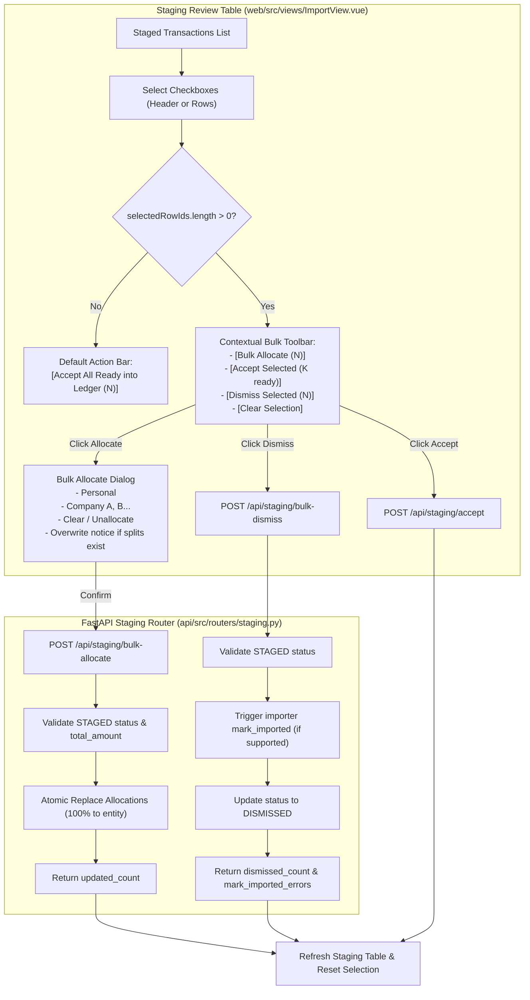

# Staged Bulk Allocations & Actions Specification

**Status:** Implemented
**Target:** v3 / Import & Staging Pipeline

---

## 1. Goal & Architectural Overview

In Wrangler's intake pipeline, transactions imported from Amazon CSVs, AI receipt scanners, bank exports, or MCP agents land in the staging layer ([`web/src/views/ImportView.vue`](file:///D:/src/personal/wrangler/web/src/views/ImportView.vue)) with status `STAGED`. Currently, users must assign an entity (Personal or a specific Company) one transaction at a time via the single-row quick-assign dropdown or the edit dialog. Furthermore, the row selection checkboxes were previously restricted solely to transactions that were already marked ready, conflating row selection with ledger acceptance.

This specification introduces **Bulk Staging Actions** and unifies row selection across all staged transactions:

1. **Decoupled Selection & General Multi-Select:** Checkboxes on the Staging Review Table are unlocked for all `STAGED` transactions (whether unallocated, partially split, or ready). A master checkbox in the table header enables one-click toggle of all staged items on the visible page.
2. **Contextual Bulk Action Toolbar:** When 1+ rows are selected, the action bar transitions into a contextual bulk toolbar featuring:
   - **Bulk Allocate (`N`):** Opens the allocation dialog.
   - **Accept Selected (`K ready`):** Accepts selected ready transactions into the Ledger (disabled if none of the selected are ready).
   - **Dismiss Selected (`N`):** Bulk-dismisses selected staged items.
   - **Clear Selection:** Deselects all rows.
   When no rows are selected, the default action remains **Accept All Ready into Ledger (`Total Ready`)**.
3. **Bulk Allocation Dialog:** Allows setting 100% allocation to **Personal**, any registered **Company**, or **Unallocated (Clear)** across all selected items. If any selected items have existing allocations or multi-splits, an informational notice alerts the user that existing allocations will be replaced.
4. **Dynamic Readiness Invariant:** Preserves Wrangler's core architecture where readiness (`is_ready`) is computed dynamically based on metadata completeness and balanced allocations. Bulk allocation immediately transitions valid transactions into ready state without requiring an extra database column or manual "mark ready" ceremony.
5. **Atomic Backend Batch Endpoints:** Introduces `POST /api/staging/bulk-allocate` and `POST /api/staging/bulk-dismiss` to execute batch operations in single database transactions with full validation and external importer `mark_imported` error aggregation.



---

## 2. API & Data Contract

### 2.1 Bulk Allocation Endpoint
- **Route:** `POST /api/staging/bulk-allocate`
- **Description:** Atomically updates allocations for a batch of staged transactions to 100% of the specified entity (or clears allocations).

#### Request Schema: `StagedBulkAllocateRequest`
```python
class StagedBulkAllocateRequest(BaseModel):
    staged_transaction_ids: list[uuid.UUID]
    is_personal: bool = False
    company_id: uuid.UUID | None = None
    clear: bool = False

    @model_validator(mode="after")
    def validate_entity_choice(self) -> Self:
        if self.clear:
            if self.is_personal or self.company_id is not None:
                raise ValueError("Cannot specify is_personal or company_id when clear is True")
            return self
        if self.is_personal and self.company_id is not None:
            raise ValueError("Cannot specify both is_personal and company_id")
        if not self.is_personal and self.company_id is None:
            raise ValueError("Must specify either is_personal=True, a company_id, or clear=True")
        return self
```

#### Response Schema: `StagedBulkAllocateResponse`
```python
class StagedBulkAllocateResponse(BaseModel):
    updated_count: int
    staged_transaction_ids: list[uuid.UUID]
```

#### Processing Logic:
1. Validates that `staged_transaction_ids` is non-empty.
2. Fetches all matching `StagedTransaction` records within the session.
3. Filters to rows where `status == "STAGED"`. If a row does not exist or is not `STAGED`, it is skipped (or an error is raised if none qualify).
4. For each qualifying staged transaction:
   - Removes all existing `StagedAllocation` records associated with it.
   - If `clear is False`:
     - Verifies `staged_tx.total_amount` is not None and not 0.
     - Creates a single `StagedAllocation` with `amount = staged_tx.total_amount`, `is_personal = request.is_personal`, `company_id = request.company_id`.
5. Commits the session atomically and returns the count of updated transactions.

---

### 2.2 Bulk Dismiss Endpoint
- **Route:** `POST /api/staging/bulk-dismiss`
- **Description:** Atomically updates status to `DISMISSED` for a batch of staged transactions and notifies upstream external sources where supported.

#### Request Schema: `StagedBulkDismissRequest`
```python
class StagedBulkDismissRequest(BaseModel):
    staged_transaction_ids: list[uuid.UUID]
```

#### Response Schema: `StagedBulkDismissResponse`
```python
class StagedBulkDismissResponse(BaseModel):
    dismissed_count: int
    staged_transaction_ids: list[uuid.UUID]
    marked_imported_count: int
    mark_imported_errors: list[str]
```

#### Processing Logic:
1. Fetches all matching `StagedTransaction` records where `status == "STAGED"`.
2. For each transaction:
   - Sets `status = "DISMISSED"`.
   - If the importer supports `mark_imported` and `is_marked_imported` is False:
     - Calls `importer.mark_imported(staged_tx.external_id)`.
     - On success: sets `is_marked_imported = True`, increments `marked_imported_count`.
     - On error: records error message in `mark_imported_errors`.
3. Commits session and returns aggregated counts and errors.

---

## 3. Frontend Architecture & User Interface

### 3.1 Table Header & Row Checkbox Selection
In [`web/src/views/ImportView.vue`](file:///D:/src/personal/wrangler/web/src/views/ImportView.vue):

- **Header Checkbox (`#header-cell-select`):**
  - Displays a checkbox in the selection column header.
  - State:
    - **Checked:** All STAGED rows on the visible page are selected.
    - **Indeterminate:** Some (but not all) STAGED rows on the visible page are selected.
    - **Unchecked:** Zero STAGED rows on the visible page are selected.
    - **Disabled:** When current filter produces 0 STAGED rows.
  - Action on click:
    - If checked or indeterminate: unchecks all visible rows.
    - If unchecked: selects all STAGED rows on the visible page.
- **Row Checkboxes (`#body-cell-select`):**
  - Checkbox is enabled for any row where `status === 'STAGED'`.
  - Disabled for rows where `status !== 'STAGED'` (e.g. `ACCEPTED` or `DISMISSED`).
- **Page-Scoped Reset:**
  - Changing pages, page sizes, or filter options (`status`, `source`) automatically resets `selectedRowIds` to `[]`.

---

### 3.2 Contextual Bulk Action Bar
Replaces the single `Accept Ready into Ledger` button in the top action section with a dynamic toolbar:

#### When `selectedRowIds.length === 0`:
```
[ Accept All Ready into Ledger (N) ]
```
- Tooltip: "Accept all N ready transactions on the current page into the Ledger"
- Disabled if `N === 0`.

#### When `selectedRowIds.length > 0`:
```
[ (i) N selected ]   [ Bulk Allocate (N) ]   [ Accept Selected (K ready) ]   [ Dismiss Selected (N) ]   [ Clear ]
```
- **Selection Count Chip:** Shows `N selected`.
- **Bulk Allocate (`N`):** Color: Primary / Unelevated. Opens `BulkAllocateDialog`.
- **Accept Selected (`K ready`):** Color: Positive / Unelevated. Disabled if `K === 0` (with tooltip explaining "None of the selected transactions are ready to accept").
- **Dismiss Selected (`N`):** Color: Negative / Flat or Outline. Prompts confirmation dialog before bulk dismissing.
- **Clear Selection:** Flat button to deselect all.

---

### 3.3 Bulk Allocate Dialog (`web/src/components/BulkAllocateDialog.vue`)

- **Title:** "Bulk Allocate Transactions"
- **Summary Subtitle:** "Assign an entity to N selected staged transactions."
- **Notice Banner (Conditional):**
  - Displayed if any selected rows already have allocations (e.g., `M of N transactions already have allocations or splits which will be overwritten`).
  - Color: Warning (amber-1 with amber-9 text).
- **Entity Selector:**
  - Radio options or select dropdown:
    1. **Personal** (`is_personal: true`)
    2. **Company Options:** List of active companies from `useCompanyStore()`
    3. **Unallocate / Reset** (`clear: true`)
- **Actions:**
  - **Cancel:** Closes dialog without changes.
  - **Apply Allocation:** Submits `POST /api/staging/bulk-allocate`, displays success notification, resets selection, and refreshes the staging table.

---

## 4. Frontend Store Updates (`web/src/stores/staging.ts`)

Add new store actions to `useStagingStore`:
```typescript
async function bulkAllocateStaged(payload: {
  staged_transaction_ids: string[]
  is_personal?: boolean
  company_id?: string | null
  clear?: boolean
}): Promise<StagedBulkAllocateResponse> {
  const response = await apiClient.post<StagedBulkAllocateResponse>("/staging/bulk-allocate", payload)
  return response.data
}

async function bulkDismissStaged(
  stagedTransactionIds: string[]
): Promise<StagedBulkDismissResponse> {
  const response = await apiClient.post<StagedBulkDismissResponse>("/staging/bulk-dismiss", {
    staged_transaction_ids: stagedTransactionIds,
  })
  return response.data
}
```

---

## 5. Verification & Testing Strategy

### 5.1 Backend Pytest Suite (`api/tests/`)
1. **`test_bulk_allocate_personal`**: Verify 100% personal allocation set on multiple staged transactions.
2. **`test_bulk_allocate_company`**: Verify company allocation set on multiple staged transactions.
3. **`test_bulk_allocate_clear`**: Verify clearing allocations empties `allocations` and sets `is_ready` to `False`.
4. **`test_bulk_allocate_overwrites_existing_splits`**: Verify multi-split rows are cleanly replaced with single 100% allocation.
5. **`test_bulk_allocate_skips_non_staged`**: Verify transactions in `DISMISSED` or `ACCEPTED` status are rejected or safely skipped.
6. **`test_bulk_dismiss`**: Verify batch dismissal updates status to `DISMISSED` and invokes `mark_imported` on compatible sources.

### 5.2 Frontend Vitest Suite (`web/src/`)
1. **Header selection**: Test select all / deselect all / indeterminate states on the visible page.
2. **Contextual action bar rendering**: Test toolbar transitions between default state (`0 selected`) and bulk selection state (`1+ selected`).
3. **Accept Selected count**: Test that `Accept Selected` button reflects only the subset of selected rows that have `is_ready === true`.
4. **BulkAllocateDialog**: Test entity selection, warning banner visibility when existing allocations are present, and payload submission.
