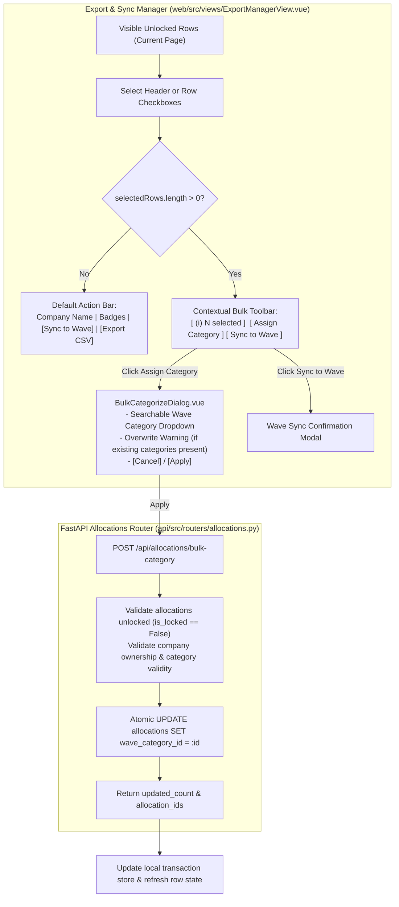

# Bulk Export Categorization Specification

**Target:** Milestone v4 / Wave Export & Accounting  
**Status:** Implemented  
**Subsystems:** Accounting Export, Core Ledger & Allocations  

---

## 1. Goal & Architectural Overview

In Wrangler, transactions attributed to business entities must be mapped to valid Wave accounting categories (expense accounts) before they can be synchronized via the Wave API ([`specs/9-wave-integration/spec.md`](file:///D:/src/personal/wrangler/specs/9-wave-integration/spec.md)). Currently in the Export & Sync Manager ([`ExportManagerView.vue`](file:///D:/src/personal/wrangler/web/src/views/ExportManagerView.vue)):
1. Users must assign categories one transaction at a time via individual table row dropdowns, which is tedious for large batches of similar business expenses.
2. The master selection checkbox in the table header is restricted solely to rows that already have a category assigned (`canSyncRowToWave`), preventing users from selecting uncategorized transactions for batch actions.
3. Category updates are submitted one HTTP request at a time via [`PATCH /api/allocations/{id}/category`](file:///D:/src/personal/wrangler/api/src/routers/allocations.py).

Following the bulk workflow patterns established in the Staging Import Manager ([`specs/11-bulk-staged-allocations/spec.md`](file:///D:/src/personal/wrangler/specs/11-bulk-staged-allocations/spec.md)), this specification introduces **Bulk Export Categorization**:

- **Decoupled Visible-Page Multi-Select:** Checkbox selection is decoupled from category completeness. Any unlocked allocation (`is_locked === false`) on the current visible page can be selected. The header checkbox provides standard three-state behavior (checked, unchecked, indeterminate).
- **Contextual Bulk Action Toolbar:** When 1 or more rows are selected in Wave mode, the action bar transitions into a bulk toolbar featuring the selection count chip, a flexible spacer, the `"Assign Category"` button, and the `"Sync to Wave"` button.
- **Bulk Categorization Dialog (`BulkCategorizeDialog.vue`):** A dedicated modal dialog providing a searchable list of the company's active Wave categories, an overwrite warning banner if existing categories will be replaced, and atomic application.
- **Atomic Backend Batch Endpoint:** A new endpoint (`POST /api/allocations/bulk-category`) that updates multiple allocations within a single atomic database transaction, verifying entity and lock invariants.



---

## 2. API & Data Contract

### 2.1 Bulk Category Assignment Endpoint

- **Route:** `POST /api/allocations/bulk-category`
- **Description:** Atomically sets `wave_category_id` across a list of unlocked allocations belonging to the same company.

#### Request Schema: `BulkAllocationCategoryUpdateRequest`
In [`api/src/schemas/allocation.py`](file:///D:/src/personal/wrangler/api/src/schemas/allocation.py):

```python
class BulkAllocationCategoryUpdateRequest(BaseModel):
    allocation_ids: list[uuid.UUID]
    wave_category_id: uuid.UUID

    @field_validator("allocation_ids")
    @classmethod
    def validate_non_empty(cls, v: list[uuid.UUID]) -> list[uuid.UUID]:
        if not v:
            raise ValueError("allocation_ids list cannot be empty")
        return v
```

#### Response Schema: `BulkAllocationCategoryUpdateResponse`
In [`api/src/schemas/allocation.py`](file:///D:/src/personal/wrangler/api/src/schemas/allocation.py):

```python
class BulkAllocationCategoryUpdateResponse(BaseModel):
    updated_count: int
    allocation_ids: list[uuid.UUID]
```

#### Endpoint Implementation: `update_allocations_bulk_category`
In [`api/src/routers/allocations.py`](file:///D:/src/personal/wrangler/api/src/routers/allocations.py):

```python
@router.post("/bulk-category", response_model=BulkAllocationCategoryUpdateResponse)
def update_allocations_bulk_category(
    payload: BulkAllocationCategoryUpdateRequest,
    db: Annotated[Session, Depends(get_db)],
) -> BulkAllocationCategoryUpdateResponse:
    # 1. Fetch category
    category = db.get(WaveCategory, payload.wave_category_id)
    if category is None:
        raise HTTPException(
            status_code=status.HTTP_404_NOT_FOUND,
            detail=f"WaveCategory with ID '{payload.wave_category_id}' not found",
        )

    # 2. Fetch allocations
    stmt = select(Allocation).where(Allocation.id.in_(payload.allocation_ids))
    allocations = list(db.scalars(stmt).all())

    if len(allocations) != len(payload.allocation_ids):
        found_ids = {a.id for a in allocations}
        missing_ids = [str(aid) for aid in payload.allocation_ids if aid not in found_ids]
        raise HTTPException(
            status_code=status.HTTP_404_NOT_FOUND,
            detail=f"Allocations not found: {', '.join(missing_ids)}",
        )

    # 3. Guard validations (atomic all-or-nothing)
    for alloc in allocations:
        if alloc.is_locked:
            raise HTTPException(
                status_code=status.HTTP_400_BAD_REQUEST,
                detail=f"Allocation {alloc.id} is locked and cannot be modified",
            )
        if alloc.is_personal or alloc.company_id != category.company_id:
            raise HTTPException(
                status_code=status.HTTP_400_BAD_REQUEST,
                detail=f"Allocation {alloc.id} does not belong to the category's company",
            )

    # 4. Atomic update
    for alloc in allocations:
        alloc.wave_category_id = payload.wave_category_id
        db.add(alloc)

    db.commit()

    return BulkAllocationCategoryUpdateResponse(
        updated_count=len(allocations),
        allocation_ids=[alloc.id for alloc in allocations],
    )
```

---

## 3. Frontend Architecture & User Interface

### 3.1 Selection Model & Header Checkbox
In [`web/src/views/ExportManagerView.vue`](file:///D:/src/personal/wrangler/web/src/views/ExportManagerView.vue) and [`web/src/views/exportManager.ts`](file:///D:/src/personal/wrangler/web/src/views/exportManager.ts):

- **Selection Eligibility:**
  - Row checkboxes are enabled for any row where `props.row.is_locked === false`.
  - Disabled for rows where `props.row.is_locked === true`.
- **Visible-Page Scope:**
  - The selectable set for the visible page is `visibleUnlockedRows = allocationRows.filter(r => !r.is_locked)`.
  - Changing pages, page size, start/end dates, or the selected company automatically clears `selectedRows`.
- **Header Checkbox State (`#header-cell-selection`):**
  - **Checked:** All visible unlocked rows on the current page are present in `selectedRows`.
  - **Indeterminate:** Some (but not all) visible unlocked rows are selected.
  - **Unchecked:** Zero visible unlocked rows are selected.
  - **Disabled:** When `visibleUnlockedRows.length === 0`.
  - **Click Action:**
    - If checked or indeterminate: deselects all visible rows on the current page.
    - If unchecked: selects all visible unlocked rows on the current page.

### 3.2 Contextual Action Bar
In [`web/src/views/ExportManagerView.vue`](file:///D:/src/personal/wrangler/web/src/views/ExportManagerView.vue):

When `isWaveMode.value === true` and `selectedRows.length > 0`, the action bar section ([`export-action-bar`](file:///D:/src/personal/wrangler/web/src/views/ExportManagerView.vue#L576-L658)) dynamically renders the contextual toolbar:

```
[ (i) N selected ]                                         [ Assign Category ]  [ Sync to Wave ]
```

1. **Selection Badge:**
   - Left-aligned.
   - Quasar component: `<q-chip color="primary" text-color="white" icon="check_circle" class="text-weight-bold" data-testid="chip-bulk-selected-count">N selected</q-chip>`.
2. **Spacer:**
   - Quasar component: `<q-space />`.
3. **Assign Category Button:**
   - Label: `"Assign Category"`.
   - Visual: `unelevated`, `color="primary"`, `icon="label"`, `data-testid="btn-bulk-assign-category"`.
   - Action: Opens `BulkCategorizeDialog`.
4. **Sync to Wave Button:**
   - Label: `"Sync to Wave"`.
   - Visual: `unelevated`, `color="positive"` (or primary), `icon="cloud_upload"`, `data-testid="btn-sync-to-wave"`.
   - Disabled State: `:disable="!canSyncSelectedToWave || syncingToWave"`.
   - Tooltip:
     - If `!canSyncSelectedToWave`: *"All selected transactions must have a category assigned before syncing to Wave"*
     - Otherwise: *"Push N categorized transactions directly to Wave"*
   - Action: Triggers existing Wave sync flow for the selected allocations.

When `selectedRows.length === 0`, the standard default action bar displays the company name, unlocked/locked summary badges, the Wave Connected status chip, disabled `Sync to Wave`, and `Export CSV`.

### 3.3 Bulk Categorization Dialog (`web/src/components/BulkCategorizeDialog.vue`)

A new component matching the architecture of [`BulkAllocateDialog.vue`](file:///D:/src/personal/wrangler/web/src/components/BulkAllocateDialog.vue):

- **Props:**
  - `modelValue: boolean`
  - `selectedRows: ExportAllocationRow[]`
  - `categories: WaveCategory[]`
- **Emits:**
  - `(e: "update:modelValue", val: boolean): void`
  - `(e: "applied", count: number): void`
- **Structure:**
  - **Title:** `"Assign Category"`
  - **Subtitle:** `"Assign a Wave category to {N} selected transaction(s)."`
  - **Overwrite Warning Banner (Conditional):**
    - Rendered when `overwrittenCount > 0`.
    - Message: `"{M} of {N} selected transactions already have a category assigned which will be updated."`
    - Styling: Amber warning banner (`bg-amber-1 text-amber-10`, `q-icon name="warning"`).
  - **Category Select Field:**
    - `<q-select>` with `dense`, `outlined`, `use-input`, `fill-input`, `hide-selected` for type-to-filter category search.
    - Options: `{ label: cat.name, value: cat.id, is_uncategorized: cat.is_uncategorized }`.
    - Displays default uncategorized category with special highlight consistent with the table row dropdown.
    - No clear option (Wave uncategorized account serves as the default unassigned target if desired).
  - **Dialog Actions:**
    - `[ Cancel ]`: Closes dialog without persisting changes.
    - `[ Apply ]`: Disabled if no category selected. Submits batch API call, shows positive toast notification, emits `applied`, closes dialog.

---

## 4. Frontend Store Updates (`web/src/stores/transactions.ts`)

Add the batch category assignment action:

```typescript
async function bulkUpdateAllocationCategory(
  allocationIds: string[],
  waveCategoryId: string,
): Promise<BulkAllocationCategoryUpdateResponse> {
  error.value = null
  try {
    const res = await apiClient.post<BulkAllocationCategoryUpdateResponse>(
      "/api/allocations/bulk-category",
      {
        allocation_ids: allocationIds,
        wave_category_id: waveCategoryId,
      },
    )

    // Update in-memory transactions reactively
    const updatedIdSet = new Set(allocationIds)
    for (const tx of transactions.value) {
      for (const alloc of tx.allocations ?? []) {
        if (updatedIdSet.has(alloc.id)) {
          alloc.wave_category_id = waveCategoryId
        }
      }
    }

    return res.data
  } catch (err) {
    const msg = err instanceof Error ? err.message : "Failed to bulk update allocation categories"
    error.value = msg
    throw err
  }
}
```

---

## 5. Helper Functions & Logic (`web/src/views/exportManager.ts`)

Export the following pure helper functions for unit testability:

1. **`isMasterHeaderChecked(visibleRowIds: string[], selectedRowIds: string[]): boolean`**  
   Returns `true` if `visibleRowIds.length > 0` and every visible ID is in `selectedRowIds`.
2. **`isMasterHeaderIndeterminate(visibleRowIds: string[], selectedRowIds: string[]): boolean`**  
   Returns `true` if some, but not all, visible IDs are present in `selectedRowIds`.
3. **`countOverwrittenCategories(selectedRows: ExportAllocationRow[]): number`**  
   Counts how many selected rows currently have a truthy `wave_category_id`.
4. **`canSyncSelectedToWave(selectedRows: ExportAllocationRow[]): boolean`**  
   Returns `true` if `selectedRows.length > 0` and every selected row has `!row.is_locked && Boolean(row.wave_category_id)`.

---

## 6. Architectural Invariants & Defenses

1. **Lock Immutability Invariant:** Allocations with `is_locked === true` can never have their category modified via single-row or bulk endpoints. The backend explicitly verifies `not alloc.is_locked` for all requested IDs.
2. **Entity Ownership Invariant:** Allocations must belong to the same company as the target `WaveCategory`. Cross-company or personal allocation category assignments are rejected with HTTP 400.
3. **Atomicity:** The batch update must execute inside a single transaction. If any allocation in the request is locked, missing, or owned by another entity, the entire batch fails without partial mutation.
4. **Wave Connection Boundary:** Bulk category assignment is strictly available when `isWaveMode === true`. For standard CSV export companies, no categories exist.

---

## 7. Verification & Testing Strategy

### 7.1 Backend Pytest Suite (`api/tests/test_allocations.py` or `api/tests/test_wave_sync_api.py`)
- **`test_bulk_category_success`**: Provide 3 unlocked business allocations and verify all receive the new `wave_category_id` in SQLite.
- **`test_bulk_category_locked_allocation_rejected`**: Include 1 locked allocation in the batch; verify HTTP 400 and ensure no allocations were modified.
- **`test_bulk_category_mismatched_company_rejected`**: Attempt to assign a category belonging to Company A to allocations belonging to Company B; verify HTTP 400.
- **`test_bulk_category_personal_allocation_rejected`**: Attempt to include a personal allocation; verify HTTP 400.
- **`test_bulk_category_invalid_category_id`**: Non-existent category ID returns HTTP 404.
- **`test_bulk_category_empty_list_rejected`**: Empty `allocation_ids` returns HTTP 422 Unprocessable Entity.

### 7.2 Frontend Vitest Suite (`web/tests/exportManager.test.ts` & `web/tests/waveUi.test.ts`)
- **Header Checkbox State**: Verify `isMasterHeaderChecked` and `isMasterHeaderIndeterminate` across empty, partial, and full visible page selections.
- **Contextual Toolbar Layout**: Verify that when `selectedRows.length > 0`, the count chip, spacer, `"Assign Category"`, and `"Sync to Wave"` buttons render.
- **`BulkCategorizeDialog.vue`**:
  - Verify render with correct selected count.
  - Verify overwrite warning banner appears when selected rows already contain category IDs.
  - Verify apply button is disabled until a category is selected.
  - Verify submission calls `bulkUpdateAllocationCategory` with expected arguments.
- **Pagination Reset**: Verify navigating pages or updating filter criteria resets `selectedRows` to empty.
