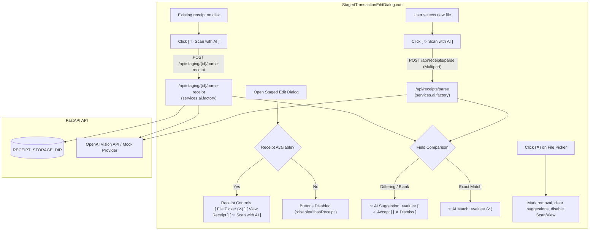

# Feature Specification: Staged Receipt AI Parsing & Inline Field Suggestions

## 1. Goal & Architectural Overview

When financial transactions are ingested from external sources such as the Amazon Transactions CSV importer, key details like transaction dates, totals, and direct order investigation URLs are captured, but human-readable purchase descriptions are left blank for manual review. Users navigate to the order link, download or screenshot the order invoice/receipt, and attach it to the staged transaction in Wrangler's Staging Area.

This specification introduces the capability to **run AI receipt parsing on-demand directly within the Staged Transaction Edit Dialog** when a receipt is attached (or a new receipt file is selected).

To protect user trust and prevent accidental overwrites of existing data (such as CSV-derived dates and totals), parsing does **not** blindly overwrite form fields. Instead, it surfaces transient **inline suggestions** directly beneath each corresponding input field (Date, Total Amount, Description):
- **Differing or Missing Fields:** Displays the AI-extracted suggestion with an **Accept (`✓`)** and **Dismiss (`✕`)** action button. Accepting copies the value into the input field for final review and editing before saving.
- **Identical Fields:** Displays a verified confirmation banner (`✨ AI Match: <value> (✓)`) with no action buttons.
- **Persistent Affordances & Spatial Stability:** The receipt action buttons (**View Receipt** and **Scan with AI**) remain permanently visible and are gracefully disabled when no receipt is present, preventing jarring UI layout shifts.
- **Streamlined Receipt Attachment:** Eliminates the redundant "Remove Receipt" button in favor of the file input's native clearable `(✕)` control.



---

## 2. Data Model & Database Migrations

### 2.1 Zero Database Migrations
This feature introduces **zero database migrations** and modifies **no database schemas**.
- `StagedTransaction` already contains `receipt_file_path`, `date`, `description`, `total_amount`, `url`, and `status`.
- All AI suggestions, match states, and parse results exist strictly in client-side Vue reactive component state (`ref`). They are transient and discard upon dialog closure.
- Database persistence occurs only when the user explicitly clicks the dialog's **Save** button, persisting whatever values currently reside in the form input fields via the existing `PUT /api/staging/{staged_id}` endpoint.

---

## 3. Backend Endpoints & Service Architecture

### 3.1 New Endpoint: `POST /api/staging/{staged_id}/parse-receipt`
Parses an existing receipt already stored on disk for a staged transaction.

- **URL:** `/api/staging/{staged_id}/parse-receipt`
- **Method:** `POST`
- **Authentication:** Session JWT (via existing dependencies)
- **Path Parameters:**
  - `staged_id` (`uuid.UUID`): The staged transaction identifier.
- **Request Body:** None.
- **Response Model:** [`ReceiptParseResult`](file:///D:/src/personal/wrangler/api/src/services/ai/base.py#L8-L19)
  ```json
  {
    "merchant": "Amazon",
    "date": "2026-10-15",
    "total_amount": 29.99,
    "description": "Amazon - Anker USB-C Cable (3-pack)"
  }
  ```
- **Error Responses:**
  - `404 Not Found`: Staged transaction does not exist.
  - `400 Bad Request`:
    - Staged transaction status is not `"STAGED"`.
    - No receipt is attached (`receipt_file_path` is null or empty).
    - Receipt file cannot be found in `settings.RECEIPT_STORAGE_DIR`.
    - Unsupported file extension/MIME type.
  - `413 Payload Too Large`: Receipt file size exceeds `settings.MAX_RECEIPT_FILE_SIZE` (20MB).
  - `503 Service Unavailable`: Upstream AI provider runtime error or network failure.

#### Implementation Flow:
1. Fetch `StagedTransaction` by `staged_id`. Verify `status == "STAGED"`.
2. Verify `staged_tx.receipt_file_path` is not `None`.
3. Resolve physical file path using `services.receipts.get_receipt_file_path(staged_tx.receipt_file_path)`.
4. Read file bytes and detect MIME type (`mimetypes.guess_type` / extension mapping).
5. Pass bytes to configured AI provider via `services.ai.factory.get_receipt_parser().parse_receipt(file_bytes, filename, mime_type)`.
6. Return `ReceiptParseResult`.

### 3.2 Reused Existing Endpoint: `POST /api/receipts/parse`
When the user selects a *new* file in the file picker that has not yet been saved to disk:
- The frontend posts the local `File` as `multipart/form-data` directly to `POST /api/receipts/parse`.
- Returns `ReceiptParseResult`.

---

## 4. Frontend UI/UX Architecture

All UI changes are scoped to [`web/src/components/StagedTransactionEditDialog.vue`](file:///D:/src/personal/wrangler/web/src/components/StagedTransactionEditDialog.vue) and its companion logic module [`web/src/components/stagedTransactionEdit.ts`](file:///D:/src/personal/wrangler/web/src/components/stagedTransactionEdit.ts).

### 4.1 Receipt Attachment Section Layout
In alignment with the UI spatial stability standard (Section 4 of `AGENTS.md`), the controls in the **Receipt Attachment** section remain visible on screen at all times and do not conditionally toggle via `v-if`.

#### Control Group Order:
```text
Receipt Attachment
┌──────────────────────────────────────────────┐  ┌──────────────┐  ┌───────────────────┐
│ [icon] Receipt file picker               (✕) │  │ View Receipt │  │ ✨ Scan with AI   │
└──────────────────────────────────────────────┘  └──────────────┘  └───────────────────┘
```
1. **Receipt File Picker (`q-file`):**
   - Flexibly expands (`class="col"`).
   - When no receipt is attached: Label reads `"Upload Receipt (.pdf, .png, .jpg)"`.
   - When a receipt is attached (either `existing_receipt_path` or `staged_receipt_file`): Label reads `"Replace Receipt (.pdf, .png, .jpg)"`. If an existing receipt is attached and no replacement file is chosen, display text indicates the attached receipt file name (e.g. `basename(existing_receipt_path)`).
   - Features Quasar's native `clearable` (`✕`) icon.
2. **`[ View Receipt ]` Button:**
   - Opens the attached receipt or staged blob preview in a new browser tab.
   - **Persistent affordance:** Always rendered.
   - Disabled (`:disable="!hasEffectiveReceipt || saving || isParsingReceipt"`).
3. **`[ ✨ Scan with AI ]` Button:**
   - Initiates AI receipt parsing.
   - **Persistent affordance:** Always rendered.
   - Disabled (`:disable="!hasEffectiveReceipt || saving || isParsingReceipt"`).
   - Shows loading spinner when scanning (`:loading="isParsingReceipt"`).
4. **Elimination of "Remove Receipt" Button:**
   - The separate red `[ Remove Receipt ]` button is removed.
   - Clicking `(✕)` in the file picker triggers `onClearReceipt()`.

### 4.2 Receipt Clear / Unlink Behavior (`onClearReceipt`)
When the user clicks the `(✕)` clear icon on the file picker:
1. `staged_receipt_file` is set to `null`.
2. If `existing_receipt_path` was present, `remove_receipt` is set to `true`.
3. `hasEffectiveReceipt` becomes `false`.
4. Both **`[ View Receipt ]`** and **`[ ✨ Scan with AI ]`** become disabled.
5. All active AI suggestions and match indicators are cleared.

### 4.3 Inline Field Suggestions Architecture

#### Data Model (`stagedTransactionEdit.ts`):
```typescript
export interface FieldSuggestion<T = string> {
  extractedValue: T
  displayValue: string
  isMatch: boolean
  isDismissed: boolean
}

export interface StagedAiSuggestionsState {
  date: FieldSuggestion<string> | null
  total_amount: FieldSuggestion<string> | null
  description: FieldSuggestion<string> | null
}
```

#### Comparison & Matching Logic:
When `ReceiptParseResult` is returned:
1. **Date:**
   - AI date string (`YYYY-MM-DD`).
   - Match condition: `form.date.trim() === aiDate.trim()`.
2. **Total Amount:**
   - AI numeric amount formatted as 2-decimal string (e.g., `"29.99"`).
   - Match condition: `Number(form.total_amount).toFixed(2) === Number(aiAmount).toFixed(2)`.
3. **Description:**
   - AI description string (`"{Merchant} - {Summary}"`).
   - Match condition: `form.description.trim().toLowerCase() === aiDescription.trim().toLowerCase()`.

#### Visual Representation:

##### Case A: Differing Value or Empty Input
Rendered directly beneath the `<q-input>` as a compact, subtle banner:
```text
┌─ Description / Payee * ───────────────────────────────────────────────────────────┐
│                                                                                   │
└───────────────────────────────────────────────────────────────────────────────────┘
 ✨ AI Suggestion: Amazon - Anker USB-C Cable (3-pack)       [ ✓ Accept ]  [ ✕ Dismiss ]
```
- **`[ ✓ Accept ]` (`data-testid="btn-accept-suggestion-{field}"`):**
  - Copies `extractedValue` into `form[field]`.
  - For `total_amount`: formats to 2 decimal places and invokes `syncSingleStagedSplitAmount(form)`.
  - Sets `isMatch = true` (or clears the suggestion).
- **`[ ✕ Dismiss ]` (`data-testid="btn-dismiss-suggestion-{field}"`):**
  - Sets `isDismissed = true`, hiding the banner.

##### Case B: Exact Match to Existing Input
Rendered directly beneath the `<q-input>` with no action buttons:
```text
┌─ Total Amount * ──────────────────────────────────────────┐
│ $ 29.99                                                   │
└───────────────────────────────────────────────────────────┘
 ✨ AI Match: $29.99 (✓)
```
- Rendered in subtle green/positive caption text with sparkle and checkmark icons.

##### Case C: Field Not Extracted by AI
If the AI did not return a value (`null` or empty string) for that field, no suggestion banner is rendered for that field.

### 4.4 Form Lifecycle & Save Invariants
- **Dialog Open:** Suggestions state initializes to empty (`null` for all fields).
- **Dialog Close / Cancel:** Suggestions state is discarded.
- **Re-scan:** Running "Scan with AI" again overwrites any existing suggestions with the new parse result.
- **Dialog Submission (`Save`):** Clicking Save validates and submits whatever values currently reside in `form.date`, `form.total_amount`, and `form.description`. Any unaccepted suggestions are ignored.

---

## 5. Security, Validation & Error Handling

1. **Transaction Immutability:** `POST /api/staging/{staged_id}/parse-receipt` rejects requests for non-`STAGED` transactions (e.g. `ACCEPTED` or `DISMISSED`) with `400 Bad Request`.
2. **File Safety:** Resolving `staged_tx.receipt_file_path` strictly uses `services.receipts.get_receipt_file_path()` to prevent path traversal attacks.
3. **AI Provider Failures:** If OpenAI or the configured AI provider times out or returns an error, the backend raises `HTTPException(503, detail=...)`. The frontend captures this error, stops the loading spinner, and displays a user-friendly error notification without corrupting existing form data.
4. **File Size Limit:** Direct uploads via `POST /api/receipts/parse` and disk parsing via `/parse-receipt` enforce `settings.MAX_RECEIPT_FILE_SIZE` (20MB).

---

## 6. Verification Scenarios & Test Suite

### 6.1 Backend Pytest Scenarios (`api/tests/test_staging_ai_receipt.py`)
1. **Happy Path Stored Receipt Parse:** Create a `StagedTransaction` with status `STAGED` and an attached dummy receipt file in `RECEIPT_STORAGE_DIR`. Call `POST /api/staging/{id}/parse-receipt` with the mock AI provider enabled. Verify 200 OK and valid `ReceiptParseResult`.
2. **Missing Receipt File:** Call endpoint on a staged transaction with `receipt_file_path = None`. Verify 400 Bad Request.
3. **Non-existent Staged ID:** Call endpoint with random UUID. Verify 404 Not Found.
4. **Accepted/Dismissed Transaction:** Call endpoint on a transaction with `status = "ACCEPTED"`. Verify 400 Bad Request.

### 6.2 Frontend Vitest Scenarios (`web/src/components/__tests__/stagedTransactionEdit.spec.ts`)
1. **Persistent Affordances:** Verify `[ View Receipt ]` and `[ ✨ Scan with AI ]` buttons are rendered in disabled state when `hasReceipt == false`.
2. **Enable Affordances:** Verify buttons become enabled when a receipt file is attached or chosen.
3. **Receipt Clear Behavior:** Verify clicking `(✕)` on the receipt picker sets `remove_receipt = true`, clears `staged_receipt_file`, and disables `View Receipt` and `Scan with AI`.
4. **AI Suggestion Comparison:**
   - Input has Date `"2026-10-14"` and AI returns `"2026-10-15"` -> renders differing suggestion with `[✓ Accept]` and `[✕ Dismiss]`.
   - Input has Amount `"29.99"` and AI returns `29.99` -> renders exact match text `"✨ AI Match: $29.99 (✓)"` with no action buttons.
   - Input has blank description and AI returns `"Amazon - Cable"` -> renders differing suggestion with `[✓ Accept]` and `[✕ Dismiss]`.
5. **Accepting Suggestion:** Clicking `[✓ Accept]` on description populates `form.description`. Clicking `[✓ Accept]` on amount updates `form.total_amount` and syncs single split allocation.
6. **Dismissing Suggestion:** Clicking `[✕ Dismiss]` hides the suggestion without modifying the input.
