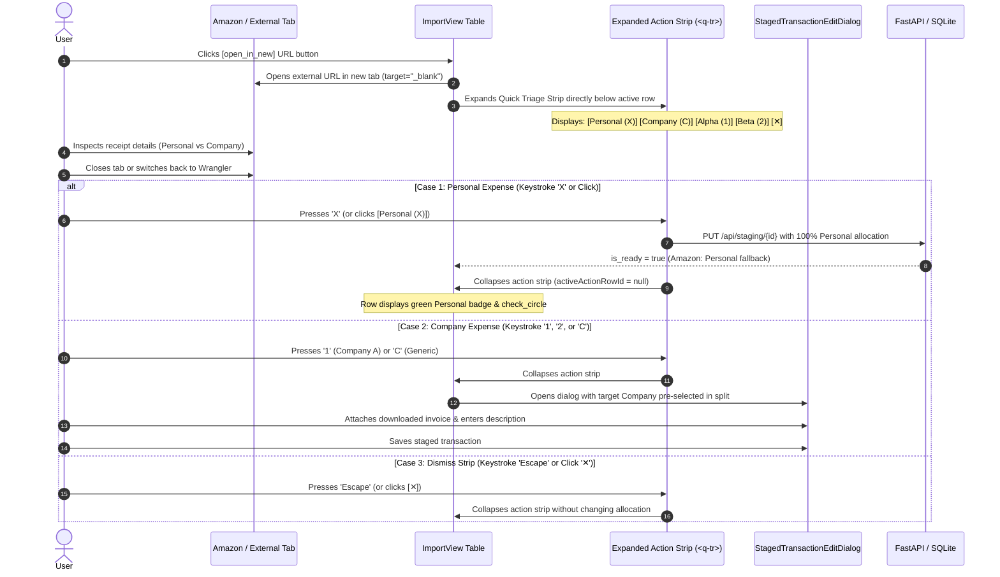

# Specification Amendment 3: URL-Activated Staging Row Quick Actions & Keyboard Triage Workstation

**Target Specification:** [`specs/15-streamlined-intake-and-ledger-urls/spec.md`](file:///D:/src/personal/wrangler/specs/15-streamlined-intake-and-ledger-urls/spec.md)  
**Status:** Draft  
**Subsystems:** Staging Layer & Platform & Shell  
**Date:** 2026-10-22  

---

## 1. Context & Motivation

In [`specs/15-streamlined-intake-and-ledger-urls/spec-amendment1.md`](file:///D:/src/personal/wrangler/specs/15-streamlined-intake-and-ledger-urls/spec-amendment1.md) and [`spec-amendment2.md`](file:///D:/src/personal/wrangler/specs/15-streamlined-intake-and-ledger-urls/spec-amendment2.md), the staging review table was optimized into a front-loaded left-to-right triage workstation (`[Select, URL, Actions, Allocation, Date, Description, Amount, Receipt]`).

However, during high-volume Amazon order intake, the interaction flow presents repetitive manual overhead:
1. The user clicks the **URL** icon to view the external order receipt in a new browser tab.
2. The user identifies the order as either Personal or Company-related in the external tab.
3. Upon returning to Wrangler, the user must visually locate and mouse-click either the small `[👤 Mark Personal]` icon button or the `[✏️ Edit]` button in the table row.
4. If it is a company transaction, the user must click into the split company dropdown to pick the specific business entity (e.g., Company A vs. Company B) before attaching the receipt and saving.

Because Amazon and financial institutions enforce strict browser security headers (`X-Frame-Options: DENY` and `Content-Security-Policy: frame-ancestors 'none'`), rendering external order details inside an embedded in-app `<iframe>` is not technically viable. External tabs remain the required mechanism for reviewing source receipts.

To maximize throughput for unallocated Amazon transactions without requiring cumbersome full-table arrow navigation, this amendment establishes a **URL-Activated Quick Action Sub-Row with Contextual Keyboard Shortcuts**.

---

## 2. Interaction Model & Workflow



### 2.1 Workflow Steps
1. **Activation:** The quick triage action sub-row expands **only** when the user clicks the external investigation URL button (`btn-open-url`). Clicking other cells in the table row sets row highlighting (`activeRowId`) without opening the action strip.
2. **Personal Allocation:** Pressing `x` or `X` (or clicking `[Personal Expense (X)]`) immediately sets the staged transaction to 100% Personal, triggers a success toast, and dismisses the action strip.
3. **Generic Company Edit:** Pressing `c` or `C` (or clicking `[Company Expense (C)]`) dismisses the action strip and opens the Staged Transaction Edit Dialog with standard defaults.
4. **Direct Company Allocation:** Pressing a digit key `1`, `2`, `3`... (or clicking the corresponding `[Company Name (N)]` button) dismisses the action strip and opens the Staged Transaction Edit Dialog with that specific company pre-allocated in the split.
5. **Dismiss / Escape:** Pressing `Escape` (or clicking the `[✕]` close button) immediately collapses the action strip without modifying data.

---

## 3. UI Component Architecture & Layout

### 3.1 Expanded Action Strip Layout (`<q-tr>`)
In [`web/src/views/ImportView.vue`](file:///D:/src/personal/wrangler/web/src/views/ImportView.vue), the table structure renders an expanded sub-row directly beneath the active row whenever `activeActionRowId === props.row.id` and `props.row.status === 'STAGED'`:

```html
<q-tr
  v-if="activeActionRowId === props.row.id && props.row.status === 'STAGED'"
  :props="props"
  class="staged-action-strip-row"
  data-testid="row-staged-action-strip"
>
  <q-td :colspan="columns.length" class="q-pa-xs">
    <div class="staged-action-strip row items-center justify-between q-px-md q-py-xs bg-blue-grey-1 rounded-borders">
      <div class="row items-center q-gutter-sm">
        <span class="text-caption text-weight-bold text-grey-8 row items-center q-mr-xs">
          <q-icon name="bolt" color="amber-9" size="18px" class="q-mr-xs" />
          Quick Triage:
        </span>

        <!-- Personal Expense (X) Button -->
        <q-btn
          unelevated
          dense
          size="sm"
          color="positive"
          icon="person"
          label="Personal Expense (X)"
          data-testid="btn-action-strip-personal"
          @click.stop="onActionStripPersonal(props.row)"
        >
          <q-tooltip>Mark 100% Personal (Shortcut: X)</q-tooltip>
        </q-btn>

        <!-- Company Expense (C) Button -->
        <q-btn
          unelevated
          dense
          size="sm"
          color="primary"
          icon="business"
          label="Company Expense (C)"
          data-testid="btn-action-strip-company"
          @click.stop="onActionStripCompany(props.row)"
        >
          <q-tooltip>Open Edit Dialog (Shortcut: C)</q-tooltip>
        </q-btn>

        <q-separator vertical class="q-mx-xs" v-if="companyStore.companies.length > 0" />

        <!-- Numbered Company Shortcuts (1, 2, 3...) -->
        <q-btn
          v-for="(comp, idx) in companyStore.companies"
          :key="comp.id"
          outline
          dense
          size="sm"
          color="primary"
          class="bg-white"
          :label="`${comp.name} (${idx + 1})`"
          :data-testid="`btn-action-strip-comp-${comp.id}`"
          @click.stop="onActionStripCompanyByIndex(props.row, idx)"
        >
          <q-tooltip>Edit with {{ comp.name }} pre-selected (Shortcut: {{ idx + 1 }})</q-tooltip>
        </q-btn>
      </div>

      <!-- Close / Dismiss Action Strip Button -->
      <q-btn
        flat
        round
        dense
        size="xs"
        icon="close"
        color="grey-6"
        aria-label="Close triage actions"
        data-testid="btn-action-strip-close"
        @click.stop="dismissActionStrip"
      >
        <q-tooltip>Close quick actions (Esc)</q-tooltip>
      </q-btn>
    </div>
  </q-td>
</q-tr>
```

### 3.2 Visual Styling Rules
- **Container Styling:** Background `bg-blue-grey-1` (`#eceff1`), with subtle border radius and `1px solid rgba(0, 0, 0, 0.08)`.
- **Button Affordances:**
  - `Personal Expense (X)`: Solid positive green (`unelevated`, `color="positive"`).
  - `Company Expense (C)`: Solid primary blue (`unelevated`, `color="primary"`).
  - Numbered Companies (`1`, `2`): Outlined primary with white fill (`outline`, `class="bg-white"`, `color="primary"`).
  - Close button: Subtle flat grey icon (`size="xs"`, `icon="close"`).
- **Persistent Visibility:** The action strip remains open until an explicit triage choice is made (`X`, `C`, `1..N`), the user closes it (`Esc`, `[✕]`), or another URL is clicked.

---

## 4. Keyboard Shortcuts & Guardrails

### 4.1 Pure Shortcut Handler (`web/src/views/importView.ts`)
To ensure full testability and prevent regressions, keyboard event evaluation is encapsulated in a pure helper:

```typescript
export interface StagingShortcutContext {
  activeActionRowId: string | null
  stagedTransactions: StagedTransaction[]
  companies: Company[]
  isDialogOpen: boolean
  onPersonal: (row: StagedTransaction) => void
  onCompanyEdit: (row: StagedTransaction, defaultCompanyId?: string | null) => void
  onDismissStrip: () => void
}

/**
 * Evaluates keyboard shortcuts when an active staging action strip is open.
 * Returns true if a shortcut was handled and default event behavior should be prevented.
 */
export function handleStagingKeyboardShortcut(
  event: KeyboardEvent,
  context: StagingShortcutContext,
): boolean {
  if (!context.activeActionRowId || context.isDialogOpen) {
    return false
  }

  // Guard: Ignore modifier key combinations (Ctrl, Meta, Alt) to preserve browser/system shortcuts (e.g. Ctrl+C)
  if (event.ctrlKey || event.metaKey || event.altKey) {
    return false
  }

  // Guard: Do not intercept typing inside form inputs, textareas, selects, or editable elements
  const target = event.target as HTMLElement | null
  if (
    target &&
    (target.tagName === "INPUT" ||
      target.tagName === "TEXTAREA" ||
      target.tagName === "SELECT" ||
      target.isContentEditable)
  ) {
    return false
  }

  const activeRow = context.stagedTransactions.find(r => r.id === context.activeActionRowId)
  if (!activeRow || activeRow.status !== "STAGED") {
    return false
  }

  const key = event.key.toLowerCase()

  if (key === "x") {
    event.preventDefault()
    context.onPersonal(activeRow)
    return true
  }

  if (key === "c") {
    event.preventDefault()
    context.onCompanyEdit(activeRow, null)
    return true
  }

  if (/^[1-9]$/.test(event.key)) {
    const companyIndex = Number(event.key) - 1
    if (companyIndex >= 0 && companyIndex < context.companies.length) {
      event.preventDefault()
      const targetCompany = context.companies[companyIndex]
      context.onCompanyEdit(activeRow, targetCompany.id)
      return true
    }
  }

  if (key === "escape") {
    event.preventDefault()
    context.onDismissStrip()
    return true
  }

  return false
}
```

### 4.2 Lifecycle Event Binding (`web/src/views/ImportView.vue`)
- In `onMounted()`: `window.addEventListener("keydown", handleKeydown)`.
- In `onUnmounted()`: `window.removeEventListener("keydown", handleKeydown)`.
- `handleKeydown(event: KeyboardEvent)` passes the reactive component state into `handleStagingKeyboardShortcut`.

---

## 5. Staged Transaction Edit Dialog Integration

### 5.1 Pre-selected Company Prop & Initialization
In [`web/src/components/StagedTransactionEditDialog.vue`](file:///D:/src/personal/wrangler/web/src/components/StagedTransactionEditDialog.vue):
1. **Prop Definition:**
   ```typescript
   const props = defineProps<{
     modelValue: boolean
     stagedTransaction: StagedTransaction | null
     defaultCompanyId?: string | null
   }>()
   ```
2. **Form State Initialization:**
   In `watch(() => [props.modelValue, props.stagedTransaction, props.defaultCompanyId])`:
   ```typescript
   if (visible && staged) {
     errorMessage.value = ""
     const resolvedCompId =
       props.defaultCompanyId ??
       (companyStore.companies.length === 1 ? companyStore.companies[0].id : null)
     form.value = createStagedTransactionEditState(staged, resolvedCompId)
     aiSuggestions.value = createInitialAiSuggestionsState()
   }
   ```

### 5.2 Helper Support for Explicit Company Pre-selection (`stagedTransactionEdit.ts`)
In [`createStagedTransactionEditState(staged, defaultCompanyId)`](file:///D:/src/personal/wrangler/web/src/components/stagedTransactionEdit.ts#L24-L63):
- If `defaultCompanyId` is explicitly provided and `rawAllocations.length <= 1`:
  - Enforces `splits = [{ amount: formattedTotal, is_personal: false, company_id: defaultCompanyId }]`.
  - Sets `is_personal = false`.
- If `rawAllocations.length > 1`: preserves existing multiple splits while populating dialog.

---

## 6. Verification Scenarios & Acceptance Criteria

### 6.1 Pure Function Tests (`web/src/views/__tests__/importView.spec.ts`)
1. **Shortcut 'X':**
   - Calls `onPersonal(activeRow)` and calls `event.preventDefault()`.
2. **Shortcut 'C':**
   - Calls `onCompanyEdit(activeRow, null)` and calls `event.preventDefault()`.
3. **Shortcut '1' and '2':**
   - For valid company indices, calls `onCompanyEdit(activeRow, targetCompany.id)` with the matching company ID.
   - For numbers out of range (e.g. `3` when only 2 companies exist), returns `false` without triggering edits.
4. **Shortcut 'Escape':**
   - Calls `onDismissStrip()` and calls `event.preventDefault()`.
5. **Guardrail Invariance:**
   - When `isDialogOpen == true`, all keys return `false`.
   - When `activeActionRowId == null`, all keys return `false`.
   - When event originates from an `INPUT` or `TEXTAREA`, returns `false`.
   - When `ctrlKey`, `metaKey`, or `altKey` is active (e.g. `Ctrl+C`), returns `false`.
   - When active row has status `DISMISSED` or `ACCEPTED`, returns `false`.

### 6.2 Component & Integration Tests (`web/src/views/__tests__/importView.spec.ts`)
1. **URL Click Affordance:**
   - Clicking `btn-open-url` opens the external URL in a new tab (`target="_blank"`) and sets `activeActionRowId`.
   - Verifies `row-staged-action-strip` appears in the DOM directly following the active row.
2. **Row Action Strip Actions:**
   - Clicking `btn-action-strip-personal` sets transaction to 100% Personal and sets `activeActionRowId = null`.
   - Clicking `btn-action-strip-company` opens `StagedTransactionEditDialog` and sets `activeActionRowId = null`.
   - Clicking `btn-action-strip-comp-{id}` opens `StagedTransactionEditDialog` with `defaultCompanyId` bound.
   - Clicking `btn-action-strip-close` sets `activeActionRowId = null`.
3. **Edit Dialog Company Pre-selection (`stagedTransactionEdit.spec.ts`):**
   - Verifies `createStagedTransactionEditState` initializes single company split with the specified `defaultCompanyId`.

---

## 7. Migration & Rollout Notes
- This amendment requires **no database migrations** and **no backend API modifications**.
- Fully backward-compatible with all existing staging actions, bulk allocation tools, and readiness rules.
