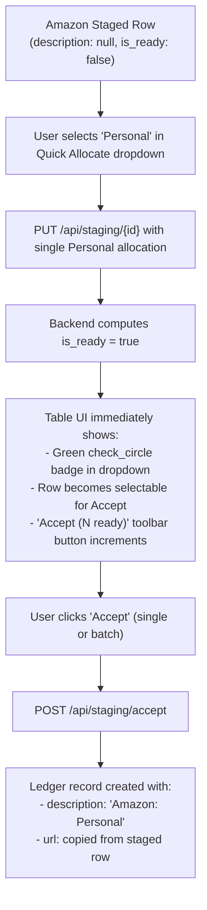

# Streamlined Staging Intake & Ledger Investigation URLs

## 1. Executive Summary & Objective

In Wrangler's architectural design, personal transactions exist primarily to account for total card statement balances and prevent unallocated leaks from external intake sources (such as Amazon order history CSVs). Because personal transactions are excluded from downstream accounting exports (Wave), they do not require detailed tax categorizations, business justification descriptions, or receipt attachments.

Previously, the staging readiness invariant ([`compute_staged_is_ready`](file:///D:/src/personal/wrangler/api/src/schemas/staging.py#L145-L173)) strictly required a non-empty `description` for all staged transactions regardless of entity attribution. When importing Amazon CSVs (which intentionally stage rows with `description = None`), users were unable to accept personal transactions directly from the staging table via the quick-allocation selector without opening the edit dialog, manually typing an arbitrary description, and saving. Furthermore, investigation URLs ([`StagedTransaction.url`](file:///D:/src/personal/wrangler/api/src/models/staged_transaction.py#L24)) were discarded upon acceptance into the permanent ledger, preventing users from reviewing the source order page for unreceipted personal transactions in historical records.

This specification delivers:
1. **Zero-Friction Personal Staging Intake:** Relaxes the staging readiness rule so that transactions allocated 100% to Personal no longer require a manual description to transition to `is_ready = True`.
2. **Automated Ledger Description Fallback:** When accepting an unlabelled personal transaction into the ledger, automatically assigns a friendly description format (e.g. `"Amazon: Personal"` via an extensible source friendly-name mapping) to satisfy SQLite's `NOT NULL` constraint without manual typing.
3. **Ledger Investigation URLs:** Expands the ledger [`Transaction`](file:///D:/src/personal/wrangler/api/src/models/transaction.py#L13-L30) schema with a nullable `url` column, copies `url` from staging upon acceptance, and exposes it in the Ledger UI and transaction edit dialogs.

---

## 2. Subsystem Invariants & Architectural Contracts

### 2.1 Staging Readiness Invariant (`compute_staged_is_ready`)
In [`api/src/schemas/staging.py`](file:///D:/src/personal/wrangler/api/src/schemas/staging.py#L145-L173), a staged transaction is ready for acceptance (`is_ready == True`) if and only if:
1. `status == "STAGED"`
2. `date is not None`
3. `total_amount is not None`
4. Allocations list is non-empty, all allocations are non-zero, and the sum of allocation amounts matches `total_amount` exactly.
5. Entity attribution rules are satisfied (at most one personal split and at most one split per company).
6. **Description Rule (Amended):**
   - If the transaction is **100% Personal** (a single allocation with `is_personal == True`), `description` is **optional** (`None` or empty string is valid).
   - If the transaction has any business split (`is_personal == False`), `description` **must be a non-empty, non-whitespace string**.

### 2.2 Core Ledger Description Invariant & Source Friendly Names
In [`api/src/models/transaction.py`](file:///D:/src/personal/wrangler/api/src/models/transaction.py#L21), `description: Mapped[str] = mapped_column(String, nullable=False)` remains strictly non-nullable.

To ensure ledger descriptions are clean and human-readable, Wrangler defines an extensible source-to-friendly-name mapping:

```python
SOURCE_FRIENDLY_NAMES: dict[str, str] = {
    "amazon_csv": "Amazon",
    "receipt_parser": "Receipt",
    "ai_receipt": "Receipt",
    "mcp": "AI Assistant",
    "manual": "Manual",
    "wrangler_csv": "Wrangler",
    "google_groups": "Google Groups",
}

def get_source_friendly_name(source: str) -> str:
    """Return friendly display name for source, falling back to title-cased source name."""
    return SOURCE_FRIENDLY_NAMES.get(source, source.replace("_", " ").title())

def format_personal_fallback_description(source: str) -> str:
    """Generate clean fallback description for personal transactions."""
    return f"{get_source_friendly_name(source)}: Personal"
```

- When [`POST /api/staging/accept`](file:///D:/src/personal/wrangler/api/src/routers/staging.py#L540-L625) inserts into `transactions`:
  - If `stx.description` is non-empty, it is used verbatim: `description = stx.description.strip()`.
  - If `stx.description` is `None` or whitespace, and the transaction is allocated to Personal, the system automatically writes:
    ```python
    description = format_personal_fallback_description(stx.source)
    # e.g., 'amazon_csv' -> 'Amazon: Personal'
    ```
  - If `stx.description` is `None` or whitespace on a business transaction, acceptance is rejected with `400 Bad Request`.

### 2.3 URL Persistence & Ledger Transfer Contract
- `StagedTransaction.url` is copied directly to `Transaction.url` during staging acceptance.
- `Transaction.url` is nullable (`String`, `nullable=True`).
- If an accepted transaction originated from manual entry or a source without a URL, `Transaction.url` defaults to `None`.

---

## 3. Data Model & Alembic Migration

### 3.1 SQLAlchemy Model Changes (`api/src/models/transaction.py`)
Add `url` column to `Transaction`:

```python
class Transaction(Base):
    __tablename__ = "transactions"
    __table_args__ = (UniqueConstraint("source", "external_id", name="uq_transactions_source_external_id"),)

    id: Mapped[uuid.UUID] = mapped_column(Uuid, primary_key=True, default=uuid.uuid4)
    source: Mapped[str] = mapped_column(String, nullable=False)
    external_id: Mapped[str | None] = mapped_column(String, nullable=True)
    date: Mapped[datetime.date] = mapped_column(Date, nullable=False)
    description: Mapped[str] = mapped_column(String, nullable=False)
    total_amount: Mapped[Decimal] = mapped_column(Numeric(12, 2), nullable=False)
    receipt_file_path: Mapped[str | None] = mapped_column(String, nullable=True)
    url: Mapped[str | None] = mapped_column(String, nullable=True)  # <-- Added
```

### 3.2 Alembic Database Migration
Create a new migration script in `api/alembic/versions/` (revising current head):

```python
"""add url to transactions

Revision ID: <revision_id>
Revises: <previous_revision_id>
Create Date: 2026-10-22
"""

from collections.abc import Sequence
import sqlalchemy as sa
from alembic import op

revision: str = "<auto_generated>"
down_revision: str | Sequence[str] | None = "<previous_revision_id>"
branch_labels: str | Sequence[str] | None = None
depends_on: str | Sequence[str] | None = None


def upgrade() -> None:
    with op.batch_alter_table("transactions") as batch_op:
        batch_op.add_column(sa.Column("url", sa.String(), nullable=True))


def downgrade() -> None:
    with op.batch_alter_table("transactions") as batch_op:
        batch_op.drop_column("url")
```

---

## 4. Backend API & Schema Specifications

### 4.1 Schema Updates (`api/src/schemas/`)

#### 1. `api/src/schemas/staging.py`
Update `compute_staged_is_ready`:

```python
def compute_staged_is_ready(staged_tx: StagedTransaction) -> bool:
    """Return True if the staged transaction has status STAGED, valid metadata, and balanced allocations."""
    if staged_tx.status != "STAGED":
        return False

    if staged_tx.date is None or staged_tx.total_amount is None:
        return False

    allocs = staged_tx.allocations
    if not allocs:
        return False

    total = Decimal(str(staged_tx.total_amount)).quantize(Decimal("0.01"))
    alloc_sum = sum((Decimal(str(a.amount)).quantize(Decimal("0.01")) for a in allocs), Decimal("0.00"))
    if alloc_sum != total:
        return False

    # Check for single 100% personal allocation
    is_personal_allocation = len(allocs) == 1 and allocs[0].is_personal and allocs[0].company_id is None

    # Description is strictly required for business allocations; optional for 100% personal allocations
    has_valid_description = bool(staged_tx.description and staged_tx.description.strip())
    if not is_personal_allocation and not has_valid_description:
        return False

    if len(allocs) > 1:
        for a in allocs:
            if a.is_personal or a.company_id is None:
                return False
        return True

    single = allocs[0]
    if single.is_personal:
        return single.company_id is None
    return single.company_id is not None
```

#### 2. `api/src/schemas/transaction.py`
Add `url: str | None = None` to Pydantic schemas:
- `TransactionCreate`: Optional `url: str | None = None`.
- `TransactionUpdate`: Optional `url: str | None = None`.
- `TransactionResponse`: Optional `url: str | None = None` (serialized via `model_config = ConfigDict(from_attributes=True)`).

### 4.2 Endpoint Modifications

#### 1. `POST /api/staging/accept` ([`api/src/routers/staging.py`](file:///D:/src/personal/wrangler/api/src/routers/staging.py#L540-L630))
Update the transaction construction loop:

```python
for stx in target_staged:
    tx_id = uuid.uuid4()
    
    # Resolve description: use existing or fallback to friendly '{FriendlySource}: Personal'
    resolved_description = (stx.description or "").strip()
    if not resolved_description:
        resolved_description = format_personal_fallback_description(stx.source)

    ledger_tx = Transaction(
        id=tx_id,
        source=stx.source,
        external_id=stx.external_id,
        date=stx.date,
        description=resolved_description,
        total_amount=stx.total_amount,
        receipt_file_path=stx.receipt_file_path,
        url=stx.url,  # Carry staging investigation URL into Ledger
    )
    for s_alloc in stx.allocations:
        ledger_tx.allocations.append(
            Allocation(
                id=uuid.uuid4(),
                transaction_id=tx_id,
                amount=s_alloc.amount,
                is_personal=s_alloc.is_personal,
                company_id=None if s_alloc.is_personal else s_alloc.company_id,
                is_locked=False,
            )
        )
    db.add(ledger_tx)
    staged_to_tx_id.append((stx, tx_id))
    ledger_tx_ids.append(tx_id)
```

#### 2. `POST /api/transactions` & `PUT /api/transactions/{id}` ([`api/src/routers/transactions.py`](file:///D:/src/personal/wrangler/api/src/routers/transactions.py))
- In `create_transaction`: map `payload.url` to `Transaction.url`.
- In `update_transaction`: map `payload.url` to `Transaction.url` when `payload.url is not None` (or allow clearing to `None`).

---

## 5. Frontend & UI/UX Specifications

### 5.1 Staging Review Table (`web/src/views/ImportView.vue`)



1. **Reactive Readiness Feedback:**
   - As soon as the user selects `"Personal"` from the quick-allocate dropdown in a table row, the row's `is_ready` status becomes `true`.
   - The green `check_circle` icon in the quick-assign selector renders immediately.
   - The batch toolbar action `Accept (${selectedReadyCount} ready)` updates immediately without manual description entry.
2. **Table Description Column Display:**
   - When a staged transaction has `description == null`, the description cell continues to render the fallback text:
     - If allocated to Personal: display italic text `<span class="text-italic text-grey-7">{{ getFriendlySourceName(row.source) }}: Personal (Pending)</span>` or keep `Unlabeled transaction`.
     - Clicking the URL icon opens the order in a new tab as normal.

### 5.2 Staged Transaction Edit Dialog (`web/src/components/StagedTransactionEditDialog.vue` & `stagedTransactionEdit.ts`)

1. **Relaxed Validation for Personal Edits (`stagedTransactionEdit.ts`):**
   - Update `canSaveStagedTransactionEdit(state)`:
     ```typescript
     const isPersonal = state.is_personal || (state.splits.length === 1 && state.splits[0].is_personal)
     if (!isPersonal && (!state.description || !state.description.trim())) {
       return false
     }
     ```
2. **Form Rule Adjustments (`StagedTransactionEditDialog.vue`):**
   - In `<q-input v-model="form.description">`:
     - Bind rules dynamically: `:rules="form.is_personal ? [] : descriptionRules"`.
     - When toggled to Personal, clear description validation errors.

### 5.3 Ledger Table & Detail View (`web/src/views/LedgerView.vue`)

1. **TypeScript Types (`web/src/types/transaction.ts`):**
   - Add `url?: string | null` to `Transaction`, `TransactionCreatePayload`, and `TransactionUpdatePayload`.
2. **URL Icon Affordance in Description Column:**
   - In `template #body-cell-description="props"`, display an inline external link button when `props.row.url` is present:
     ```html
     <div class="row items-center q-gutter-xs no-wrap">
       <span :class="getTextWeightClass(props.row)">{{ props.row.description }}</span>
       <q-btn
         v-if="props.row.url"
         flat
         round
         dense
         size="xs"
         icon="open_in_new"
         color="primary"
         :href="props.row.url"
         target="_blank"
         rel="noopener noreferrer"
         data-testid="btn-ledger-open-url"
         @click.stop
       >
         <q-tooltip>Open Source URL</q-tooltip>
       </q-btn>
     </div>
     ```

### 5.4 Ledger Transaction Edit Dialog (`web/src/components/TransactionEditDialog.vue` & `transactionEdit.ts`)

1. **State & Payload Management (`transactionEdit.ts`):**
   - Add `url: string` to `TransactionEditFormState`.
   - In `createTransactionEditState(tx)`: initialize `url: tx.url || ""`.
   - In `prepareTransactionEditPayload(state)`: include `url: state.url.trim() || null`.
2. **Dialog UI Component (`TransactionEditDialog.vue`):**
   - Add an investigation URL input field (matching `StagedTransactionEditDialog.vue`):
     ```html
     <q-input
       v-model="form.url"
       dense
       outlined
       label="Investigation URL"
       placeholder="https://..."
       data-testid="input-ledger-url"
       class="q-mb-sm"
     >
       <template #prepend>
         <q-icon name="link" />
       </template>
       <template #append v-if="form.url && form.url.trim()">
         <q-btn
           flat
           round
           dense
           size="sm"
           icon="open_in_new"
           color="primary"
           :href="form.url.trim()"
           target="_blank"
           rel="noopener noreferrer"
           data-testid="btn-ledger-open-url"
           @click.stop
         >
           <q-tooltip>Open URL</q-tooltip>
         </q-btn>
       </template>
     </q-input>
     ```

---

## 6. Verification Scenarios & Acceptance Criteria

### 6.1 Backend Automated Tests (`api/tests/`)

1. **Staging Readiness Calculation (`test_importer_framework.py`, `test_staging_api.py`):**
   - Create a staged transaction with `description = None` and unallocated splits. Verify `is_ready == False`.
   - Allocate 100% to a Company (`is_personal = False`). Verify `is_ready == False` (blocked by missing description).
   - Allocate 100% to Personal (`is_personal = True`). Verify `is_ready == True` (allowed without description).
   - Add a company split so allocations are mixed/split. Verify `is_ready == False`.
2. **Acceptance Endpoint Description Fallback (`test_staging_api.py`):**
   - Accept a staged item with `description = None`, `source = "amazon_csv"`, and 100% Personal allocation.
   - Verify HTTP 200 response and successful acceptance.
   - Query the created ledger `Transaction`. Verify `description == "Amazon: Personal"`.
   - Accept a staged item with `description = "Office Supplies"`, `source = "amazon_csv"`, and 100% Personal allocation.
   - Verify created ledger `Transaction` retains `description == "Office Supplies"`.
3. **Investigation URL Persistence (`test_staging_api.py`, `test_transactions_api.py`):**
   - Stage a transaction with `url = "https://www.amazon.ca/gp/your-account/order-details?orderID=702-1234567"`.
   - Accept the transaction.
   - Query `GET /api/transactions/{id}`. Verify `url` matches the source staging URL.
   - Verify updating a ledger transaction via `PUT /api/transactions/{id}` preserves or updates `url`.

### 6.2 Frontend Automated Tests (`web/tests/`)

1. **Staged Edit Form Validation (`stagedTransactionEdit.spec.ts`):**
   - Verify `canSaveStagedTransactionEdit` returns `true` when `description == ""` but `is_personal == true`.
   - Verify `canSaveStagedTransactionEdit` returns `false` when `description == ""` and `is_personal == false`.
2. **Ledger Edit Form Validation (`transactionEdit.spec.ts`):**
   - Verify URL payload extraction and preservation during edit.
3. **ImportView Staging Table UI (`ImportView.spec.ts`):**
   - Verify that selecting "Personal" from quick-assign causes the readiness checkmark to render for an item with null description.
   - Verify clicking the batch Accept button accepts the personal transaction into the ledger.
4. **LedgerView UI (`LedgerView.spec.ts`):**
   - Verify the `open_in_new` button appears in the description column when a transaction has a non-null `url`.
