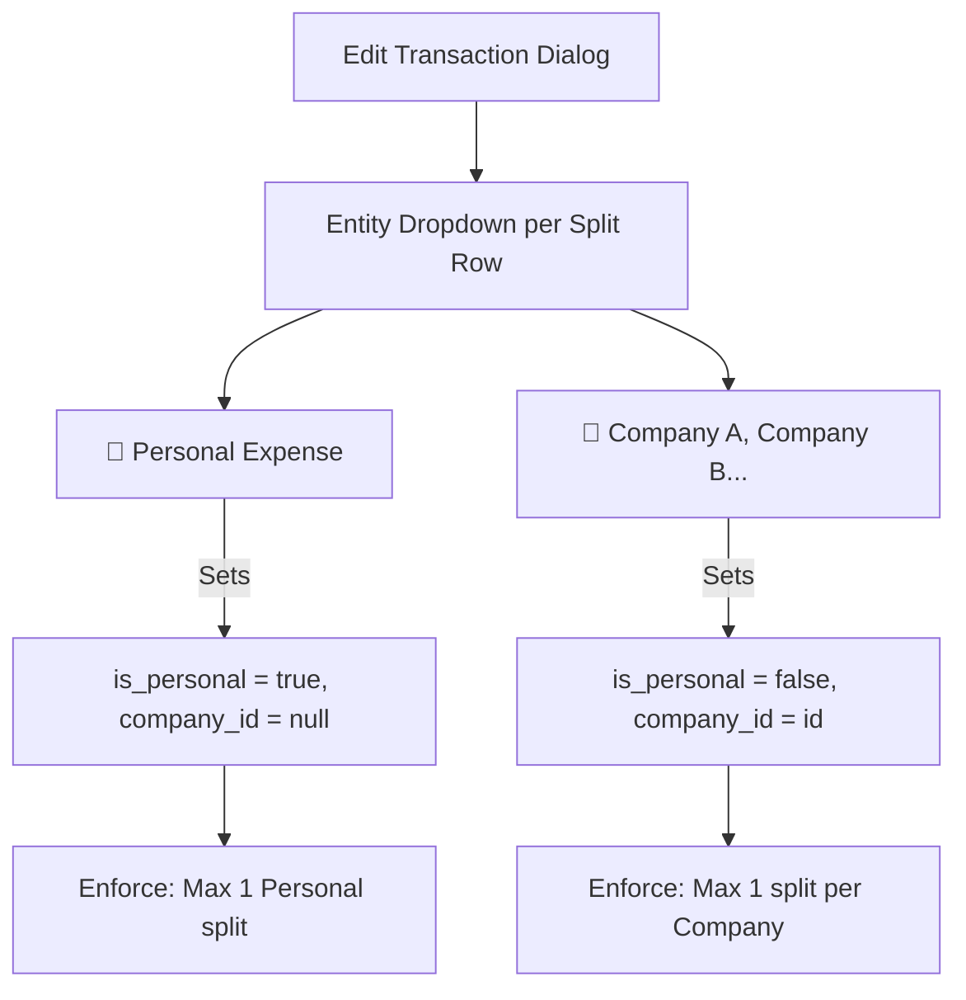

# Mixed Entity Splits, Auto-Locked Personal Allocations & Ledger Clean-Up

## 1. Executive Summary & Objective

Wrangler was designed from inception as an ingestion and routing layer rather than a full double-entry accounting general ledger. Its architectural boundary dictates that a parent transaction can have at most **one** allocation per entity—specifically, at most one personal split and at most one split per company ([`specs/ARCHITECTURE.md`](file:///D:/src/personal/wrangler/specs/ARCHITECTURE.md#L180-L186)).

In practice, users frequently encounter orders (such as Amazon shipments or warehouse store receipts) containing a mixture of personal purchases and business expenses. However, an artificial restriction in the staging validation layer and frontend edit dialogs treated "Personal Expense" as a binary, whole-transaction toggle, completely preventing transactions from being split between personal and business entities.

Additionally, personal transactions introduced visual friction on the permanent ledger:
1. **Ledger Visual Clutter:** Every locked ledger row displayed three separate lock icons (a dedicated lock column, an allocation badge, and the action button).
2. **Permanent Unlocked Bold Highlight:** Because personal transactions are never exported to external accounting software (Wave), they remained unlocked indefinitely (`is_locked = False`), causing them to be rendered permanently in bold font and signaling an incomplete task.
3. **Redundant Intake Overhead:** 100% personal transactions were pushed all the way through staging to the ledger solely to satisfy deduplication concerns, even though deduplication hashing natively tracks dismissed items in the staging layer.

This specification addresses these ergonomics and architectural gaps by delivering:
1. **Mixed Entity Splits:** Allows staged and ledger transactions to be split between Personal and one or more distinct companies, adhering strictly to the entity attribution invariant (max 1 personal split, max 1 split per company).
2. **Auto-Locked Personal Allocations:** Any allocation marked as Personal (`is_personal = True`) is automatically created with `is_locked = True` upon entry into the permanent ledger.
3. **Consolidated Ledger UI:** Removes the redundant Column 1 lock icon and the redundant Allocation badge lock icon from [`LedgerView.vue`](file:///D:/src/personal/wrangler/web/src/views/LedgerView.vue), keeping only the interactive lock toggle in the Actions column and relying on font weight (`text-weight-bold`) as the single, clean visual indicator for unlocked business allocations.
4. **Streamlined Personal Triage in Staging:** Updates the 1-click personal action and `X` keyboard shortcut to dismiss 100% personal transactions directly (`status = "DISMISSED"`), keeping the permanent ledger uncluttered while maintaining 100% reliable deduplication for future CSV re-imports.

---

## 2. Subsystem Invariants & Business Rules

### 2.1 Entity Allocation Invariant (Restored)
In accordance with [`specs/ARCHITECTURE.md`](file:///D:/src/personal/wrangler/specs/ARCHITECTURE.md#L180-L186), a transaction may be allocated across multiple entities under the following non-negotiable rules:
1. A transaction can have at most **one** personal allocation (`is_personal == True` and `company_id is None`).
2. A transaction can have at most **one** allocation per distinct company (`is_personal == False` and `company_id is not None`).
3. Sub-allocations across multiple internal categories for the same company remain strictly forbidden in Wrangler and must be managed downstream in Wave.
4. The sum of all allocation amounts must equal the transaction's `total_amount` exactly.

### 2.2 Staging Readiness Invariant (`compute_staged_is_ready`)
In [`api/src/schemas/staging.py`](file:///D:/src/personal/wrangler/api/src/schemas/staging.py#L145-L180), a staged transaction is ready for acceptance (`is_ready == True`) if and only if:
1. `status == "STAGED"`
2. `date is not None` and `total_amount is not None` (strictly non-zero).
3. The allocations list is non-empty, and the sum of allocation amounts matches `total_amount` exactly.
4. **Entity Attribution Check:**
   - At most one allocation has `is_personal == True`.
   - Every allocation with `is_personal == False` has a valid, non-null `company_id`.
   - No two allocations have the same `company_id`.
5. **Description Rule:**
   - If the transaction has any business split (`any(not a.is_personal for a in staged_tx.allocations)`), `description` **must be a non-empty, non-whitespace string**.
   - If the transaction is 100% Personal, `description` is optional (falls back to `format_personal_fallback_description` upon acceptance).

### 2.3 Auto-Locking Personal Allocations Invariant
Because personal expenses are never exported to downstream accounting systems:
1. When a transaction is accepted into the ledger via [`POST /api/staging/accept`](file:///D:/src/personal/wrangler/api/src/routers/staging.py#L532-L630), any allocation with `is_personal == True` is committed with **`is_locked = True`**.
2. Any business allocation (`is_personal == False`) is committed with **`is_locked = False`**.
3. When creating transactions manually via [`POST /api/transactions`](file:///D:/src/personal/wrangler/api/src/routers/transactions.py#L111-L233), personal allocations are saved with `is_locked = True`.
4. If a transaction is split between Personal ($25.00) and Company A ($75.00), the personal split is immediately locked, while the Company A split remains unlocked until exported to Wave.

### 2.4 Accounting Export & Ledger Status Reconciliation
1. Downstream Wave CSV export ([`api/src/services/export.py`](file:///D:/src/personal/wrangler/api/src/services/export.py#L26-L38)) continues to filter out allocations with `is_personal == True`.
2. For mixed split transactions, only the business allocation amount is exported (e.g., $75.00 for Company A).
3. Upon export, the business allocation transitions to `is_locked = True`.
4. Because the personal split was already `is_locked = True`, the transaction is now **fully locked** and automatically transitions from `text-weight-bold` to `text-weight-regular` in the Ledger table.

### 2.5 100% Personal Triage & Deduplication Contract
1. Ingestion deduplication ([`api/src/routers/importers.py`](file:///D:/src/personal/wrangler/api/src/routers/importers.py#L174-L206)) matches incoming `(source, external_id)` against all rows in `staged_transactions` regardless of status (`STAGED`, `DISMISSED`, `ACCEPTED`).
2. Marking an unneeded 100% personal item as dismissed (`status = "DISMISSED"`) retains its `(source, external_id)` in the SQLite database permanently.
3. Subsequent imports of overlapping Amazon or bank CSV files will skip the dismissed external ID as a duplicate.
4. Users do not need to push 100% personal transactions to the permanent ledger to maintain duplicate safety.

---

## 3. Data Model & Schema Specifications

### 3.1 Schema Compatibility
The underlying SQLite database models ([`Transaction`](file:///D:/src/personal/wrangler/api/src/models/transaction.py), [`Allocation`](file:///D:/src/personal/wrangler/api/src/models/allocation.py), [`StagedTransaction`](file:///D:/src/personal/wrangler/api/src/models/staged_transaction.py), and [`StagedAllocation`](file:///D:/src/personal/wrangler/api/src/models/staged_allocation.py)) already support nullable `company_id` and boolean `is_personal`. **No Alembic migrations or database schema alterations are required.**

### 3.2 Existing Ledger Data & Zero-Cleanup Invariant
Historical personal transactions already residing on the permanent ledger remain intact as valid records. **No retroactive database cleanup, data deletion, or migration scripts are required.** Existing transactions with personal allocations remain fully functional, editable, and viewable in the Ledger UI without modification.

---

## 4. Backend API Specifications

### 4.1 Staging Readiness Update (`api/src/schemas/staging.py`)
Replace the existing split checks in [`compute_staged_is_ready`](file:///D:/src/personal/wrangler/api/src/schemas/staging.py#L145-L180):

```python
def compute_staged_is_ready(staged_tx: StagedTransaction) -> bool:
    """Return True if the staged transaction has status STAGED, valid metadata, and balanced allocations."""
    if staged_tx.status != "STAGED":
        return False

    if staged_tx.date is None or staged_tx.total_amount is None or staged_tx.total_amount == 0:
        return False

    allocs = staged_tx.allocations
    if not allocs:
        return False

    total = Decimal(str(staged_tx.total_amount)).quantize(Decimal("0.01"))
    alloc_sum = sum((Decimal(str(a.amount)).quantize(Decimal("0.01")) for a in allocs), Decimal("0.00"))
    if alloc_sum != total:
        return False

    # Check entity attribution invariants
    personal_allocs = [a for a in allocs if a.is_personal]
    if len(personal_allocs) > 1:
        return False
    if personal_allocs and personal_allocs[0].company_id is not None:
        return False

    business_allocs = [a for a in allocs if not a.is_personal]
    business_company_ids = [a.company_id for a in business_allocs]
    if any(cid is None for cid in business_company_ids):
        return False
    if len(business_company_ids) != len(set(business_company_ids)):
        return False

    # Description is strictly required if there are any business allocations
    is_pure_personal = len(personal_allocs) == 1 and len(business_allocs) == 0
    has_valid_description = bool(staged_tx.description and staged_tx.description.strip())
    if not is_pure_personal and not has_valid_description:
        return False

    return True
```

### 4.2 Staging Allocation Validation (`api/src/routers/staging.py`)
In `_validate_and_apply_staged_allocations`:
Remove the exception that blocks personal splits:
```python
# REMOVE THIS BLOCK:
# if len(items) > 1 and any(item.is_personal for item in items):
#     raise HTTPException(
#         status_code=status.HTTP_400_BAD_REQUEST,
#         detail="Only business transactions can be split. Remove extra splits before marking as personal.",
#     )
```
Replace with entity validation:
```python
personal_items = [item for item in items if item.is_personal]
if len(personal_items) > 1:
    raise HTTPException(
        status_code=status.HTTP_400_BAD_REQUEST,
        detail="A transaction can have at most one personal allocation.",
    )

business_items = [item for item in items if not item.is_personal]
business_company_ids = [item.company_id for item in business_items]
if any(cid is None for cid in business_company_ids):
    raise HTTPException(
        status_code=status.HTTP_400_BAD_REQUEST,
        detail="Business allocation requires a valid company_id",
    )
if len(business_company_ids) != len(set(business_company_ids)):
    raise HTTPException(
        status_code=status.HTTP_400_BAD_REQUEST,
        detail="A transaction can have at most one allocation per company/entity.",
    )

for item in business_items:
    company = db.get(Company, item.company_id)
    if company is None:
        raise HTTPException(
            status_code=status.HTTP_400_BAD_REQUEST,
            detail=f"Company with ID '{item.company_id}' not found",
        )
```

### 4.3 Staging Acceptance Auto-Locking (`api/src/routers/staging.py`)
In `accept_staged_transactions`, auto-lock personal allocations when creating permanent `Allocation` records:

```python
for s_alloc in stx.allocations:
    ledger_tx.allocations.append(
        Allocation(
            id=uuid.uuid4(),
            transaction_id=tx_id,
            amount=s_alloc.amount,
            is_personal=s_alloc.is_personal,
            company_id=None if s_alloc.is_personal else s_alloc.company_id,
            is_locked=s_alloc.is_personal,  # Personal splits auto-lock immediately
        )
    )
```

### 4.4 Manual Transaction Creation & Updates (`api/src/routers/transactions.py`)
1. In `create_transaction`:
   - Allow `alloc_item.is_personal`.
   - When creating `Allocation`: set `is_personal = alloc_item.is_personal`, `company_id = None if alloc_item.is_personal else alloc_item.company_id`, and `is_locked = alloc_item.is_personal`.
2. In `_validate_and_apply_allocations`:
   - Auto-lock newly created personal allocations (`is_locked = item.is_locked or item.is_personal`).

---

## 5. Frontend & UI/UX Specifications

### 5.1 Split Entity Selector in Edit Dialogs
Both [`StagedTransactionEditDialog.vue`](file:///D:/src/personal/wrangler/web/src/components/StagedTransactionEditDialog.vue) and [`TransactionEditDialog.vue`](file:///D:/src/personal/wrangler/web/src/components/TransactionEditDialog.vue) are updated to treat "Personal Expense" as an entity option inside each split row rather than a top-level binary toggle.



1. **Remove Top-Level Personal Toggle:**
   - Remove `<q-toggle v-model="form.is_personal" label="Personal Expense">` from both dialogs.
2. **Unified Split Entity Options:**
   - Define a computed entity options list for each split row:
     ```typescript
     interface EntityOption {
       label: string
       value: string // 'personal' | companyId
       isPersonal: boolean
       companyId: string | null
       disable: boolean
     }
     ```
   - "Personal Expense" is available unless another split row already selected "Personal Expense".
   - Each Company is available unless another split row already selected that specific company.
3. **Split Row Layout:**
   - In each split row:
     - Entity `<q-select>`:
       - Displays "Personal Expense" (with person icon) or company name (with business icon).
       - When selection changes to "Personal Expense": `split.is_personal = true; split.company_id = null;`.
       - When selection changes to a company: `split.is_personal = false; split.company_id = value;`.
     - Amount `<q-input>`: operates as existing split amount input.
     - Remove Split `<q-btn>`: disabled when only 1 split exists.
4. **Form Validation Helpers (`stagedTransactionEdit.ts` & `transactionEdit.ts`):**
   - Update `canSaveStagedTransactionEdit` and `canSaveTransactionEdit`:
     - Allow splits containing up to 1 personal split and distinct company splits.
     - If all splits are personal, description is optional (staged fallback applies).
     - If any split is a company split, `description` is required.

### 5.2 Ledger Table Decluttering (`web/src/views/LedgerView.vue`)

| Area | Current Implementation | Amended Implementation | Rationale |
| :--- | :--- | :--- | :--- |
| **Column 1 (`lock`)** | Dedicated 32px column with `<q-icon name="lock" />` | **Removed completely.** | Redundant with font weight and row action icon. Saves horizontal space. |
| **Column 6 (`allocations`)** | Text + `<q-badge color="amber-2"><q-icon name="lock" />...</q-badge>` | **Badge removed.** Displays clean allocation label only: e.g. `Personal`, `Company A`, or `Personal + Company A`. | Eliminates double lock icons. Multi-split transactions remain clearly labelled. |
| **Column 8 (`actions`)** | `<q-btn icon="lock" \| "lock_open" />` | **Retained.** Single interactive lock toggle / split lock menu. | Serves as the interactive control and visual status when hovering/clicking. |
| **Row Font Weight** | Bold for unlocked, regular for fully locked. | **Retained.** Driven by `getTextWeightClass(row)`. | Clear, non-distracting visual affordance that draws attention to unlocked rows. |

1. **Table Columns Definition (`columns`):**
   - Remove `{ name: "lock", ... }` from the column list.
2. **Template Cleanup:**
   - Remove `<template #header-cell-lock>` and `<template #body-cell-lock>`.
   - In `<template #body-cell-allocations>`: remove `<q-badge v-if="isTransactionFullyLocked">` and `<q-badge v-else-if="isTransactionPartiallyLocked">`.
3. **Allocation Display Helper (`ledger.ts`):**
   - Update `getAllocationLabel` so mixed splits render a friendly label:
     - 1 personal split: `"Personal"`
     - 1 company split: `"[Company Name]"`
     - 1 personal + 1 company split: `"[Company Name] + Personal"`
     - Multiple business splits: `"[N] splits"`

### 5.3 Staging Review Table & Quick Triage (`web/src/views/ImportView.vue`)
Since 100% personal transactions do not belong on the permanent ledger, the front-loaded triage workstation is streamlined to archive them directly into `DISMISSED` state with one click or keypress:

1. **Quick Triage Action Strip (`<q-tr>`):**
   - Update `Personal Expense (X)` button label and tooltip:
     - Label: **`Dismiss Personal (X)`**
     - Icon: `person_off` or `person`
     - Tooltip: `Dismiss 100% personal transaction (Shortcut: X)`
   - When clicked or triggered via shortcut `X`:
     - Calls backend `POST /api/staging/bulk-dismiss` (or single dismiss endpoint).
     - Closes action strip.
     - Displays toast: `"Transaction dismissed as personal"`.
     - The row is immediately removed from the active staging queue and safely archived as `DISMISSED`.
2. **Row Actions Column:**
   - In row actions: update `[👤 Mark Personal]` button to `[👤 Dismiss Personal]`, invoking the dismiss workflow directly.
3. **Auditability & Recovery:**
   - Dismissed personal transactions remain accessible under the table's `Status: DISMISSED` filter.
   - If a transaction was dismissed by mistake, clicking `[🔄 Restore]` returns it to `STAGED` status.

---

## 6. Verification Scenarios & Acceptance Criteria

### 6.1 Backend Automated Tests (`api/tests/`)

1. **Staging Readiness with Mixed Splits (`test_staging_api.py`):**
   - Create a staged transaction ($100.00) with two splits: $30.00 Personal (`is_personal=True, company_id=None`) and $70.00 Company A (`is_personal=False, company_id=uuidA`).
   - With `description = ""`: verify `is_ready == False` (description required for business split).
   - With `description = "Office supplies and book"`: verify `is_ready == True`.
   - Attempt to add two personal splits to the same transaction: verify rejected with `400 Bad Request`.
   - Attempt to add two splits for the same company: verify rejected with `400 Bad Request`.
2. **Staging Acceptance with Mixed Splits (`test_staging_api.py`):**
   - Accept the staged mixed-split transaction.
   - Query the created ledger `Transaction` and its `allocations`:
     - Personal allocation ($30.00) has `is_locked == True`.
     - Company A allocation ($70.00) has `is_locked == False`.
     - Total transaction has `isTransactionPartiallyLocked == True`.
3. **Core Ledger Transaction Endpoints (`test_transactions_api.py`):**
   - Create a transaction via `POST /api/transactions` with a personal split ($20.00) and company split ($80.00).
   - Verify personal split is saved with `is_locked = True`.
4. **Wave CSV Export with Mixed Splits (`test_wave_export.py`):**
   - Generate Wave CSV for Company A.
   - Verify only the $70.00 Company A split appears in the CSV.
   - Verify the $30.00 personal split is completely omitted from the CSV.
5. **Deduplication of Dismissed Transactions (`test_importers_api.py`):**
   - Stage an Amazon transaction with `external_id = "order_123_date_amt"`.
   - Dismiss the staged transaction (`status = "DISMISSED"`).
   - Upload the same Amazon CSV again.
   - Verify the transaction is detected as an existing duplicate and skipped (`skipped_duplicates == 1`).

### 6.2 Frontend Automated Tests (`web/tests/`)

1. **Staged Transaction Edit Dialog (`stagedTransactionEdit.spec.ts` & `StagedTransactionEditDialog.spec.ts`):**
   - Verify entity dropdown in split rows allows selecting "Personal Expense" alongside companies.
   - Verify selecting "Personal Expense" on split 1 disables the "Personal Expense" option in split 2.
   - Verify `canSaveStagedTransactionEdit` validates sum of mixed splits.
2. **Ledger Transaction Edit Dialog (`transactionEdit.spec.ts` & `TransactionEditDialog.spec.ts`):**
   - Verify mixed splits can be added and saved on an existing transaction.
3. **Ledger Table UI Clean-Up (`ledgerView.spec.ts`):**
   - Verify table column definitions do NOT contain `"lock"`.
   - Verify allocation cells do NOT render `<q-badge>` lock icons.
   - Verify action column retains the interactive lock button.
   - Verify a transaction with 100% personal allocation renders in regular font weight (`text-weight-regular`).
   - Verify a transaction with an unlocked business allocation renders in bold font weight (`text-weight-bold`).
4. **Staging Review Table & Quick Triage (`importView.spec.ts`):**
   - Verify pressing `X` or clicking `Dismiss Personal` invokes the dismiss action.
   - Verify row leaves the active staging table.
