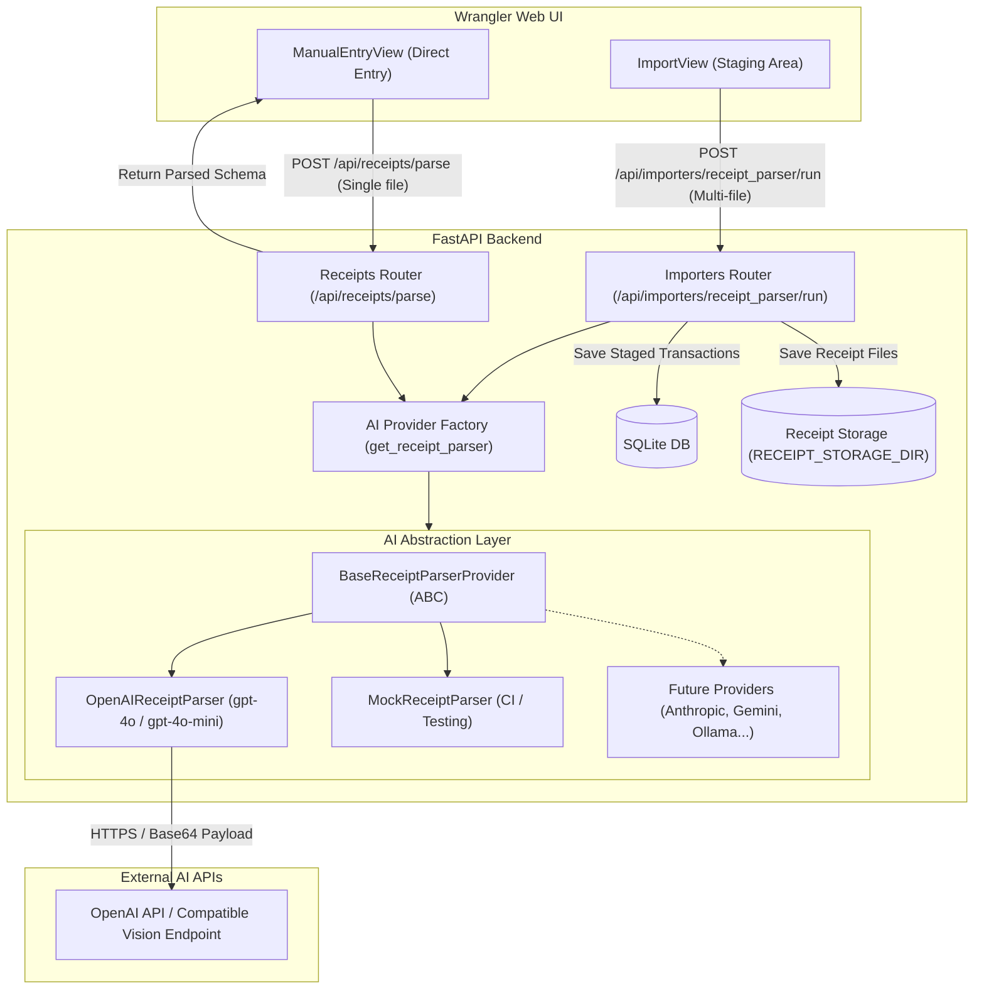

# AI Receipt Integration & Multi-Provider Architecture Specification

**Status:** Implemented

## 1. Goal & Overview

This specification defines the **AI Receipt Parsing** feature and **Pluggable AI Abstraction Layer** for Wrangler.

The system introduces an automated receipt extraction pipeline capable of parsing scanned photos (`.jpg`, `.jpeg`, `.png`, `.webp`) and digital documents (`.pdf`) to accurately extract:
- **Date** (`YYYY-MM-DD`)
- **Merchant / Payee Name**
- **Total Amount**
- **Concise Purchase Description** (formatted as `"{Merchant} - {Summary of purchased goods}"`)

Receipt intake is supported across two primary workflows:
1. **Batch Receipt Staging (`ImportView`):** A dedicated **Receipt Scanner** importer in the Staging Area allows users to drop one or multiple receipt files. Each receipt is processed with concurrency controls, attached to a new `StagedTransaction` in `STAGED` status, and deduplicated via deterministic SHA-256 file hashing. Users review and assign allocations in Staging before batch-accepting into the ledger.
2. **Manual Entry Auto-Fill (`ManualEntryView`):** A **Scan Receipt** helper on the Manual Entry form that parses a single dropped receipt in real-time, pre-filling the transaction date, description, amount, and attaching the file for immediate ledger submission.

The backend introduces an extensible **AI Provider Abstraction Layer** defaulting to OpenAI models (such as `gpt-4o` or `gpt-4o-mini`) via structured JSON outputs and vision inputs, alongside a deterministic `MockReceiptParser` for automated testing and offline development.

---

## 2. Server Architecture & Processing Flow



---

## 3. Data Model & Database Migration Strategy

### 3.1 Zero Database Migrations

This feature requires **no database migrations** and introduces **zero schema changes**.
All AI-parsed receipts map cleanly into Wrangler's existing database architecture:

1. **`StagedTransaction` (`staged_transactions`):**
   - `source`: `"receipt_parser"`
   - `external_id`: `"sha256:<file_sha256_hexdigest>"` (Deterministic file hash prevents accidental re-imports)
   - `date`: Extracted transaction date (`datetime.date | None`)
   - `description`: Extracted vendor + item summary (`str | None`)
   - `total_amount`: Extracted numeric total (`Decimal | None`)
   - `receipt_file_path`: Relative filename of stored receipt in `RECEIPT_STORAGE_DIR`
   - `status`: `"STAGED"`
   - `is_marked_imported`: `False`
   - `url`: `None`

2. **Ledger `Transaction` (`transactions`):**
   - When accepted from staging or created via Manual Entry, records use standard `Transaction` columns (`date`, `description`, `total_amount`, `receipt_file_path`, `source`).

### 3.2 Deduplication Key & Lifecycle

- **Deterministic SHA-256 Hashing:** Before invoking the AI provider, the backend computes the SHA-256 hash of the uploaded file bytes:
  $$\text{external\_id} = \text{"sha256:"} + \text{hashlib.sha256(file\_bytes).hexdigest()}$$
- **Duplicate Prevention:** The database unique constraint `(source, external_id)` guarantees that re-uploading an identical file in subsequent batches is immediately identified as a duplicate. Duplicates are skipped without making external AI API calls, saving API costs and avoiding duplicate staging items.
- **Graceful Fallbacks:** If the AI extracts a date and description but the total amount is illegible or torn, the record is still saved to `staged_transactions` with `total_amount = None` and the receipt attached. The user can view the receipt in the Staging dialog and supply the missing amount before accepting.

---

## 4. AI Abstraction Layer Architecture (`api/src/services/ai/`)

### 4.1 Interface Contract (`api/src/services/ai/base.py`)

The AI abstraction layer decouples Wrangler's business logic from specific LLM providers. Every provider implements `BaseReceiptParserProvider`:

```python
import datetime
from abc import ABC, abstractmethod
from decimal import Decimal
from pydantic import BaseModel, ConfigDict, Field


class ReceiptParseResult(BaseModel):
    """Normalized structured data extracted from a receipt document."""

    merchant: str | None = Field(default=None, description="Clean name of the merchant or store")
    date: datetime.date | None = Field(default=None, description="Transaction date")
    total_amount: Decimal | None = Field(default=None, description="Final total amount charged")
    description: str | None = Field(
        default=None,
        description="Concise description formatted as '{Merchant} - {Summary of items purchased}'",
    )

    model_config = ConfigDict(from_attributes=True)


class BaseReceiptParserProvider(ABC):
    """Abstract base class for receipt parsing AI providers."""

    @property
    @abstractmethod
    def provider_id(self) -> str:
        """Unique identifier for this AI provider (e.g., 'openai', 'mock')."""

    @abstractmethod
    async def parse_receipt(
        self,
        file_bytes: bytes,
        filename: str,
        mime_type: str,
    ) -> ReceiptParseResult:
        """Parse receipt file bytes and return structured receipt data.

        Raises:
            ValueError: If file format is unsupported or payload cannot be processed.
            RuntimeError: If upstream AI provider returns an unrecoverable API or authentication error.
        """
```

---

### 4.2 OpenAI Provider Implementation (`api/src/services/ai/openai_provider.py`)

The `OpenAIReceiptParser` implements `BaseReceiptParserProvider` targeting OpenAI's vision and document-capable models (`gpt-4o`, `gpt-4o-mini`):

1. **Structured Outputs (JSON Schema):** Enforces deterministic JSON output conforming to `ReceiptParseResult` using OpenAI's `response_format` with `strict: True`:
   ```json
   {
     "type": "json_schema",
     "json_schema": {
       "name": "receipt_extraction",
       "strict": true,
       "schema": {
         "type": "object",
         "properties": {
           "merchant": { "type": ["string", "null"] },
           "date": { "type": ["string", "null"], "description": "YYYY-MM-DD format" },
           "total_amount": { "type": ["number", "null"] },
           "description": { "type": ["string", "null"] }
         },
         "required": ["merchant", "date", "total_amount", "description"],
         "additionalProperties": false
       }
     }
   }
   ```
2. **Multi-Modal Payload Construction:**
   - **Raster Images (`image/jpeg`, `image/png`, `image/webp`):** Base64 encoded and attached via `image_url`:
     ```python
     {
         "type": "image_url",
         "image_url": {
             "url": f"data:{mime_type};base64,{base64.b64encode(file_bytes).decode('utf-8')}"
         },
     }
     ```
   - **PDF Documents (`application/pdf`):** Base64 encoded and attached via Chat Completions native `file` block:
     ```python
     {
         "type": "file",
         "file": {
             "filename": filename,
             "file_data": f"data:application/pdf;base64,{base64.b64encode(file_bytes).decode('utf-8')}",
         },
     }
     ```
3. **HTTP Client & Custom Base URL:**
   - Uses `httpx.AsyncClient` (already included in `api/pyproject.toml`) with a configurable timeout (`AI_TIMEOUT_SECONDS`, default 60s).
   - Base endpoint constructed as `f"{settings.OPENAI_BASE_URL.rstrip('/')}/chat/completions"` (defaults to `https://api.openai.com/v1/chat/completions`). Setting `OPENAI_BASE_URL` enables seamless routing to local Ollama, vLLM, Azure OpenAI, or OpenRouter instances.
4. **Extraction Prompt System & PDF Constraints:**
   - System prompt instructs model to act as a Canadian/North American expense accountant.
   - Instructs model to identify the true merchant/vendor name, sanitize line item noise, parse dates to standard `YYYY-MM-DD`, and extract the final settled total.
   - Formatting rule for `description`: `"{Merchant} - {Items Summary}"` (e.g., `"Costco - Groceries and cleaning supplies"`).
   - **PDF Page Limit (Configurable):** Receipts are expected to be short transaction slips or invoices (1–5 pages). Multi-page PDFs up to `settings.AI_MAX_PDF_PAGES` (default 3) are processed; PDFs exceeding this configurable threshold are rejected with `400 Bad Request` (`detail: f"PDF page count exceeds maximum allowed limit of {settings.AI_MAX_PDF_PAGES} pages"`) to prevent runaway token consumption and timeouts. Page count is inspected via `pypdf` (`len(pypdf.PdfReader(io.BytesIO(file_bytes)).pages)`).

---

### 4.3 Mock Provider Implementation (`api/src/services/ai/mock_provider.py`)

The `MockReceiptParser` enables local development, CI test suites, and end-to-end testing without external network calls or API costs:
- Returns deterministic parsed data based on filename conventions or dummy receipt defaults.
- For example, a file named `sample_receipt_45_99.png` automatically returns `total_amount=Decimal("45.99")`, `merchant="Sample Store"`, `date=datetime.date.today()`, `description="Sample Store - Office supplies"`.

---

### 4.4 Provider Factory & Configuration (`api/src/services/ai/factory.py`)

A factory function `get_receipt_parser()` instantiates the configured provider based on backend configuration:

```python
def get_receipt_parser() -> BaseReceiptParserProvider:
    provider = settings.AI_PROVIDER.lower().strip()
    if provider == "openai":
        return OpenAIReceiptParser(
            api_key=settings.OPENAI_API_KEY,
            model=settings.OPENAI_MODEL,
            base_url=settings.OPENAI_BASE_URL,
            timeout_seconds=settings.AI_TIMEOUT_SECONDS,
            max_pdf_pages=settings.AI_MAX_PDF_PAGES,
        )
    elif provider == "mock":
        return MockReceiptParser()
    else:
        raise ValueError(f"Unsupported AI_PROVIDER: '{provider}'")
```

#### Settings (`api/src/core/config.py`):
```python
# AI Receipt Parsing Configuration
AI_PROVIDER: str = "openai"  # "openai" or "mock"
OPENAI_API_KEY: str = ""
OPENAI_MODEL: str = "gpt-4o-mini"
OPENAI_BASE_URL: str = "https://api.openai.com/v1"
AI_TIMEOUT_SECONDS: int = 60
AI_MAX_BATCH_CONCURRENCY: int = 3
AI_MAX_PDF_PAGES: int = 10
```

---

## 5. Backend API Endpoints & Importer Registration

### 5.1 Receipt Parser Importer (`api/src/services/importers/ai_receipt.py`)

Registers a new importer in `api/src/services/importers/registry.py`:
- `importer_id`: `"receipt_parser"`
- `source_name`: `"receipt_parser"`
- `display_name`: `"Receipt Scanner (AI)"`
- `description`: `"Scan receipt photos (.png, .jpg, .webp) or PDFs into staging with attached files."`
- `input_type`: `ImporterInputType.FILE`
- `accepted_file_types`: `[".jpg", ".jpeg", ".png", ".webp", ".pdf"]`
- `supports_mark_imported`: `False`

#### Execution Workflow (`fetch_and_parse`):
1. Reads `file_bytes` and `filename`.
2. Computes `external_id = f"sha256:{hashlib.sha256(file_bytes).hexdigest()}"`.
3. Calls active parser: `parsed = await parser.parse_receipt(file_bytes, filename, mime_type)`.
4. Returns `[ImportedTransactionData(...)]` with `receipt=ImporterReceiptData(filename=filename, content=file_bytes, content_type=mime_type)`.

---

### 5.2 Multi-File Support in Importers Router (`api/src/routers/importers.py`)

The importer execution endpoint `POST /api/importers/{importer_id}/run` is updated to support multi-file uploads:

```
POST /api/importers/{importer_id}/run
Content-Type: multipart/form-data
Body:
  files: UploadFile[] (or single 'file' / 'files')
```

#### Processing Rules:
1. **Multi-File Extraction:** Gathers all uploaded files from `form.getlist("files")` or fallback `form.getlist("file")`.
2. **Concurrency Limiting:** When multiple files are processed (such as for `receipt_parser`), files are processed concurrently using `asyncio.Semaphore(settings.AI_MAX_BATCH_CONCURRENCY)`.
3. **Resilient Partial Success:**
   - If a file parses successfully: It is deduplicated and saved to `staged_transactions`, and its receipt is written to `RECEIPT_STORAGE_DIR`.
   - If a file fails parsing or generates an error (e.g. unreadable format or timeout): It is recorded in `failed_files: list[str]` (e.g. `["receipt_bad.pdf: corrupt document"]`). The transaction batch does not abort, allowing valid receipts to stage successfully.
4. **Enhanced Response Schema (`ImporterRunResponse` in `schemas/importer.py`):**
   ```python
   class ImporterRunResponse(BaseModel):
       importer_id: str
       total_parsed: int
       staged_count: int
       skipped_duplicates: int
       items: list[StagedTransactionResponse]
       failed_files: list[str] = Field(default_factory=list)
   ```

---

### 5.3 Ad-Hoc Parse Endpoint (`api/src/routers/receipts.py`)

A dedicated parse endpoint supports real-time extraction for the Manual Entry form:

```
POST /api/receipts/parse
Content-Type: multipart/form-data
Body:
  file: UploadFile
```

#### Response (`200 OK`):
```json
{
  "merchant": "Home Depot",
  "date": "2026-10-15",
  "total_amount": "87.45",
  "description": "Home Depot - Lumber and screws"
}
```

#### Error Handling:
- **`400 Bad Request`:** Unsupported file MIME type or missing file.
- **`503 Service Unavailable`:** Active provider unconfigured (`OPENAI_API_KEY` missing) or external API connection failure.

---

### 5.4 File Validation & Security Boundaries

- **Maximum File Size:** 20 MB per file (`MAX_RECEIPT_FILE_SIZE = 20 * 1024 * 1024`). Files exceeding this size immediately return `413 Payload Too Large`.
- **Accepted MIME Types:** Strictly enforced against `image/jpeg`, `image/png`, `image/webp`, and `application/pdf`. Other file types return `400 Bad Request` (`detail: "Unsupported file type. Allowed: .jpg, .jpeg, .png, .webp, .pdf"`).
- **PDF Page Count Limit (`AI_MAX_PDF_PAGES`):** Configurable via environment variable (default: 10 pages). PDFs exceeding `settings.AI_MAX_PDF_PAGES` return `400 Bad Request`.
- **Path Traversal Protection:** All persisted receipt filenames continue to use `sanitize_filename` and are prefixed with UUIDs to completely prevent path traversal vulnerabilities.

---

## 6. Frontend Architecture & User Experience

### 6.1 Staging View Updates (`web/src/views/ImportView.vue`)

1. **Multi-File Selection:**
   - The file input component (`<q-file>`) dynamically enables `:multiple="selectedImporter?.importer_id === 'receipt_parser'"` and `:use-chips="true"`.
   - Displays count of selected files when multiple receipts are chosen.
2. **Batch Progress & Notification:**
   - Shows an indeterminate or determinate loading state (`runningImporter`) during AI batch processing.
   - On completion, displays a detailed summary notification:
     - Positive: `"5 receipts staged successfully"`
     - Warning (if duplicates or failures): `"3 staged, 1 duplicate skipped, 1 failed (receipt_blurry.jpg)"`.
3. **Review & Allocation:**
   - Staged items appear immediately in the staging table with receipt attachment thumbnails/chips.
   - Users perform quick single-click allocations (`Quick Assign` company or personal) and click `Accept into Ledger`.

---

### 6.2 Manual Entry Updates (`web/src/views/ManualEntryView.vue`)

1. **Form Layout Reordering (Receipt-First Intake):**
   - The Receipt Attachment field is moved to **Row 1** (the top position in the form card, preceding Date and Amount).
   - This top-of-form placement visually signals to the user that dropping or selecting a receipt can be done immediately without filling any other fields first, allowing AI-extracted data to cascade down into the remaining inputs.
   - **New Form Order:**
     - **Row 1:** Receipt Attachment (`<q-file>`) with inline AI Scan trigger.
     - **Row 2:** Date (`YYYY-MM-DD`) and Amount (`$`).
     - **Row 3:** Description / Payee.
     - **Row 4:** Allocations (Splits).
   - **Keyboard & Typing Focus:** For users entering expenses manually without a receipt, the component preserves default focus on the Date input (or permits pressing Tab/Enter) so manual keyboard-only workflows remain completely uninhibited.

2. **Scan Receipt / Auto-Fill Trigger:**
   - In the top Receipt Attachment field, an interactive **"Scan with AI"** action button is displayed (along with auto-triggering on file select):
     ```vue
     <q-file
       v-model="form.receipt_file"
       outlined
       dense
       clearable
       label="Receipt Attachment (Optional - Drop to Auto-Fill)"
       accept=".pdf,.png,.jpg,.jpeg,.webp"
       data-testid="input-receipt-file"
       @update:model-value="onReceiptSelected"
     >
       <template #prepend>
         <q-icon name="attach_file" />
       </template>
       <template #after>
         <q-btn
           round
           dense
           flat
           icon="auto_awesome"
           color="primary"
           :loading="isParsingReceipt"
           :disable="!form.receipt_file"
           data-testid="btn-scan-receipt"
           @click="parseCurrentReceipt"
         >
           <q-tooltip>Scan & Auto-Fill with AI</q-tooltip>
         </q-btn>
       </template>
     </q-file>
     ```

3. **Form Pre-Fill & Downward Cascade:**
   - On response from `POST /api/receipts/parse`:
     - `form.date = parsed.date || form.date`
     - `form.description = parsed.description || parsed.merchant || form.description`
     - `form.total_amount = parsed.total_amount ? String(parsed.total_amount) : form.total_amount`
     - When `form.splits.length === 1`, existing reactivity automatically synchronizes `splits[0].amount` to the new total amount.
   - Displays a success toast: `"Receipt parsed! Please verify details."`

4. **Zero Redundant Uploads:**
   - The original `File` object remains bound to `form.receipt_file`. When the user clicks `Create Transaction`, standard `POST /api/transactions` saves the ledger entry and persists the receipt file on disk.

---

### 6.3 Frontend State Management & Type Contracts

1. **`web/src/types/staging.ts` Updates:**
   - Update `ImporterRunResponse`:
     ```typescript
     export interface ImporterRunResponse {
       importer_id: string
       total_parsed: number
       staged_count: number
       skipped_duplicates: number
       items: StagedTransaction[]
       failed_files?: string[]
     }
     ```
2. **`web/src/stores/staging.ts` Updates:**
   - **Multi-File Signature:** Update `runImporter` signature:
     ```typescript
     async function runImporter(importerId: string, files?: File | File[] | null): Promise<ImporterRunResponse>
     ```
     Appends all selected files to `FormData` (`files`).
   - **`canRunImporter` Helper:** Updated to handle arrays:
     ```typescript
     export function canRunImporter(importer: ImporterMetadata | null, file: File | File[] | null): boolean {
       if (!importer) return false
       if (importer.input_type === "file") {
         if (Array.isArray(file)) return file.length > 0
         return Boolean(file)
       }
       return true
     }
     ```
   - **Source Filter Options:** Add `{ label: "Receipt Scanner", value: "receipt_parser" }` to `SOURCE_FILTER_OPTIONS`.
   - **Summary Toast:** Enhance `formatImporterSummaryToast` to alert if `failed_files?.length > 0`.

3. **`web/src/stores/transactions.ts` Updates:**
   - Add `parseReceipt` store action:
     ```typescript
     async function parseReceipt(file: File): Promise<ReceiptParseResponse> {
       const fd = new FormData()
       fd.append("file", file)
       return await apiClient.post<ReceiptParseResponse>("/api/receipts/parse", fd)
     }
     ```
   - Define `ReceiptParseResponse` interface in `web/src/types/transaction.ts`:
     ```typescript
     export interface ReceiptParseResponse {
       merchant: string | null
       date: string | null
       total_amount: number | string | null
       description: string | null
     }
     ```

---

## 7. Architectural Impact Review & Risk Mitigation

| Dimension | Architectural Evaluation & Safety Guarantee |
| :--- | :--- |
| **Cross-Spec Consistency** | Strictly conforms to `specs/v1/spec.md` (transaction constraints, CAD currency, `RECEIPT_STORAGE_DIR`) and `specs/v2/1-importer-framework/spec.md` (`BaseImporter` hierarchy, `ImportedTransactionData`, Staging table structure). |
| **Ledger Immutability** | Staging intake never directly writes to Ledger tables (`transactions`, `allocations`). User review, split validation, and explicit acceptance remain mandatory. |
| **Deduplication** | Fast deterministic SHA-256 hash deduplication operates prior to external AI invocation, preventing duplicate external API billing and duplicate staging rows. |
| **Performance & Timeouts** | Multi-file uploads bounded by `asyncio.Semaphore(3)` to respect provider rate limits; timeouts clamped by `AI_TIMEOUT_SECONDS = 60` to prevent hung worker threads. |
| **CI / Testing Isolation** | `MockReceiptParser` guarantees full backend test suite execution (`pnpm test`) runs 100% offline with zero external network dependencies or API keys. |
| **Failure Tolerance** | Batch imports support partial success. Corrupted or unreadable receipts in a batch do not abort successfully parsed receipts. |
| **Zero Migration Risk** | Fits entirely within existing database columns without schema modifications or Alembic table locks. |
