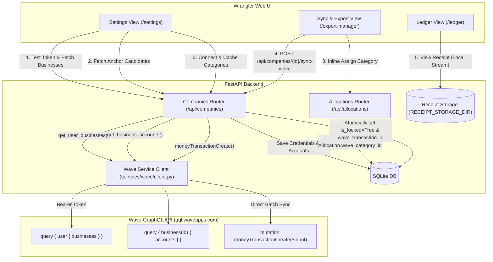

# Wave API Integration & Synchronization Specification

**Status:** Implemented

## 1. Goal & Architectural Overview

This specification defines the re-introduction of automated **Wave API Integration** in Wrangler for Wave Pro companies, coexisting alongside the existing **Manual CSV Export** workflow for Wave Free companies.

### 1.1 Guiding Principle & System Boundary
As defined in [AGENTS.md](file:///D:/src/personal/wrangler/AGENTS.md), **Wrangler is an Ingestion and Routing Layer, NOT a full double-entry accounting system.** Its primary responsibilities are:
1. **Deduplication:** Preventing duplicate intake across intake sources (Amazon CSVs, AI receipt parsers, MCP agents, manual entry).
2. **Receipt Matching & Storage:** Durable, collision-free local archiving and fast receipt viewing.
3. **Entity Attribution:** Routing financial transactions across Personal expenses and business entities (*Personal vs. Company A vs. Company B*).

**Entity Attribution Scope Rule:** Wrangler enforces that a parent transaction can have at most **one allocation per entity** (at most one personal split and at most one split per company). Wrangler does not manage granular accounting sub-categorization (e.g., splitting an expense across multiple internal expense categories for the same business). Granular categorization or multi-category splits belong strictly inside downstream accounting systems (such as Wave).

### 1.2 Core Capabilities
1. **Connection-Driven Mode:** Integration mode is determined dynamically per company. A company with active Wave credentials operates in **Wave API Sync** mode; an unlinked company operates in **CSV Export** mode.
2. **Token-Based Authentication:** Authenticates against Wave's public GraphQL API using long-lived **Full Access Bearer Tokens** generated via the Wave Developer Portal. Eliminates OAuth 2.0 redirect callbacks, browser cookie collisions across multiple Wave accounts, and background token refresh failures.
3. **Cached Chart of Accounts:** Synchronizes and caches active Expense categories and discovers Wave's system `UNCATEGORIZED_EXPENSE` account in a local SQLite table (`wave_categories`).
4. **Clean Intake Separation:** **Ledger**, **Manual Entry**, and **Staging** views remain 100% free of accounting category dropdowns. Category assignment occurs exclusively inside the **Sync & Export** view just prior to synchronization.
5. **Adaptive Sync & Export View:** Dynamically adapts based on the selected company:
   - For Wave-connected companies: Primary action is **"Sync to Wave"** with inline category assignment per row, immediate category persistence, selective row syncing, and an optional secondary **"Export CSV"** backup action.
   - For unlinked companies: Retains standard **"Export CSV"** and manual locking.
6. **Receipt Memo Annotation:** Receipts remain durably stored in Wrangler (`RECEIPT_STORAGE_DIR`). Financial sync pushes structured ledger data to Wave via `moneyTransactionCreate`, annotating the transaction description with a receipt memo reference.
7. **Idempotency & Re-sync Safeguards:** Tracks Wave transaction IDs on allocations. Because Wave's API does not support editing or deleting transactions, re-syncing previously pushed allocations is blocked with an `"Already in Wave"` warning badge, directing users to make adjustments in Wave manually.

---

## 2. Server Architecture & API Flow



---

## 3. Data Model Changes

### 3.1 Company Model (`api/src/models/company.py`)
Add Wave configuration fields to the `Company` ORM model:

- `wave_api_token: Mapped[str | None]` — Long-lived Full Access Bearer Token generated in Wave Developer Portal. Nullable.
- `wave_business_id: Mapped[str | None]` — Wave Business ID (GraphQL Node ID, e.g. `QnVzaW5lc3M6MTIzNDU=`). Nullable.
- `wave_business_name: Mapped[str | None]` — Friendly display name of the linked Wave business. Nullable.
- `wave_equity_account_id: Mapped[str | None]` — Wave Account ID used as the anchor/offset account for double-entry bookkeeping (e.g., Owner's Equity or Bank account). Nullable.

> [!NOTE]
> A company is considered **Wave-Connected** if and only if `wave_api_token`, `wave_business_id`, and `wave_equity_account_id` are all non-null.

### 3.2 WaveCategory Model (`api/src/models/wave_category.py`)
Re-introduce the `WaveCategory` ORM model to cache active accounts fetched from Wave:

- `id: Mapped[uuid.UUID]` — Primary Key (`default=uuid.uuid4`).
- `company_id: Mapped[uuid.UUID]` — Foreign Key to `companies.id` (`ondelete="CASCADE"`).
- `wave_account_id: Mapped[str]` — Wave GraphQL Account ID (e.g. `QWNjb3VudDoxMjM0NQ==`).
- `name: Mapped[str]` — Friendly account name (e.g., `"Office Supplies"`, `"Advertising & Promotion"`).
- `account_type: Mapped[str]` — Wave account type (e.g., `"EXPENSE"`).
- `account_subtype: Mapped[str | None]` — Wave account subtype (e.g., `"UNCATEGORIZED_EXPENSE"`).
- `is_uncategorized: Mapped[bool]` — Boolean flag (`default=False`), set to `True` for Wave's system `UNCATEGORIZED_EXPENSE` account.
- **Table Constraints:** Unique constraint on `(company_id, wave_account_id)`.

### 3.3 Allocation Model (`api/src/models/allocation.py`)
Add Wave tracking columns to the `Allocation` ORM model:

- `wave_category_id: Mapped[uuid.UUID | None]` — Foreign Key to `wave_categories.id` (`ondelete="SET NULL"`), nullable.
- `wave_transaction_id: Mapped[str | None]` — Transaction ID returned by Wave after successful creation (e.g. `QnVzaW5lc3M6Li4u`), nullable.
- **Relationship:** `wave_category = relationship("WaveCategory")`.

### 3.4 Entity Attribution Constraint (Enforce 1 Allocation per Entity)
To preserve the guiding principle that Wrangler is an entity attribution layer:
- In `PUT /api/transactions/{id}` and `PUT /api/transactions/{id}/allocations`:
  1. Enforce that at most **one** allocation has `is_personal == True`.
  2. Enforce that for all allocations with `is_personal == False`, every `company_id` is distinct (`len(company_ids) == len(set(company_ids))`).
  3. Attempting to add multiple splits for the same company or multiple personal splits returns `400 Bad Request` (`"A transaction can have at most one allocation per company/entity. Manage sub-categories directly in Wave."`).

### 3.5 Database Migration Plan (Alembic)
Create an Alembic migration using SQLite batch operations:
1. Add columns `wave_api_token`, `wave_business_id`, `wave_business_name`, and `wave_equity_account_id` to table `companies`.
2. Create table `wave_categories` with foreign key to `companies.id` (`ondelete="CASCADE"`) and unique constraint on `(company_id, wave_account_id)`.
3. Add columns `wave_category_id` (FK to `wave_categories.id`) and `wave_transaction_id` to table `allocations`.

---

## 4. Wave Service & API Integration Client (`api/src/services/wave/`)

Create a dedicated Wave service module `api/src/services/wave/client.py` using `httpx.AsyncClient` targeting Wave's GraphQL endpoint:
$$\text{Endpoint: } \text{https://gql.waveapps.com/graphql/public}$$

### 4.1 Header Authentication
Every request includes:
```http
Authorization: Bearer <wave_api_token>
Content-Type: application/json
```

### 4.2 Wave GraphQL Operations

#### 4.2.1 `get_user_businesses(token: str) -> list[WaveBusiness]`
Queries Wave for all businesses accessible by the token:
```graphql
query GetUserBusinesses {
  user {
    id
    defaultEmail
    businesses(page: 1, pageSize: 50) {
      edges {
        node {
          id
          name
          isPersonal
          isClassicAccounting
        }
      }
    }
  }
}
```

#### 4.2.2 `get_business_accounts(token: str, business_id: str) -> dict[str, list[WaveAccount]]`
Fetches the business Chart of Accounts, returning both anchor candidate accounts and expense categories:
```graphql
query GetBusinessAccounts($businessId: ID!) {
  business(id: $businessId) {
    id
    name
    accounts(page: 1, pageSize: 500) {
      edges {
        node {
          id
          name
          type {
            value
            name
          }
          subtype {
            value
            name
          }
          isArchived
        }
      }
    }
  }
}
```
**Account Filtering Rules:**
- Exclude `isArchived == True`.
- **Anchor Accounts:** Accounts where `type.value in ("ASSET", "LIABILITY", "EQUITY")` and `subtype.value in ("CASH_AND_BANK", "CREDIT_CARD", "MONEY_MARKET", "OWNERS_EQUITY")`.
- **Expense Categories:** Accounts where `type.value == "EXPENSE"`. Flag any account where `subtype.value == "UNCATEGORIZED_EXPENSE"` with `is_uncategorized = True`.

#### 4.2.3 `create_money_transaction(...) -> str`
Executes Wave's `moneyTransactionCreate` mutation:
```graphql
mutation CreateMoneyTransaction($input: MoneyTransactionCreateInput!) {
  moneyTransactionCreate(input: $input) {
    didSucceed
    inputErrors {
      path
      message
      code
    }
    transaction {
      id
    }
  }
}
```

**Parameters & Mapping Logic:**
- `externalId`: `f"wrangler_{allocation_id}"` (Provides strict idempotency in Wave).
- `date`: Parent transaction date ISO string (`YYYY-MM-DD`).
- `description`: Formatted as `"{tx.description} [Receipt: {sanitized_filename}]"` if an attached receipt exists, otherwise `"{tx.description}"`.
- **Amount & Refund Direction:**
  - For standard expenses (`amount > 0`):
    - `anchor`: `{ "accountId": equity_account_id, "amount": float(amount), "direction": "WITHDRAWAL" }`
    - `lineItems`: `[{ "accountId": category_account_id, "amount": float(amount), "balance": "INCREASE" }]`
  - For refunds / credits (`amount < 0`):
    - `anchor`: `{ "accountId": equity_account_id, "amount": float(abs(amount)), "direction": "DEPOSIT" }`
    - `lineItems`: `[{ "accountId": category_account_id, "amount": float(abs(amount)), "balance": "DECREASE" }]`

---

## 5. Backend REST API Endpoints

### 5.1 Company Wave Configuration Endpoints (`api/src/routers/companies.py`)

#### `POST /api/companies/wave/test-token`
- **Request Body:** `{ "token": "string" }`
- **Description:** Verifies the Full Access Token against Wave and returns the list of accessible businesses (`id`, `name`, `is_personal`).
- **Errors:** Returns `401 Unauthorized` if Wave rejects the token, or `502 Bad Gateway` if Wave is unreachable.

#### `POST /api/companies/wave/business-accounts`
- **Request Body:**
  ```json
  {
    "token": "string",
    "business_id": "string"
  }
  ```
- **Description:** Queries Wave for the business's Chart of Accounts using the provided token and returns eligible candidate anchor accounts (Cash/Bank, Credit Card, Owner's Equity) and active expense categories prior to saving the connection.
- **Response (`200 OK`):**
  ```json
  {
    "anchor_accounts": [
      {
        "id": "QWNjb3VudDoxMjM0NQ==",
        "name": "Owner's Equity",
        "type": "EQUITY",
        "subtype": "OWNERS_EQUITY"
      }
    ],
    "expense_categories": [
      {
        "id": "QWNjb3VudDoxMjM0Ng==",
        "name": "Office Supplies",
        "type": "EXPENSE",
        "subtype": null,
        "is_uncategorized": false
      }
    ]
  }
  ```
- **Errors:** Returns `401 Unauthorized` if Wave rejects the token, or `502 Bad Gateway` if Wave is unreachable.

#### `POST /api/companies/{id}/wave/connect`
- **Request Body:**
  ```json
  {
    "token": "string",
    "business_id": "string",
    "business_name": "string",
    "equity_account_id": "string"
  }
  ```
- **Action:**
  1. Saves credentials to the `Company` record.
  2. Queries Wave's Chart of Accounts for `business_id`.
  3. Upserts all active expense accounts into `wave_categories` for this `company_id`.
  4. Returns updated `CompanyResponse`.

#### `POST /api/companies/{id}/wave/sync-categories`
- **Action:** Refreshes cached accounts from Wave for the company, upserting new accounts and removing deleted ones.
- **Response:** Returns updated list of `WaveCategoryResponse` items.

#### `GET /api/companies/{id}/wave/categories`
- **Response:** Returns list of cached categories for this company, ordered with `is_uncategorized` first, then alphabetically by name.

#### `DELETE /api/companies/{id}/wave`
- **Action:** Clears `wave_api_token`, `wave_business_id`, `wave_business_name`, and `wave_equity_account_id` on the company. Deletes associated `wave_categories`. Reverts company immediately to CSV export mode.

### 5.2 Wave Transaction Synchronization Endpoint

#### `POST /api/companies/{id}/sync-wave`
- **Request Body (Optional):**
  ```json
  {
    "allocation_ids": ["uuid-1", "uuid-2"]
  }
  ```
- **Pre-Flight Validation:**
  - Verify company is Wave-connected (`400 Bad Request` if unlinked).
  - Query target allocations: must belong to `company_id`, `is_personal == False`, and `is_locked == False`.
  - Validate that every allocation to be synced has a valid `wave_category_id` (or fallback to company's `UNCATEGORIZED_EXPENSE` category if configured).
  - Any allocation where `wave_transaction_id is not None` is rejected (`"Allocation {id} was already synced to Wave"`).
- **Execution & Atomic Per-Transaction Commits:**
  Iterate through matching allocations. For each allocation:
  1. Call Wave's `moneyTransactionCreate`.
  2. If Wave succeeds:
     - Update allocation: `is_locked = True`, `wave_transaction_id = result.transaction.id`.
     - Commit changes for this allocation immediately to SQLite.
     - Increment `synced_count`.
  3. If Wave fails:
     - Log failure message.
     - Append to error summary list: `{ "allocation_id": id, "description": desc, "error": error_message }`.
     - Increment `failed_count`.
- **Response (`200 OK`):**
  ```json
  {
    "total_processed": 10,
    "synced_count": 9,
    "failed_count": 1,
    "errors": [
      {
        "allocation_id": "3fa85f64-5717-4562-b3fc-2c963f66afa6",
        "description": "Staples - Paper",
        "error": "Account not found or inactive"
      }
    ]
  }
  ```

### 5.3 Inline Category Assignment Endpoint (`api/src/routers/allocations.py`)

#### `PATCH /api/allocations/{id}/category`
- **Request Body:** `{ "wave_category_id": "uuid | null" }`
- **Action:** Updates `wave_category_id` on the allocation.
- **Validation:**
  - Allocation must not be locked (`is_locked == False`). Returns `400 Bad Request` if locked.
  - If `wave_category_id` is provided, verify it exists and belongs to the allocation's `company_id`.
- **Response:** Updated `AllocationResponse`.

---

## 6. Frontend UI Requirements (Vue 3 + Quasar)

### 6.1 Clean Intake Views (Zero Category Clutter)
To preserve simplicity and separation of concerns:
- **Ledger View (`LedgerView.vue`):** Displays transactions and splits without category dropdowns. Unlocked Wave allocations display their lock state and an optional inline "Sync to Wave" button.
- **Manual Entry View (`ManualEntryView.vue`):** Completely free of category dropdowns. User chooses Date, Description, Amount, Company, and optional receipt.
- **Staging Area (`ImportView.vue` & Staging Dialogs):** Allocations are assigned to companies only; no category dropdowns.

### 6.2 Company Management & Wave Setup (`SettingsView.vue` & `CompanyFormDialog.vue`)

In the Company Form Dialog:
1. **Wave Integration Card / Section:**
   - Display connection status badge: **Connected to Wave** (green) or **CSV Export Only** (grey).
   - **Full Access Token Input:** Password-masked input field with a **"Test & Fetch Businesses"** button (invokes `POST /api/companies/wave/test-token`).
   - When verified:
     - **Wave Business Dropdown:** Selectable list of businesses tied to the token. Selecting a business automatically triggers `POST /api/companies/wave/business-accounts` to retrieve anchor candidate accounts.
     - **Anchor Account Dropdown:** Selectable list of eligible Bank/Equity accounts populated from the business-accounts response.
     - **"Connect Wave" Button:** Saves the token, business ID, business name, and selected anchor account via `POST /api/companies/{id}/wave/connect`.
     - **"Sync Categories" Button:** Displays total cached categories and triggers `POST /api/companies/{id}/wave/sync-categories`.
     - **"Disconnect Wave" Button:** Red/negative button with confirmation dialog to unlink Wave and revert to CSV export mode.

### 6.3 Adaptive Sync & Export View (`ExportManagerView.vue`)

The `/export-manager` view adapts based on the active company selected in the filter bar:

#### 6.3.1 Action Bar
- **For Non-Wave Companies:** Retains existing **"Export CSV"** button (downloads CSV and auto-locks).
- **For Wave-Connected Companies:**
  - **Primary Button:** **"Sync to Wave"** (with icon `cloud_upload`).
    - Tooltip: *"Push selected categorized transactions directly to Wave"*.
    - Disabled when no rows are selected or when selected rows lack categories.
  - **Secondary Action (Split Button / Dropdown):** **"Export CSV"** backup button.
  - **"Sync Categories" Quick Action:** Small button next to company selector to refresh categories from Wave without opening Settings.

#### 6.3.2 Allocations Table (Wave Mode)
When a Wave company is selected, the preview table introduces:
1. **Row Checkboxes:** Multi-select column with "Select All" toggle in header.
2. **Category Column:**
   - Displays an inline `QSelect` dropdown on every row.
   - Dropdown is populated with that company's cached Wave categories, highlighting Wave's `"Uncategorized Expense"` option.
   - Changing the selection immediately triggers `PATCH /api/allocations/{id}/category` with a subtle saved indicator.
   - If unselected, displays a warning chip: `"Category Required"`.
3. **Lock / Sync Status Column:**
   - If `allocation.is_locked == False` and `wave_transaction_id is None`: Displays `Unlocked` badge.
   - If `allocation.is_locked == True` and `wave_transaction_id is not None`: Displays `Synced to Wave` (green chip with checkmark).
   - If `allocation.is_locked == False` and `wave_transaction_id is not None`: Displays `Already in Wave` (warning chip) with tooltip: *"Previously pushed to Wave. Wave does not allow updates via API; adjust in Wave directly."* (Row checkbox disabled).
4. **Receipt Column:** Standard receipt viewer button (opens stored receipt in new tab).

#### 6.3.3 Sync Execution & Feedback
Clicking **"Sync to Wave"**:
1. Prompts confirmation dialog: *"Push {count} transactions totaling {total} to Wave?"*.
2. Displays a progress spinner dialog during sync (`POST /api/companies/{id}/sync-wave`).
3. Upon completion, presents a summary dialog:
   - Green banner: *"{synced_count} transactions successfully synced to Wave."*
   - If any errors occurred: List of failed transactions with Wave error messages and direct links to inspect them.
4. Refreshes the allocations table and company statistics.

---

## 7. Error Handling, Idempotency & Edge Cases

### 7.1 Idempotency Key (`externalId`)
Every Wave transaction payload passes `externalId = f"wrangler_{allocation.id}"`. If an interrupted HTTP connection causes a retry, Wave's API uses this key to prevent duplicate records.

### 7.2 Zero Update / Delete in Wave API
Wave's public API contains no mutations to update or delete money transactions:
- If a synced transaction is unlocked in Wrangler, `wave_transaction_id` remains stored on the allocation.
- The UI blocks re-syncing to prevent duplicate creation.
- The unlock warning confirmation explicitly notifies the user:
  > *"If this transaction has already been synced to Wave, you must also adjust or delete it directly inside Wave's web interface."*

### 7.3 Multi-Account Isolation
Because authentication uses Full Access Tokens stored directly on each `Company` row:
- Company A can use Token A (from Wave Account A).
- Company B can use Token B (from Wave Account B).
- Requests execute completely independently with zero shared session state.

### 7.4 Network Failures & Partial Syncs
Batch sync processes allocations sequentially with atomic database commits per transaction:
- If transactions 1–5 succeed and transaction 6 encounters a Wave network error, transactions 1–5 remain locked and recorded in SQLite.
- Transaction 6 remains unlocked and can be retried immediately once connectivity resumes.

---

## 8. Backwards Compatibility & Verification

1. **Existing CSV Workflow:** Companies without Wave credentials remain 100% functional on the existing CSV export workflow.
2. **Existing Data Safety:** All existing allocations retain their current `is_locked` values. The new columns (`wave_category_id`, `wave_transaction_id`) default to `None`.
3. **Immutability Rules:** Existing lock rules protecting locked transactions from accidental edits or deletes remain active and unchanged.
