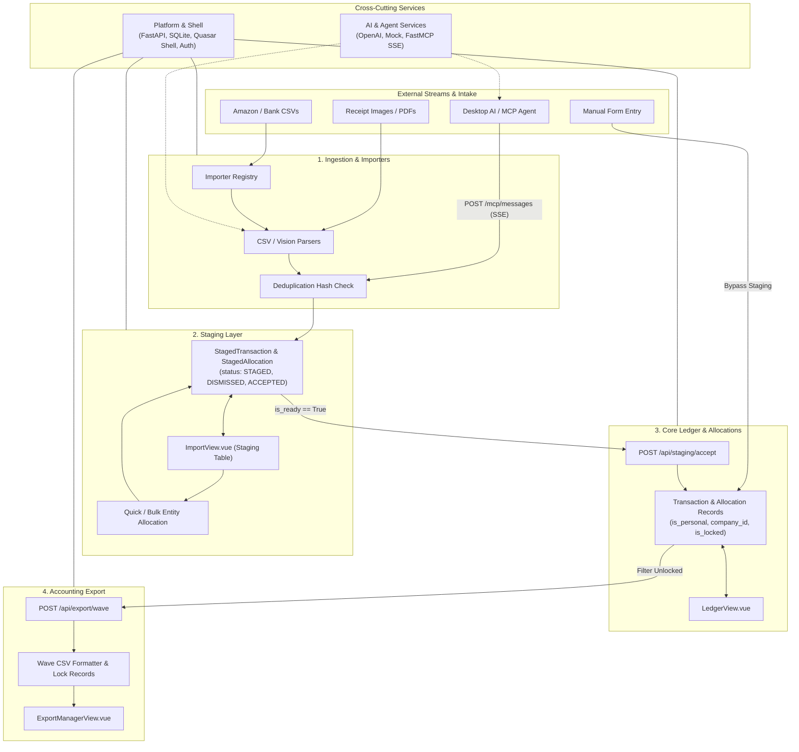

# Wrangler Architecture & Subsystems Guide

This document defines Wrangler's end-to-end data pipeline, subsystem boundaries, codebase mappings, and non-negotiable architectural invariants. It is the authoritative architectural reference for developers and specification authors.

---

## 1. System Philosophy & Scope

**Wrangler is an Ingestion and Routing Layer, not a full double-entry general ledger.**

Its core responsibilities are:
1. **Deduplication:** Preventing duplicate intake across diverse external streams (Amazon CSVs, AI receipt parsers, MCP agents, bank exports).
2. **Receipt Storage & Correlation:** Durable, collision-free local archiving and on-demand receipt viewing.
3. **Entity Attribution:** Routing financial transactions across Personal expenses and distinct business entities (e.g., *Personal vs. Company A vs. Company B*).

> [!IMPORTANT]
> **Scope Boundary:** A parent transaction can have at most **one** allocation per entity (at most one personal split and at most one split per company). Wrangler does not manage granular sub-categorization (e.g., internal expense chart-of-accounts splitting for the same company). That responsibility belongs strictly to downstream accounting tools (such as Wave).

---

## 2. End-to-End Data Lifecycle

Data moves through Wrangler in a unidirectional lifecycle:

---

## 3. Subsystem Profiles

### 1. Ingestion & Importers
- **Purpose:** Intake, parse, and normalize diverse transaction sources into standardized staging payloads while rejecting duplicates.
- **Key Entities / Models:** Raw upload payloads, file hashes, `(source, external_id)` tuples.
- **Codebase Touchpoints:**
  - Routers: [`api/src/routers/importers.py`](file:///D:/src/personal/wrangler/api/src/routers/importers.py), [`api/src/routers/receipts.py`](file:///D:/src/personal/wrangler/api/src/routers/receipts.py)
  - Services: [`api/src/services/importers/`](file:///D:/src/personal/wrangler/api/src/services/importers/), [`api/src/services/intake.py`](file:///D:/src/personal/wrangler/api/src/services/intake.py)
  - Importers: `BaseImporter`, `AmazonCSVImporter`, `WranglerCSVImporter`, `ReceiptParserImporter`
  - Frontend: [`web/src/views/ImportView.vue`](file:///D:/src/personal/wrangler/web/src/views/ImportView.vue)
- **Hand-off Contract:** Importers **never** insert directly into the permanent `transactions` table. All imported data must be staged as `StagedTransaction` records with status `STAGED`.

---

### 2. Staging Layer
- **Purpose:** Buffer uncommitted transactions, allow interactive user review, quick entity assignment, bulk allocations, and dismissal.
- **Key Entities / Models:**
  - `StagedTransaction`: `id`, `source`, `external_id`, `date`, `description`, `total_amount`, `receipt_file_path`, `external_url`, `status` (`STAGED`, `ACCEPTED`, `DISMISSED`).
  - `StagedAllocation`: `id`, `staged_transaction_id`, `amount`, `is_personal`, `company_id`.
- **Codebase Touchpoints:**
  - Routers: [`api/src/routers/staging.py`](file:///D:/src/personal/wrangler/api/src/routers/staging.py)
  - Models: [`api/src/models/staged_transaction.py`](file:///D:/src/personal/wrangler/api/src/models/staged_transaction.py), [`api/src/models/staged_allocation.py`](file:///D:/src/personal/wrangler/api/src/models/staged_allocation.py)
  - Frontend: [`web/src/stores/staging.ts`](file:///D:/src/personal/wrangler/web/src/stores/staging.ts), [`web/src/views/ImportView.vue`](file:///D:/src/personal/wrangler/web/src/views/ImportView.vue)
- **Hand-off Contract:**
  - Readiness (`is_ready`) is dynamically computed: all required fields present AND allocations sum exactly to `total_amount`.
  - Accepting a staged transaction (`POST /api/staging/accept`) atomically converts it into a permanent `Transaction` + `Allocation` records, marks the staged record as `ACCEPTED`, and triggers the importer's `mark_imported()` callback.

---

### 3. Core Ledger & Allocations
- **Purpose:** Permanent historical transaction registry, entity assignment balance tracking, and transaction locking.
- **Key Entities / Models:**
  - `Transaction`: `id`, `source`, `external_id`, `date`, `description`, `total_amount`, `receipt_file_path`.
  - `Allocation`: `id`, `transaction_id`, `amount`, `is_personal`, `company_id`, `is_locked`.
  - `Company`: `id`, `name`, `currency`.
- **Codebase Touchpoints:**
  - Routers: [`api/src/routers/transactions.py`](file:///D:/src/personal/wrangler/api/src/routers/transactions.py), [`api/src/routers/allocations.py`](file:///D:/src/personal/wrangler/api/src/routers/allocations.py), [`api/src/routers/companies.py`](file:///D:/src/personal/wrangler/api/src/routers/companies.py)
  - Models: [`api/src/models/transaction.py`](file:///D:/src/personal/wrangler/api/src/models/transaction.py), [`api/src/models/allocation.py`](file:///D:/src/personal/wrangler/api/src/models/allocation.py), [`api/src/models/company.py`](file:///D:/src/personal/wrangler/api/src/models/company.py)
  - Frontend: [`web/src/stores/transactions.ts`](file:///D:/src/personal/wrangler/web/src/stores/transactions.ts), [`web/src/views/LedgerView.vue`](file:///D:/src/personal/wrangler/web/src/views/LedgerView.vue), [`web/src/views/ManualEntryView.vue`](file:///D:/src/personal/wrangler/web/src/views/ManualEntryView.vue)
- **Hand-off Contract:** Once an allocation is locked (`is_locked = True`), it is immutable and cannot be updated, deleted, or re-exported without being explicitly unlocked.

---

### 4. Accounting Export
- **Purpose:** Formats approved business transactions into downstream accounting formats (Wave CSV export: `Date`, `Description`, `Amount`), tracks export batches, and coordinates receipt file bundles.
- **Key Entities / Models:** Export batch history, lock status updates.
- **Codebase Touchpoints:**
  - Routers: [`api/src/routers/export.py`](file:///D:/src/personal/wrangler/api/src/routers/export.py) (or Wave export services)
  - Services: [`api/src/services/wave/`](file:///D:/src/personal/wrangler/api/src/services/wave/), [`api/src/services/export.py`](file:///D:/src/personal/wrangler/api/src/services/export.py)
  - Frontend: [`web/src/views/ExportManagerView.vue`](file:///D:/src/personal/wrangler/web/src/views/ExportManagerView.vue)
- **Hand-off Contract:** Only allocations with `is_personal == False` and `is_locked == False` can be exported. Upon successful CSV export, affected allocations transition immediately to `is_locked = True`.

---

### 5. AI & Agent Services
- **Purpose:** Pluggable machine learning providers for vision receipt parsing, structured information extraction, and external agent ingestion via Model Context Protocol (MCP).
- **Key Entities / Models:** `BaseReceiptParserProvider`, FastMCP tool definitions (`stage_transaction`), structured JSON schemas.
- **Codebase Touchpoints:**
  - Providers: [`api/src/services/ai/`](file:///D:/src/personal/wrangler/api/src/services/ai/) (`OpenAIReceiptParser`, `MockReceiptParser`)
  - MCP: [`api/src/services/mcp.py`](file:///D:/src/personal/wrangler/api/src/services/mcp.py) (`/mcp/sse`)
  - Config: `OPENAI_API_KEY`, `OPENAI_MODEL`, `MCP_API_KEY` in [`api/src/core/config.py`](file:///D:/src/personal/wrangler/api/src/core/config.py)
- **Hand-off Contract:** External agents interact with Wrangler via the MCP server on `/mcp/sse`. MCP tools stage uncommitted items with `source = "mcp"`; they do not write unverified items to the core ledger.

---

### 6. Platform & Shell
- **Purpose:** Foundational cross-cutting infrastructure, web application shell, authentication middleware, database engine, backup services, and production deployment.
- **Key Entities / Models:** Admin credentials, JWT session token, SQLite connection pool, app layout state.
- **Codebase Touchpoints:**
  - Core: [`api/src/core/config.py`](file:///D:/src/personal/wrangler/api/src/core/config.py), [`api/src/core/security.py`](file:///D:/src/personal/wrangler/api/src/core/security.py), [`api/src/database.py`](file:///D:/src/personal/wrangler/api/src/database.py)
  - Auth: [`api/src/routers/auth.py`](file:///D:/src/personal/wrangler/api/src/routers/auth.py), [`web/src/stores/auth.ts`](file:///D:/src/personal/wrangler/web/src/stores/auth.ts)
  - Shell UI: [`web/src/layouts/MainLayout.vue`](file:///D:/src/personal/wrangler/web/src/layouts/MainLayout.vue), [`web/src/stores/app.ts`](file:///D:/src/personal/wrangler/web/src/stores/app.ts)

---

## 4. Subsystem Decision Matrix

When authoring a specification, use this decision matrix to determine which subsystem(s) are impacted:

| If your feature involves... | Primary Subsystems | Authoritative Specs to Review |
| :--- | :--- | :--- |
| Parsing an external format, new CSV type, PDF/image scraping, deduplication hashing | **Ingestion & Importers** | [`#2`](file:///D:/src/personal/wrangler/specs/2-importer-framework/spec.md), [`#3`](file:///D:/src/personal/wrangler/specs/3-amazon-csv-importer/spec.md), [`#5`](file:///D:/src/personal/wrangler/specs/5-staged-url-and-amazon-enhancements/spec.md), [`#8`](file:///D:/src/personal/wrangler/specs/8-ai-receipts-integration/spec.md) |
| Pre-acceptance review, staging table UI, quick-assigning entities, bulk actions | **Staging Layer** | [`#2`](file:///D:/src/personal/wrangler/specs/2-importer-framework/spec.md), [`#4`](file:///D:/src/personal/wrangler/specs/4-ai-agent-integration-mcp/spec.md), [`#11`](file:///D:/src/personal/wrangler/specs/11-bulk-staged-allocations/spec.md) |
| Split allocation math, ledger table filters, company entities, locking | **Core Ledger & Allocations** | [`#1`](file:///D:/src/personal/wrangler/specs/1-initial-implementation/spec.md), [`#6`](file:///D:/src/personal/wrangler/specs/6-remove-multi-currency/spec.md), [`#9`](file:///D:/src/personal/wrangler/specs/9-wave-integration/spec.md), [`#11`](file:///D:/src/personal/wrangler/specs/11-bulk-staged-allocations/spec.md) |
| CSV export formats, export batch history, external accounting sync | **Accounting Export** | [`#9`](file:///D:/src/personal/wrangler/specs/9-wave-integration/spec.md) (+ amendment 1) |
| LLM prompts, vision receipt scanning, MCP server tools, streaming assistants | **AI & Agent Services** | [`#4`](file:///D:/src/personal/wrangler/specs/4-ai-agent-integration-mcp/spec.md), [`#8`](file:///D:/src/personal/wrangler/specs/8-ai-receipts-integration/spec.md) |
| Quasar layout/drawer, authentication/JWT, SQLite pooling, backups, Docker/LAN | **Platform & Shell** | [`#1`](file:///D:/src/personal/wrangler/specs/1-initial-implementation/spec.md), [`#7`](file:///D:/src/personal/wrangler/specs/7-collapsible-sidebar/spec.md), [`#10`](file:///D:/src/personal/wrangler/specs/10-production-deployment/spec.md) |

---

## 5. Architectural Invariants (Non-Negotiables)

1. **Entity Allocation Invariant:** A parent transaction can have at most **one** personal split and at most **one** split per company. Sub-allocations to internal categories do not belong in Wrangler.
2. **Staging Isolation:** Unapproved external imports must **never** be written directly to `transactions`. They must be staged in `staged_transactions` and accepted via the staging lifecycle.
3. **Immutability of Locked Allocations:** Exported allocations (`is_locked = True`) cannot be modified or deleted without explicit user unlocking.
4. **Deterministic Deduplication:** Ingestion streams must prevent duplicates using the unique `(source, external_id)` constraint or deterministic SHA-256 file hashing.
5. **Single Base Currency:** All monetary amounts are recorded in single base currency (CAD). No runtime foreign exchange conversion or multi-currency columns exist.
