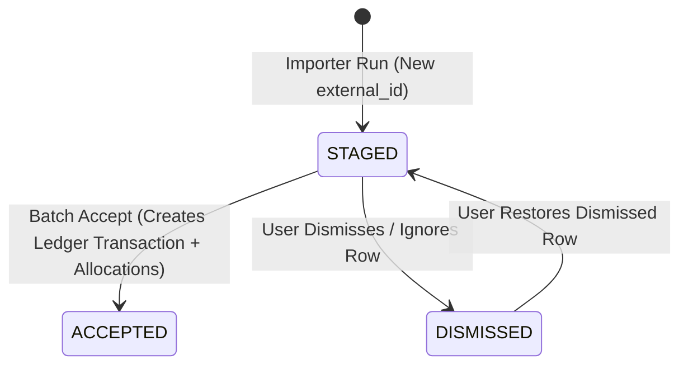

# Transaction Importer Framework & Staging Specification

## 1. Goal & Overview
This specification defines the **Transaction Importer Framework** and **Staging Workflow** for Wrangler.

Importing transactions is a two-phase batch workflow:
1. **Intake & Staging:** An **Importer** adapter pulls raw transaction data from a specific source (either taking a single uploaded file as input or taking no inputs and fetching directly from an external integration), normalizes the records (including optional receipt attachments returned by the source), deduplicates against previously imported records, and persists new items into the **Staging Area**.
2. **Staging Review & Batch Ledger Acceptance:** In the top-level **Import & Staging View**, the user reviews staged transactions, attaches or replaces receipts, assigns Personal or Business allocations (including multi-company splits), dismisses unwanted records, and accepts ready transactions in batch into the main **Ledger** ([`Transaction`](file:///D:/src/personal/wrangler/api/src/models/transaction.py#L13-L30) and [`Allocation`](file:///D:/src/personal/wrangler/api/src/models/allocation.py#L17-L29)). Upon acceptance, the framework automatically invokes the source importer's `mark_as_imported` hook (a no-op for importers that do not support marking in the source system).

This specification also defines:
- The reusable **`BaseCsvImporter`** foundation for all CSV-based importers.

---

## 2. Data Model Changes

To persist staged transactions, prevent duplicate imports across runs (even when a user dismisses an unwanted transaction), and avoid polluting existing Ledger queries and Wave CSV exports with unallocated draft items, two new SQLite tables are introduced via Alembic migration.

### 2.1 `StagedTransaction` (`staged_transactions`)
Represents an imported transaction persisted in the staging area or historical import log.

- `id`: `UUID` (Primary Key, `default=uuid.uuid4`)
- `source`: `String` (`nullable=False`, indexed; matches the importer's `source_name`, e.g., `"wrangler_csv"`, `"amazon_csv"`, `"google_groups"`)
- `external_id`: `String | None` (`nullable=True`, unique identifier from the source system)
- `date`: `Date` (`nullable=False`)
- `description`: `String` (`nullable=False`)
- `total_amount`: `Numeric(12, 2)` (`nullable=False`, strictly non-zero; negative values denote refunds/credits)
- `currency_code`: `String` (`nullable=False`, `default="USD"`)
- `receipt_file_path`: `String | None` (`nullable=True`, relative filename within `RECEIPT_STORAGE_DIR`)
- `status`: `String` (`nullable=False`, `default="STAGED"`, indexed; allowed values: `"STAGED"`, `"ACCEPTED"`, `"DISMISSED"`)
- `is_marked_imported`: `Boolean` (`nullable=False`, `default=False`; tracks whether `mark_as_imported` has been executed for this record)
- `ledger_transaction_id`: `UUID | None` (`ForeignKey("transactions.id", ondelete="SET NULL")`, `nullable=True`; populated when `status == "ACCEPTED"`)
- `created_at`: `DateTime` (`nullable=False`, `default=lambda: datetime.datetime.now(datetime.UTC)`)
- **Table Constraints:**
  - `UniqueConstraint("source", "external_id", name="uq_staged_transactions_source_external_id")`
- **Relationships:**
  - `allocations`: `Mapped[list[StagedAllocation]]` (`cascade="all, delete-orphan"`, `back_populates="staged_transaction"`)

### 2.2 `StagedAllocation` (`staged_allocations`)
Stores draft allocations configured by the user while a transaction is in the `"STAGED"` state. Unlike Ledger [`Transaction`](file:///D:/src/personal/wrangler/api/src/models/transaction.py#L13-L30) records, a newly imported `StagedTransaction` starts with zero `StagedAllocation` rows until the user assigns a company, splits the transaction, or marks it as personal in the Staging UI.

- `id`: `UUID` (Primary Key, `default=uuid.uuid4`)
- `staged_transaction_id`: `UUID` (`ForeignKey("staged_transactions.id", ondelete="CASCADE")`, `nullable=False`)
- `amount`: `Numeric(12, 2)` (`nullable=False`)
- `is_personal`: `Boolean` (`nullable=False`, `default=False`)
- `company_id`: `UUID | None` (`ForeignKey("companies.id", ondelete="RESTRICT")`, `nullable=True`)
- **Relationships:**
  - `staged_transaction`: `Mapped[StagedTransaction]` (`back_populates="allocations"`)
  - `company`: `Mapped[Company | None]`
- **Company Deletion Rule:** Deleting a `Company` (`DELETE /api/companies/{company_id}`) **MUST** be blocked (`400 Bad Request`) if the company is referenced by any existing `StagedAllocation` (in addition to existing Ledger `Allocation` records).

### 2.3 Deduplication & Lifecycle State Rules


1. **Deduplication on Import:**
   - When an importer parses raw records, any record with a non-null `external_id` is checked against:
     1. Earlier records in the **same import batch** (intra-batch deduplication).
     2. Existing records in `staged_transactions` matching `(source, external_id)` (regardless of whether `status` is `STAGED`, `ACCEPTED`, or `DISMISSED`).
     3. Existing records in `transactions` matching `(source, external_id)`.
   - If a match exists in any of the above, the record is **not** inserted again and is incremented in `skipped_duplicates`.
2. **Dismissing & Restoring vs. Deleting:**
   - When a user dismisses/ignores a staged row in the UI, `status` is set to `"DISMISSED"` (the row remains in `staged_transactions` as a lightweight tombstone so future imports from that source do not re-import the same `external_id`). If the dismissed row had an unaccepted receipt file on disk, the receipt file is deleted via [`delete_receipt_file`](file:///D:/src/personal/wrangler/api/src/services/receipts.py#L53-L61) and `receipt_file_path` is set to `None`.
   - A user can restore a `"DISMISSED"` row back to `"STAGED"` (`POST /api/staging/{staged_id}/restore`) so it can be allocated and accepted into the Ledger (noting that any receipt deleted on dismissal must be re-attached if needed, and `is_marked_imported` remains unchanged if the external source was already marked).
3. **Readiness for Acceptance:**
   - A `StagedTransaction` with `status == "STAGED"` is considered **Ready** (`is_ready == True`) when:
     - `len(allocations) >= 1`
     - `sum(a.amount for a in allocations) == total_amount`
     - If `len(allocations) > 1`, all allocations have `is_personal == False` and a non-null `company_id`.
     - If `len(allocations) == 1`, either `is_personal == True` (`company_id is None`) or `is_personal == False` (`company_id is not None`).

---

## 3. Backend Importer Framework Architecture (`api/src/services/importers/`)

### 3.1 Core Data Structures & Base Classes (`api/src/services/importers/base.py`)

```python
from abc import ABC, abstractmethod
from datetime import date
from decimal import Decimal
from enum import StrEnum
from pydantic import BaseModel, ConfigDict, field_validator


class ImporterInputType(StrEnum):
    FILE = "file"
    NONE = "none"


class ImporterReceiptData(BaseModel):
    """Optional receipt file payload extracted directly by an importer."""

    filename: str
    content: bytes
    content_type: str = "application/pdf"


class ImportedTransactionData(BaseModel):
    """Normalized transaction item produced by an importer implementation."""

    external_id: str | None = None
    date: date
    description: str
    total_amount: Decimal
    currency_code: str = "USD"
    receipt: ImporterReceiptData | None = None

    model_config = ConfigDict(from_attributes=True)

    @field_validator("description")
    @classmethod
    def validate_description(cls, v: str) -> str:
        cleaned = v.strip()
        if not cleaned:
            raise ValueError("description must not be empty")
        return cleaned

    @field_validator("total_amount")
    @classmethod
    def validate_total_amount(cls, v: Decimal) -> Decimal:
        if v == Decimal("0"):
            raise ValueError("total_amount must be strictly non-zero")
        return v
```

#### `BaseImporter` Abstract Base Class
Every source-specific importer subclasses `BaseImporter`:

- `importer_id: str` (Abstract property; unique URL-safe identifier, e.g., `"wrangler_csv"`, `"google_groups"`, `"amazon_csv"`).
- `source_name: str` (Property; defaults to `self.importer_id`, stored in `StagedTransaction.source` and `Transaction.source`).
- `display_name: str` (Abstract property; human-readable name shown in the UI, e.g., `"Amazon Transactions CSV"`).
- `description: str` (Abstract property; brief UI help text explaining what this importer reads).
- `input_type: ImporterInputType` (Abstract property; `ImporterInputType.FILE` or `ImporterInputType.NONE`).
- `accepted_file_Types: list[str]` (Property; defaults to `[]` when `input_type == NONE`, or e.g. `[".csv"]` / `[".pdf"]` when `input_type == FILE`).
- `supports_mark_imported: bool` (Property; defaults to `False`. Overridden to `True` by importers that mark records in the external source system).
- `async def fetch_and_parse(self, file_bytes: bytes | None = None, filename: str | None = None) -> list[ImportedTransactionData]` (Abstract method; validates input requirement and returns normalized transaction items).
- `async def mark_as_imported(self, external_ids: list[str]) -> None` (Concrete method; **defaults to a no-op** `return None`. Subclasses with `supports_mark_imported = True` override this to update the external integration).

### 3.2 Common CSV Importer Base Class (`api/src/services/importers/csv_base.py`)

To ensure all current and future CSV importers share file reading, encoding/BOM handling, header validation, and field parsing without becoming a generic user-mapped CSV tool, `BaseCsvImporter(BaseImporter)` provides:

- Fixed properties:
  - `input_type = ImporterInputType.FILE`
  - `accepted_file_types = [".csv"]`
- Class/abstract attributes for subclasses:
  - `REQUIRED_COLUMNS: tuple[str, ...]` — Exact column headers required in the CSV file.
  - `SKIP_ZERO_AMOUNT_ROWS: bool = True` — Automatically skips rows whose parsed amount is `0.00`.
- Shared execution pipeline in `fetch_and_parse(self, file_bytes: bytes | None = None, filename: str | None = None)`:
  1. Verifies `file_bytes` is non-empty (raises `ImporterValidationError("CSV file is required and must not be empty")` -> `400 Bad Request`).
  2. Decodes `file_bytes` using `"utf-8-sig"` (gracefully stripping UTF-8 BOM if present, with fallback to `"latin-1"` if needed).
  3. Initializes `csv.DictReader(io.StringIO(decoded_text))`.
  4. Normalizes header names (`header.strip()`) and verifies all `REQUIRED_COLUMNS` are present. If any are missing, raises `ImporterValidationError(f"Missing required CSV columns: {', '.join(missing)}")`.
  5. Iterates through each data row (1-indexed starting at row 2 for error reporting) and calls `self.parse_row(row_dict, row_number) -> ImportedTransactionData | None`:
     - If `parse_row` returns `None`, the row is intentionally skipped (e.g., cancelled order or header repeat).
     - If `parse_row` raises `ValueError` or `ValidationError`, raises `ImporterValidationError(f"Row {row_number}: {err}")`.
- Shared static utility helpers on `BaseCsvImporter`:
  - `parse_amount(raw: str) -> Decimal`: Strips currency symbols (`$`, `CAD`, `USD`), commas, whitespace, and converts parenthetical negatives like `(12.34)` to `-12.34`.
  - `parse_iso_or_common_date(raw: str) -> date`: Parses `YYYY-MM-DD`, `MM/DD/YYYY`, `YYYY/MM/DD`, or ISO timestamps (`YYYY-MM-DDTHH:MM:SS...`).

### 3.3 Importer Registry (`api/src/services/importers/registry.py`)
A central registry mapping `importer_id -> BaseImporter` instance so routers can discover all registered importers and look up a specific importer by `importer_id` or `source_name`.

---

## 4. Backend API Endpoints (`api/src/routers/importers.py` & `api/src/routers/staging.py`)

All endpoints require authentication via the existing `AuthenticationMiddleware`.

### 4.1 Importer Discovery & Execution
- **`GET /api/importers`**
  - Returns the list of registered importers and their metadata:
    ```json
    [
      {
        "importer_id": "wrangler_csv",
        "source_name": "wrangler_csv",
        "display_name": "Wrangler Standard Transactions CSV",
        "description": "Imports transactions from a standard Wrangler CSV file (External ID, Date, Description, Amount, Currency).",
        "input_type": "file",
        "accepted_file_types": [".csv"],
        "supports_mark_imported": false
      }
    ]
    ```
- **`POST /api/importers/{importer_id}/run`**
  - **Payload:**
    - If `importer.input_type == "file"`: Accepts `multipart/form-data` with a required `file: UploadFile` field. Returns `400 Bad Request` if no file is provided.
    - If `importer.input_type == "none"`: Accepts an empty body or `{}` (no file required).
  - **Execution Flow:**
    1. Calls `await importer.fetch_and_parse(file_bytes, filename)`.
    2. Checks each `ImportedTransactionData` item for duplicates (intra-batch + `StagedTransaction` + `Transaction` on `(importer.source_name, item.external_id)`).
    3. For each new item:
       - Generates `staged_id = uuid.uuid4()`.
       - If `item.receipt` is present, writes the receipt bytes to `settings.RECEIPT_STORAGE_DIR` as `{staged_id}_{sanitize_filename(item.receipt.filename)}` and sets `receipt_file_path`.
       - Inserts a `StagedTransaction(status="STAGED", ...)` record.
    4. Commits all new `StagedTransaction` rows atomically.
  - **Response (`200 OK`):**
    ```json
    {
      "importer_id": "<importer_id>",
      "total_parsed": 15,
      "staged_count": 12,
      "skipped_duplicates": 3,
      "items": [ ... ]
    }
    ```

### 4.2 Staging Area Management & Batch Ledger Acceptance
- **`GET /api/staging`**
  - **Query Parameters:**
    - `status`: Optional filter (`"STAGED"`, `"ACCEPTED"`, `"DISMISSED"`; defaults to `"STAGED"`).
    - `source`: Optional filter by `source`.
    - `page` (default `1`), `page_size` (default `50`, max `100`).
  - **Response (`200 OK`):** Paginated list of `StagedTransactionResponse` items (including `allocations`, `is_ready: bool`, and `supports_mark_imported: bool`), ordered by `date DESC, id DESC`.
- **`PUT /api/staging/{staged_id}`**
  - Updates a staged transaction's metadata (`date`, `description`, `total_amount`), draft `allocations` (`list[StagedAllocationItem]`), and/or receipt (`multipart/form-data` with `file` or `remove_receipt: bool`, or `application/json`).
  - **Validation:**
    - Returns `400 Bad Request` if `status != "STAGED"`.
    - If `allocations` is provided as an empty list (`[]`), clears all existing draft allocations on the staged transaction and resets `is_ready = False` (`"Unallocated"`).
    - If `allocations` is provided and non-empty, enforces the same split and personal/business rules as Ledger transactions:
      - `sum(alloc.amount) == total_amount`
      - If `len(allocations) > 1`, `is_personal` must be `False` on all splits.
      - Every business split (`is_personal == False`) must reference an existing `Company.id`.
  - **Response (`200 OK`):** Updated `StagedTransactionResponse`.
- **`POST /api/staging/{staged_id}/receipt` & `DELETE /api/staging/{staged_id}/receipt`**
  - Uploads/replaces or removes a receipt file on a `"STAGED"` transaction using `RECEIPT_STORAGE_DIR` (returns `400 Bad Request` if `status != "STAGED"`).
- **`POST /api/staging/{staged_id}/dismiss`**
  - Returns `400 Bad Request` if `status != "STAGED"`.
  - Marks a `"STAGED"` transaction as `"DISMISSED"`, clears its draft `allocations`, deletes its unaccepted receipt file from disk if present, and preserves the `(source, external_id)` record to prevent future duplicate imports.
  - If the importer has `supports_mark_imported == True`, `external_id` is present, and `is_marked_imported == False`, automatically calls `await importer.mark_as_imported([external_id])` after DB commit and updates `is_marked_imported = True`. If the external call raises an exception, catches it (without rolling back the local dismissal) and includes `mark_imported_error: str | None` on the response so the frontend can alert the user to handle it manually in the source system.
  - **Response (`200 OK`):** Updated `StagedTransactionResponse` (including optional `mark_imported_error: str | None = None`).
- **`POST /api/staging/{staged_id}/restore`**
  - Returns `400 Bad Request` if `status != "DISMISSED"`.
  - Restores a `"DISMISSED"` transaction back to `"STAGED"` (`status = "STAGED"`, starting with zero allocations / `"Unallocated"`).
  - **Response (`200 OK`):** Updated `StagedTransactionResponse`.
- **`POST /api/staging/accept`**
  - **Payload:**
    ```json
    {
      "staged_transaction_ids": ["<uuid-1>", "<uuid-2>"]
    }
    ```
    *(If `staged_transaction_ids` is omitted or `null`, accepts all currently `STAGED` transactions that satisfy `is_ready == True`).*
  - **Validation & Atomic Ledger Creation:**
    1. Verifies all target `StagedTransaction` records exist, have `status == "STAGED"`, and satisfy `is_ready == True` (balanced allocations with valid company IDs). If any explicitly requested ID is not ready, returns `400 Bad Request` detailing the unready transaction.
    2. In a single database transaction:
       - For each `StagedTransaction`, creates a [`Transaction`](file:///D:/src/personal/wrangler/api/src/models/transaction.py#L13-L30) record (`source`, `external_id`, `date`, `description`, `total_amount`, `currency_code`, `receipt_file_path`) and corresponding [`Allocation`](file:///D:/src/personal/wrangler/api/src/models/allocation.py#L17-L29) records (`is_locked=False`).
       - Updates `StagedTransaction.status = "ACCEPTED"` and `StagedTransaction.ledger_transaction_id = tx.id`.
       - Commits the database transaction.
    3. **Automatic `mark_as_imported` Hook:**
       - Groups accepted records with non-null `external_id` and `is_marked_imported == False` by `source`.
       - For each `source`, resolves the importer from the registry and calls `await importer.mark_as_imported(external_ids)` (which is a no-op if `supports_mark_imported == False`).
       - Sets `is_marked_imported = True` on the accepted `StagedTransaction` records and commits. If the external call raises an exception, catches it and includes `mark_imported_errors: list[str]` in the response without failing or rolling back the accepted Ledger transactions so the frontend can alert the user to handle marking in the source system manually.
  - **Response (`200 OK`):**
    ```json
    {
      "accepted_count": 2,
      "ledger_transaction_ids": ["<tx-uuid-1>", "<tx-uuid-2>"],
      "marked_imported_count": 2,
      "mark_imported_errors": []
    }
    ```

---

## 5. Frontend UI Requirements (`web/src/views/ImportView.vue`)

### 5.1 Navigation & Routing
- Add a top-level navigation item in [`web/src/layouts/nav.ts`](file:///D:/src/personal/wrangler/web/src/layouts/nav.ts):
  - `{ name: "import", label: "Import", icon: "cloud_upload", path: "/import" }`
- Register the route `/import` in [`web/src/router/routes.ts`](file:///D:/src/personal/wrangler/web/src/router/routes.ts) pointing to `ImportView.vue` with `meta: { requiresAuth: true }`.

### 5.2 Importer Runner Panel (Top Section of `ImportView.vue`)
- **Importer Select Dropdown:** Populated from `GET /api/importers`. Displays `display_name` and `description`.
- **Dynamic Input Control:**
  - When the selected importer has `input_type === "file"`, renders a Quasar `q-file` picker restricted to `accepted_file_types` (e.g., `.csv`, `.pdf`).
  - When the selected importer has `input_type === "none"`, hides the file picker and displays an info badge indicating the importer pulls directly from the integration source.
- **Capability Badge:** When `supports_mark_imported === true`, displays an informational chip/badge: *"Automatically marks items as imported in source upon acceptance"*.
- **"Run Importer" Button:**
  - Disabled if no importer is selected, or if `input_type === "file"` and no file is selected.
  - Calls `POST /api/importers/{importer_id}/run`, displays a toast summary (`"Imported X new transactions into staging (Y duplicates skipped)"`), and refreshes the Staging Table.

### 5.3 Staging Review Table & Batch Actions (Main Section of `ImportView.vue`)
Displays persisted staged transactions (`GET /api/staging`):
- **Filter Controls:**
  - **Status Filter:** Allows filtering by status (`"STAGED"` default, `"DISMISSED"`, `"ACCEPTED"`).
  - **Source Filter:** Optional filter by importer `source`.
- **Columns:**
  1. **Selection Checkbox:** Allows selecting ready `"STAGED"` rows for batch acceptance.
  2. **Date (`YYYY-MM-DD`)**
  3. **Description**
  4. **Source**
  5. **Amount** (formatted currency)
  6. **Allocation Status / Summary:**
     - Shows `"Unallocated"` (warning badge) if no allocations are configured yet.
     - Shows `"Personal"` or the allocated Company name(s) (positive badge) when `is_ready === true`.
     - For `"STAGED"` rows, provides a quick inline Company selector / Personal toggle (with a clear option to reset back to `"Unallocated"`) for single-allocation assignment, plus an **"Edit / Split"** button that opens the allocation/receipt editor dialog for multi-company splits.
  7. **Receipt:**
     - If `receipt_file_path` is present (either supplied by the importer or uploaded by the user), shows a **"View Receipt"** icon button (opens in a new tab) and a replace/remove option (when `status === "STAGED"`).
     - If absent on a `"STAGED"` row, shows an **"Attach Receipt"** button.
  8. **Actions:**
     - When `status === "STAGED"`:
       - **Edit / Split Button:** Opens modal to edit date, description, amount, multi-company splits (or clear allocations), and receipt.
       - **Dismiss Button:** Calls `POST /api/staging/{id}/dismiss` to ignore the staged transaction and prevent future duplicate re-imports. If the response includes a non-null `mark_imported_error`, displays a prominent warning notification alerting the user that marking the item in the external integration failed and must be handled manually.
     - When `status === "DISMISSED"`:
       - **Restore Button:** Calls `POST /api/staging/{id}/restore` to return the transaction to `"STAGED"` status for review and allocation.
- **Batch Action Bar:**
  - **"Accept Ready into Ledger (N)" Button:** Enabled when at least one ready staged transaction is selected (or all ready transactions). Calls `POST /api/staging/accept`, automatically triggers `mark_as_imported` on the backend, shows a confirmation toast, and refreshes the Staging Table. If `mark_imported_errors` is non-empty, displays a prominent warning notification listing the failure(s) so the user can mark those items manually in the external integration.
