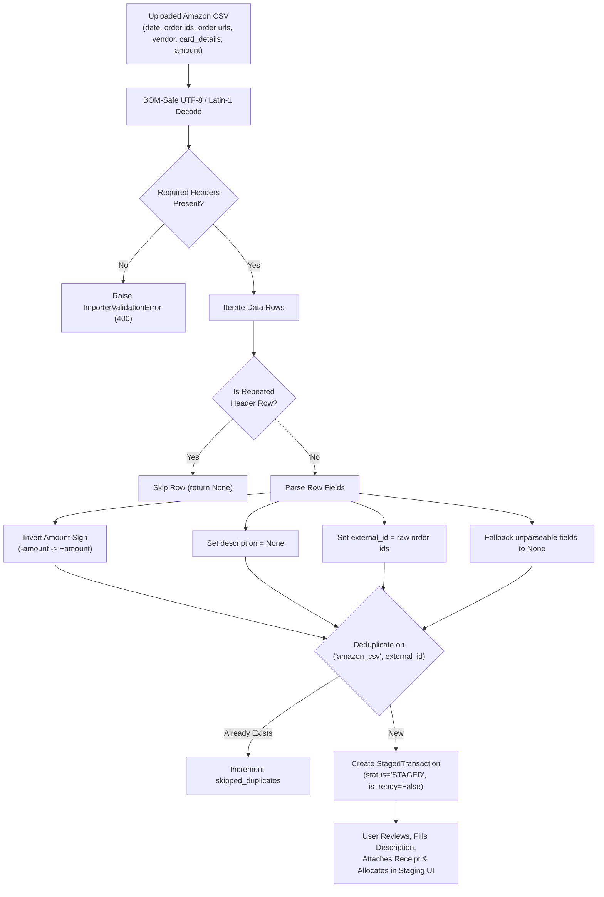

# Amazon Transactions CSV Importer Specification

## 1. Goal & Overview

The **Amazon Transactions CSV Importer** (`AmazonCsvImporter`) is a file-based intake adapter that subclasses [`BaseCsvImporter`](file:///D:/src/personal/wrangler/api/src/services/importers/csv_base.py#L13-L141) to ingest Amazon order history and refund transactions into Wrangler's Staging Area.

Imported transactions are held in [`StagedTransaction`](file:///D:/src/personal/wrangler/api/src/models/staged_transaction.py#L13-L35) records with `source = "amazon_csv"`. As requested by business requirements:
- The importer **inverts the sign** of all amounts because charges appear as negative outflows in the source CSV, whereas Wrangler records expenses as positive numbers and refunds as negative numbers.
- The importer leaves **`description` blank (`None`)**, giving the user full manual control to describe and allocate each purchase when reviewing staged records.
- The importer **does not skip rows where parsing fails** (e.g., malformed or missing dates/amounts). Any unparseable fields are staged as `None` so that every transaction is brought into Wrangler for user review and manual correction.
- The importer automatically detects and skips **duplicate header rows** embedded in the CSV export.



---

## 2. Target Amazon CSV Schema & Contract

The importer parses transaction CSV reports exported from Amazon order history matching tools or card reconciliation exports.

### 2.1 Required Headers (`REQUIRED_COLUMNS`)
The CSV file **MUST** contain the following 6 headers (case-sensitive, trimmed):

```python
REQUIRED_COLUMNS: tuple[str, ...] = (
    "date",
    "order ids",
    "order urls",
    "vendor",
    "card_details",
    "amount",
)
```

If any of these columns are missing from the header row, `BaseCsvImporter` raises an [`ImporterValidationError`](file:///D:/src/personal/wrangler/api/src/services/importers/base.py#L9-L10) (`400 Bad Request`):
`"Missing required CSV columns: <column_list>"`

### 2.2 Sample Source Data
```csv
date,order ids,order urls,vendor,card_details,amount
2026-10-16,702-6236836-4669054,https://www.amazon.ca/gp/your-account/order-details/ref=oh_aui_or_o01_?ie=UTF8&orderID=702-6236836-4669054,Amazon.ca,Mastercard ****9145,-96.04
2026-10-12,702-4929086-4929052,https://www.amazon.ca/gp/your-account/order-details/ref=oh_aui_or_o01_?ie=UTF8&orderID=702-4929086-4929052,AMZN Mktp CA,Mastercard ****9145,-15.67
2026-09-19,"D01-0626645-1689808, ??","https://www.amazon.ca/...",??,Mastercard ****9145,-27.25
2026-09-10,702-1234567-8901234,https://www.amazon.ca/...,Amazon.ca,Mastercard ****9145,15.00
date,order ids,order urls,vendor,card_details,amount
```

---

## 3. Importer Adapter Contract (`api/src/services/importers/amazon_csv.py`)

### 3.1 Class Metadata & Attributes
- **Class Name:** `AmazonCsvImporter(BaseCsvImporter)`
- **`importer_id`:** `"amazon_csv"`
- **`source_name`:** `"amazon_csv"`
- **`display_name`:** `"Amazon Transactions CSV"`
- **`description`:** `"Imports Amazon orders and refunds from an exported Amazon transactions CSV file."`
- **`input_type`:** `ImporterInputType.FILE`
- **`accepted_file_types`:** `[".csv"]`
- **`supports_mark_imported`:** `False` (inherits default no-op from [`BaseImporter`](file:///D:/src/personal/wrangler/api/src/services/importers/base.py#L54-L103))
- **`REQUIRED_COLUMNS`:** `("date", "order ids", "order urls", "vendor", "card_details", "amount")`
- **`SKIP_ZERO_AMOUNT_ROWS`:** `False` (zero or unparseable amounts must not be silently dropped; they are staged for review)

### 3.2 Row Parsing & Normalization Rules (`parse_row`)

Each row dictionary is processed through the following deterministic pipeline:

```python
def parse_row(self, row: dict[str, str], row_number: int) -> ImportedTransactionData | None:
    ...
```

#### 1. Duplicate Header Row Detection (Skip Row)
Some export tools concatenate monthly reports and repeat the CSV header row in the middle or bottom of the file (e.g., line 15 in sample data).
- **Rule:** If `row.get("date", "").strip().lower() == "date"` or `row.get("order ids", "").strip().lower() == "order ids"`, the row is identified as a repeated header.
- **Action:** Return `None` to silently skip the row.

#### 2. Unique Identifier (`external_id`)
- **Rule:** Taken directly from `row.get("order ids", "").strip()`.
- **Formatting:** Use the value **exactly as it comes in**, preserving multiple order IDs, digital IDs, or placeholders (e.g., `"702-6236836-4669054"`, `"D01-0626645-1689808, ??"`).
- **Empty Check:** If the stripped string is empty, `external_id` is set to `None`.

#### 3. Date Normalization (`date`)
- **Rule:** Attempt to parse `row.get("date", "")` using [`BaseCsvImporter.parse_iso_or_common_date`](file:///D:/src/personal/wrangler/api/src/services/importers/csv_base.py#L64-L86) (supporting `YYYY-MM-DD`, `MM/DD/YYYY`, and ISO timestamps).
- **Parse Failure Fallback:** If the date string is empty or cannot be parsed, **do NOT raise an exception or skip the row**. Set `date = None`.

#### 4. Description (`description`)
- **Rule:** Always set to `None`.
- **Rationale:** The source CSV lacks item titles, and the user will determine and enter descriptions in Wrangler during staging review and allocation.

#### 5. Amount Parsing & Sign Inversion (`total_amount`)
- **Sign Inversion Rule:** The sign of the parsed amount is inverted (`total_amount = -parsed_amount`):
  - **Purchases / Charges:** In the CSV, purchases are negative (e.g., `-96.04`). After inversion, `total_amount` becomes positive (`Decimal("96.04")`).
  - **Refunds / Returns:** In the CSV, refunds appear as positive numbers (e.g., `15.00` or `+15.00`). After inversion, `total_amount` becomes negative (`Decimal("-15.00")`).
- **Parsing Mechanics:** Strip currency symbols, commas, and whitespace using [`BaseCsvImporter.parse_amount`](file:///D:/src/personal/wrangler/api/src/services/importers/csv_base.py#L27-L63), then multiply by `-1`.
- **Parse Failure Fallback:** If `amount` is empty, malformed, or evaluates to `0.00`, set `total_amount = None` so that the row is preserved for user review in Staging.

#### 6. Currency (`currency_code`)
- **Rule:** Always defaults to `"CAD"` (as Amazon Canadian orders and cards do not specify an explicit currency column).

#### 7. Receipts (`receipt`)
- **Rule:** Amazon transaction CSV files do not contain embedded receipt attachments. `receipt = None`. Users attach receipts via the Staging UI or API.

#### 8. Ignored Columns
- `order urls` and `card_details` are omitted from the imported transaction.

---

## 4. Framework & Schema Updates

To support importing rows with unparsed fields or blank descriptions for manual review in Staging, the importer framework contract is updated as follows:

### 4.1 Nullable Fields on `ImportedTransactionData` (`api/src/services/importers/base.py`)
[`StagedTransaction`](file:///D:/src/personal/wrangler/api/src/models/staged_transaction.py#L20-L22) already defines `date`, `description`, and `total_amount` as nullable columns (`Mapped[... | None] = mapped_column(..., nullable=True)`). To allow importers to emit records that need user completion in Staging:

```python
class ImportedTransactionData(BaseModel):
    """Normalized transaction item produced by an importer implementation."""

    external_id: str | None = None
    date: date | None = None
    description: str | None = None
    total_amount: Decimal | None = None
    currency_code: str = "CAD"
    receipt: ImporterReceiptData | None = None

    model_config = ConfigDict(from_attributes=True)

    @field_validator("description", mode="before")
    @classmethod
    def clean_description(cls, v: Any) -> str | None:
        if v is None:
            return None
        cleaned = str(v).strip()
        return cleaned if cleaned else None

    @field_validator("total_amount", mode="before")
    @classmethod
    def validate_total_amount(cls, v: Any) -> Decimal | None:
        if v is None:
            return None
        dec = Decimal(str(v))
        if dec == Decimal("0"):
            return None
        return dec
```

### 4.2 Staging Readiness Rule
A staged transaction imported with `description = None` or `total_amount = None` cannot be accepted into the Ledger until the user fills in the required fields:
- In [`api/src/routers/staging.py`](file:///D:/src/personal/wrangler/api/src/routers/staging.py#L390-L407), acceptance validation enforces:
  - `staged_tx.description` is non-empty.
  - `staged_tx.date` is not `None`.
  - `staged_tx.total_amount` is not `None`.
  - Sum of `staged_tx.allocations` equals `staged_tx.total_amount`.

---

## 5. Deduplication & Idempotency Rules

When `POST /api/importers/amazon_csv/run` is executed:
1. **Intra-Batch Deduplication:**
   - If multiple rows in the same CSV file share the exact same non-empty `external_id`, the first occurrence is staged and subsequent identical rows are counted in `skipped_duplicates`.
2. **Cross-Table Deduplication:**
   - If `external_id` is present, the importer checks for an existing record matching `source == "amazon_csv"` and `external_id == item.external_id` across:
     - `staged_transactions` (whether `STAGED`, `ACCEPTED`, or `DISMISSED`).
     - `transactions` (Ledger table).
   - If found, the record is skipped and `skipped_duplicates` is incremented.
3. **Rows Without `external_id`:**
   - If `external_id` is `None`, the record is not deduplicated and is always staged.

---

## 6. Registration & API Integration

### 6.1 Importer Registry (`api/src/services/importers/registry.py`)
`AmazonCsvImporter` is instantiated and registered in the global importer registry upon application startup:

```python
register_importer(AmazonCsvImporter())
```

### 6.2 Endpoint Behavior
- **`GET /api/importers`:** Includes `amazon_csv` in the list of available importers:
  ```json
  {
    "importer_id": "amazon_csv",
    "source_name": "amazon_csv",
    "display_name": "Amazon Transactions CSV",
    "description": "Imports Amazon orders and refunds from an exported Amazon transactions CSV file.",
    "input_type": "file",
    "accepted_file_types": [".csv"],
    "supports_mark_imported": false
  }
  ```
- **`POST /api/importers/amazon_csv/run`:**
  - Accepts `multipart/form-data` with `file: UploadFile`.
  - Parses rows, creates `StagedTransaction` records, and returns `ImporterRunResponse`.

---

## 7. Testing Requirements (`api/tests/test_amazon_csv_importer.py`)

Implementation must include unit and integration tests covering:
1. **Header Validation:**
   - Valid headers succeed.
   - Missing required headers (e.g., missing `order ids` or `amount`) raises `ImporterValidationError` (HTTP 400).
2. **Amount Inversion:**
   - Negative purchase amount `-96.04` parses to `Decimal("96.04")`.
   - Positive refund amount `15.00` parses to `Decimal("-15.00")`.
   - Formatted amount with currency/commas `-$1,234.56` parses to `Decimal("1234.56")`.
3. **Blank Description:**
   - All parsed rows have `description is None`.
4. **Repeated Header Skipping:**
   - Row where `date == "date"` and `order ids == "order ids"` returns `None` and is not staged.
5. **Parse Resilience (No Dropped Rows):**
   - Row with malformed date stages with `date = None`.
   - Row with malformed or zero amount stages with `total_amount = None`.
   - Row with multi-order / placeholder ID (`"D01-0626645-1689808, ??"`) preserves the string as `external_id`.
6. **Deduplication:**
   - Repeated uploads of the same Amazon CSV result in `skipped_duplicates` matching the staged count.
