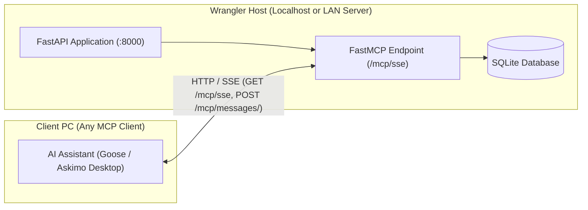

# AI Agent Integration (Model Context Protocol) Specification

## 1. Goal & Overview

This specification defines how Wrangler exposes its transaction intake pipeline to external AI desktop assistants (such as Goose or Askimo Desktop) via the **Model Context Protocol (MCP)** using **FastMCP** (the official Python MCP SDK).

Wrangler exposes a single, unified **HTTP/SSE transport** across all environments:
- **Local Development:** The FastAPI app runs locally, accessible at `http://localhost:8000/mcp/sse`.
- **Production (LAN Server):** The FastAPI app runs on a home network server, accessible at `http://<lan-server-ip>:8000/mcp/sse`.

Wrangler acts strictly as an MCP tool provider. Client-side agent workflows (such as browser automation or prompt skills) run entirely within the user's external desktop assistant; Wrangler's responsibility is solely to provide authenticated MCP tools that validate, deduplicate, and persist incoming transaction data directly into Wrangler's Staging Area for user review and allocation.

---

## 2. Server Architecture & Network Contract



### 2.1 Interface Contract
- **Role:** Wrangler is an MCP tool server. It exposes endpoints conforming to the Model Context Protocol over SSE transport.
- **Client Agnostic:** Any MCP client supporting HTTP/SSE can connect by pointing to the server's SSE URL with the configured `MCP_API_KEY`.
- **Intake Target:** All records ingested via MCP tools are written to `staged_transactions` with `source = "mcp"`, leaving final categorization, splitting, and ledger acceptance to the user in the Wrangler web UI.

---

## 3. Transport & Security Architecture

### 3.1 Transport & Protocol Details
- **Library:** `fastmcp` (the official Python SDK for MCP, `mcp` package).
- **FastAPI Integration:** Mounted directly onto the core FastAPI application instance via `mcp.mount(app, path="/mcp")` or Starlette ASGI sub-application mounting (`app.mount("/mcp", mcp_app)`).
- **Protocol:** Server-Sent Events (SSE) over HTTP (`GET /mcp/sse` for the server event stream, `POST /mcp/messages/` for client-to-server tool execution messages).
- **Plain HTTP Support (No HTTPS Required):**
  - Native desktop applications (Askimo Desktop, Goose) run in native runtime environments (Electron, Rust, Go) that do not enforce browser-style "Mixed Content" security restrictions.
  - They connect freely to unencrypted `http://` endpoints on loopback (`localhost`, `127.0.0.1`) and private RFC 1918 subnets (`192.168.x.x`, `10.x.x.x`).
  - **No SSL/TLS certificates, self-signed certificates, reverse proxies, or SSH tunnels are required.**
- **Network Binding:** In production, the FastAPI application binds to `0.0.0.0:8000` so it can receive LAN connections from other devices on the network.

### 3.2 Security & Authentication (`MCP_API_KEY`)

Wrangler uses an authentication middleware (`AuthenticationMiddleware` in [`api/src/core/security.py`](file:///D:/src/personal/wrangler/api/src/core/security.py#L78-L136)) that protects all system routes. Because desktop MCP clients connect over LAN to SSE endpoints, MCP authentication operates as follows:

1. **Configuration:**
   - A dedicated environment variable `MCP_API_KEY` is added to `Settings` in [`api/src/core/config.py`](file:///D:/src/personal/wrangler/api/src/core/config.py).
   - If `MCP_API_KEY` is configured with a non-empty string, all incoming requests to the `/mcp` route prefix must present a matching key.
2. **Multi-Channel Key Transport:**
   Desktop clients and SSE client libraries vary in how they configure custom headers on event streams. The authentication handler for `/mcp` routes accepts `MCP_API_KEY` via any of the following:
   - **Authorization Header:** `Authorization: Bearer <MCP_API_KEY>`
   - **Custom Header:** `X-API-Key: <MCP_API_KEY>`
   - **URL Query Parameter:** `http://<server-host>:8000/mcp/sse?api_key=<MCP_API_KEY>`
3. **Middleware Interception:**
   - Requests targeting `/mcp` or `/mcp/*` are exempted from the standard user JWT session check.
   - If `MCP_API_KEY` is configured: the middleware validates the provided key using constant-time comparison (`secrets.compare_digest`). If invalid or missing, it immediately responds with `401 Unauthorized` (`{"detail": "Invalid or missing MCP API key"}`).
   - If `MCP_API_KEY` is empty or not set, access to `/mcp` is permitted unconditionally over LAN (trust-on-local-network mode).

---

## 4. MCP Tools Specification

The MCP server instance (`FastMCP("Wrangler", ...)`) exposes explicit tool functions decorated with `@mcp.tool()`.

All database operations within tools must create a localized SQLAlchemy session via `SessionLocal()` (from [`database.py`](file:///D:/src/personal/wrangler/api/src/database.py#L25-L36)) enclosed in a `try...finally` block to ensure deterministic session cleanup across asynchronous SSE calls.

### 4.1 Intake Source Architecture & Namespacing

To maintain conceptual clarity across Wrangler:
- **`source` is the Intake Channel:** All records created via the MCP server are strictly assigned `source = "mcp"`. This mirrors other intake channels (`"manual"`, `"wrangler_csv"`, `"amazon_csv"`, `"google_groups"`) and ensures UI filters show a clean, predictable **"Source: MCP"** option rather than arbitrary merchant strings.
- **Namespaced `external_id` for Deduplication:** The database unique constraint is `(source, external_id)`. To prevent order number collisions between different merchants (e.g., Amazon order `#1001` vs. a local store order `#1001`), the tool constructs `external_id` as `{source_label}:{raw_order_id}` (e.g., `amazon:114-1234567-8901234`).
- **Merchant Identity in `description`:** Merchant names belong in `description` (e.g., `"[Amazon] Wireless Keyboard"`), matching the format exported to Wave (`Date, Description, Amount`).
- **Base Currency:** Default currency is `"CAD"`, satisfying the database's non-null `currency_code` column and matching the system base currency.

---

### 4.2 Generic Staging Tool: `stage_transaction`

The primary intake tool supporting any AI agent scraper or merchant source.

**Staged transactions are flexible.** An agent frequently cannot determine every value (an unreadable receipt, a missing total, an ambiguous date). The agent must never invent a value and must never be forced to resolve the gap in its own chat. Instead it sends `null` (or omits the argument) for anything it cannot determine, and the user completes the record in the Wrangler web UI (see §5). Only the identity fields (`source_label`, `external_id`) are mandatory, because they drive deduplication.

```python
@mcp.tool()
async def stage_transaction(
    source_label: str,
    external_id: str,
    date: str | None = None,
    total_amount: float | None = None,
    description: str | None = None,
    currency_code: str | None = None,
) -> str:
    """Stage a transaction in Wrangler for user review and allocation.

    Any value that cannot be determined should be passed as null (never guessed); the user completes it in Wrangler.

    Args:
        source_label: Intake source identifier (e.g., 'amazon', 'receipts@mmjm.ca'). Required.
        external_id: Unique order ID or reference from the source. Required.
        date: Transaction date in ISO format (YYYY-MM-DD or ISO timestamp), or null if unknown.
        total_amount: Non-zero amount; positive for purchases, negative for returns/refunds, or null if unknown.
        description: Item title, summary, or vendor notes, or null if unknown.
        currency_code: Three-letter ISO currency code, or null (defaults to 'CAD').

    Returns:
        A human-readable confirmation string detailing whether the transaction was staged
        or skipped as a duplicate.
    """
```

#### Behavior & Validation Rules:
1. **Input Normalization & Namespacing:**
   - `source_label`: Trimmed and lowercased (`source_label.strip().lower()`). Must not be empty.
   - `raw_external_id`: Trimmed (`external_id.strip()`). Must not be empty.
   - `namespaced_external_id`: Constructed as `f"{source_label}:{raw_external_id}"`.
   - `description`: Null, omitted, or blank is stored as `NULL`. Otherwise it is trimmed and prefixed with a source tag so vendor identity is clear in the Ledger and Wave CSV exports. The tag is `f"[{source_label.title()}]"` for plain labels, and the label exactly as written (`f"[{source_label}]"`) when the label contains `@` (e.g., `[receipts@mmjm.ca]`). An existing tag is not duplicated.
   - `currency_code`: Null, omitted, or blank defaults to `"CAD"`. Otherwise trimmed and uppercased.
   - `total_amount`: Null or omitted is stored as `NULL`. A provided value is converted to `Decimal(f"{total_amount:.2f}")` and must be strictly non-zero (a provided zero is rejected with an error). Negative values are permitted to represent refunds, returns, or credits.
   - `date`: Null, omitted, or blank is stored as `NULL`. A provided value is parsed to a Python `datetime.date`, accepting `YYYY-MM-DD` or full ISO 8601 timestamps (extracting the date component). A provided but malformed date is rejected with an error (a supplied-but-wrong value is an agent error and should be reported; a missing value is not).
2. **Idempotency & Deduplication Check:**
   Before inserting, the tool performs a deduplication query across two tables:
   - Queries `StagedTransaction` where `source == "mcp"` and `external_id == namespaced_external_id`.
   - Queries `Transaction` where `source == "mcp"` and `external_id == namespaced_external_id`.
   - **If a match exists:** The tool **does not raise an exception**. Instead, it returns an idempotent skip confirmation:
     > `"Transaction '[mcp] {namespaced_external_id}' already exists in Wrangler (status: <STAGED|ACCEPTED|DISMISSED|LEDGER>). Skipped."`
      *(This allows the scraping agent to loop through order pages without aborting the batch).*
    - **Existing records are never modified.** A re-run that supplies values for a record previously staged with `NULL`s does not fill them in or overwrite anything; the user's edits in Wrangler always win.
3. **Record Creation:**
    - Creates a new `StagedTransaction` record with:
      - `id`: `uuid.uuid4()`
      - `source`: `"mcp"`
      - `external_id`: `namespaced_external_id`
      - `date`: `parsed_date` or `NULL`
      - `description`: `formatted_description` or `NULL`
      - `total_amount`: `amount_decimal` or `NULL`
      - `currency_code`: `currency_code`
      - `status`: `"STAGED"`
      - `is_marked_imported`: `False`
      - `receipt_file_path`: `None`
    - **No initial allocations:** Per the Importer Framework specification ([`specs/v2/1-importer-framework/spec.md`](file:///D:/src/personal/wrangler/specs/v2/1-importer-framework/spec.md#L40-L46)), a staged transaction starts with zero `StagedAllocation` records (`"Unallocated"`) so the user can assign personal vs. business allocations or multi-company splits in the UI.
4. **Commit & Return:**
    - Commits the database transaction.
    - Returns a success string:
      > `"Successfully staged transaction: [mcp] amazon:114-1234567-8901234 - [Amazon] Wireless Keyboard ($29.99 CAD)."`
    - When any of `date`, `total_amount` or `description` was null, the string states what is still missing (e.g., `"... Needs review in Wrangler: date, total_amount."`). This is informational; the agent takes no further action.

---

### 4.3 Pre-flight Verification Tool: `check_transaction_exists`

Allows an AI agent to check whether an order has already been ingested before performing complex operations.

```python
@mcp.tool()
async def check_transaction_exists(
    source_label: str,
    external_id: str,
) -> dict:
    """Check if a transaction with the given source label and external ID already exists in Wrangler.
    
    Args:
        source_label: Merchant identifier (e.g., 'amazon').
        external_id: Raw order ID or reference number.
        
    Returns:
        A dictionary containing:
        - exists (bool): True if present in staging or ledger.
        - location (str | None): 'staged' or 'ledger' if found.
        - status (str | None): 'STAGED', 'ACCEPTED', 'DISMISSED', or 'COMMITTED'.
    """
```
The implementation checks for `source == "mcp"` and `external_id == f"{source_label.strip().lower()}:{external_id.strip()}"`.

---

## 5. Staging Pipeline & UI Integration

### 5.1 Staging Area Lifecycle
Transactions inserted via MCP adhere to the full Staging Area lifecycle defined in [`specs/v2/1-importer-framework/spec.md`](file:///D:/src/personal/wrangler/specs/v2/1-importer-framework/spec.md):

```
       [External AI Agent via FastMCP]
                     |
                     v
             (status: "STAGED", source: "mcp")
        StagedTransaction (Unallocated)
                     |
                     v
           [Wrangler Web UI: /import]
         User reviews date/amount/title
         Selects: Personal OR Business (Company split)
         Optionally attaches PDF receipt/invoice
                     |
                     v
           [Batch Accept Button]
                     |
                     v
            Ledger Transaction & Allocations
```

1. **Immediate Visibility:** Staged transactions appear immediately in the **Import & Staging View** (`/import`, `GET /api/staging?status=STAGED`).
2. **Clean Filter Dropdown:** The `source` column displays `"mcp"`. The UI filter dropdown includes `"mcp"` so users can isolate all records scraped by AI desktop assistants.
3. **User Allocation & Metadata Completion:** Staged transactions may have null `date`, `description`, or `total_amount` if not available during intake. Such transactions display as not ready (`is_ready = False`). `is_ready` evaluates to `True` only when `date`, `description`, and `total_amount` are all non-null, and allocations are balanced. The user can:
   - Edit metadata (date, description, amount) via `PUT /api/staging/{id}`.
   - Toggle to **Personal** (`is_personal = True`).
   - Assign to a **Company** (`is_personal = False`).
   - Click **Edit / Split** to split across multiple businesses.
   - Attach or replace a receipt file (`POST /api/staging/{id}/receipt`).
4. **Batch Acceptance:** When ready, the user clicks **"Accept Ready into Ledger"** (`POST /api/staging/accept`) to commit them to the live Ledger ([`Transaction`](file:///D:/src/personal/wrangler/api/src/models/transaction.py#L13-L30) and [`Allocation`](file:///D:/src/personal/wrangler/api/src/models/allocation.py#L17-L29)).
5. **Dismissal:** If an order was personal or irrelevant and should not be imported, the user clicks **Dismiss** (`POST /api/staging/{id}/dismiss`). The record transitions to `"DISMISSED"`, retaining `(source="mcp", external_id)` to ensure future agent runs continue to skip it.

---

## 6. Architectural Impact Review

| Dimension | Architectural Assessment | Mitigation |
| :--- | :--- | :--- |
| **System Boundary Separation** | Client-side scraping logic (browser automation, DOM scraping, Goose skills) does not belong in Wrangler's backend codebase. | Clean boundary: Wrangler is strictly an MCP server providing tools and validation over HTTP/SSE. Scraping details are excluded from backend implementation. |
| **Unified Transport (Dev & Prod)** | Running separate local stdio and remote HTTP adapters increases complexity and testing overhead. | Wrangler exposes a single, unified HTTP/SSE interface (`/mcp/sse`) used identically on `localhost:8000` (dev) and LAN IP (prod). No stdio code needed. |
| **HTTP vs. HTTPS** | Setting up local TLS certificates or reverse proxies introduces friction for home lab setups. | Desktop AI agents (Askimo, Goose) run natively without browser mixed-content restrictions, connecting directly over plain `http://` on loopback and LAN. |
| **Intake Channel vs. Merchant Origin** | Making `source` freeform would pollute UI filters with inconsistent strings (`"amazon"`, `"amzn"`). | Fixed `source = "mcp"` unifies the intake channel with `"manual"`, `"wrangler_csv"`, and `"google_groups"`. Merchant origin is preserved in `description`. |
| **Cross-Merchant Deduplication** | Multiple merchants could generate identical order numbers (e.g. order `#1001`), colliding under `source = "mcp"`. | Namespacing `external_id = f"{source_label}:{raw_id}"` (e.g. `amazon:114-...`) guarantees deterministic, zero-collision uniqueness across all scraped sites. |
| **Cross-Spec Alignment** | Adheres strictly to the two-phase staging workflow defined in `specs/v2/1-importer-framework/spec.md`. Does not insert unreviewed records directly into the Ledger. | Preserves Ledger integrity and Wave CSV export consistency. |
| **Idempotency & Deduplication** | Agents re-running over the same order history will encounter existing orders. | Dual-table check (`staged_transactions` and `transactions`) on `("mcp", namespaced_external_id)` returns a graceful confirmation without failing the agent's task. |
| **Authentication & LAN Security** | Desktop clients running on a separate Windows machine cannot use interactive browser cookies or short-lived frontend JWTs. | Dedicated `MCP_API_KEY` supported via query parameter (`?api_key=`), `Authorization: Bearer`, or `X-API-Key`. Exempted from JWT auth in middleware. |
| **Concurrency & Thread Safety** | FastMCP handles asynchronous tool invocations concurrently over SSE. | Each tool invocation creates and disposes its own isolated SQLAlchemy `Session` via `SessionLocal()`, avoiding shared session concurrency issues. |
| **Data Integrity** | Floats passed by LLMs can introduce precision artifacts (e.g., `29.98999999999`). | Formatted and converted immediately to `Decimal(f"{total_amount:.2f}")` with non-zero validation when provided. |
| **Currency Default** | SQLite `currency_code` column is non-null. | Defaults to `"CAD"` across all tools, satisfying the schema while reflecting user base currency. |
| **Schema Impact** | Staged transactions allow partial data (`date`, `description`, `total_amount` nullable). | Alembic migration alters `staged_transactions` columns (`date`, `description`, `total_amount`) to nullable. Ledger transactions remain strictly non-null. |
