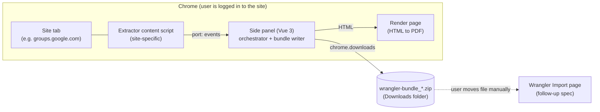

# Browser Extension Bundle Exporter Specification

## 1. Goal & Overview

This specification defines the **Wrangler Bundle Exporter**, a Chrome (Manifest V3) browser extension that pulls transaction data and receipts out of specific websites the user is already logged in to, and packages them into a single downloadable **Wrangler Bundle** (`.zip`).



### 1.1 Scope

**In scope**
- The **Wrangler Bundle format** (§3). This is a normative contract between the extension (writer) and the Wrangler API (reader).
- The extension package: architecture, extractor plug-in contract, bundle-writing pipeline, side-panel UI, tests (§4).
- The Google Groups extractor (§5).

**Out of scope (explicit non-goals)**
- **Wrangler API changes.** There are no data model, endpoint or importer changes here. Requirements this spec places on the follow-up import spec are listed informatively in §7. Specs 1–4 are **not** modified by this spec.
- **Sending data to Wrangler.** The extension never talks to the Wrangler API and stores no Wrangler URL or credentials. The user moves the downloaded zip to Wrangler manually.
- **Marking items as processed in the source site** (e.g. locking Google Groups conversations) and any persistent "already exported" cursor. The extension keeps no memory of previous exports. Deduplication is solely Wrangler's job via `(source, external_id)`.
- Parsing amounts, currencies or vendor details from Google Groups emails (see §5).
- Chrome Web Store publishing. The extension is loaded unpacked for personal use.
- Non-Chromium browsers.

### 1.2 Key Decisions

| # | Decision | Rationale |
| :-- | :--- | :--- |
| D1 | Delivery is a **downloaded zip only**. | No CORS, mixed-content or credential handling. The zip is a durable local backup. |
| D2 | Bundle `source` is **per site** (`google_groups`, later `amazon`, ...), declared in the manifest. | Keeps existing source names/filters and gives every site its own `(source, external_id)` dedupe namespace. |
| D3 | **Every CSV cell except `external_id` may be blank.** | Matches the nullable `staged_transactions` columns and the MCP spec §4.2 principle: never guess, the user completes the record in Staging. |
| D4 | **One receipt per row.** | Wrangler stores one `receipt_file_path` per transaction. |
| D5 | Extractors only emit **raw values**. A shared host pipeline owns validation, normalization, receipt rendering, CSV/zip writing and download. | Adding a site never touches the bundle format code. |
| D6 | The **side panel is the orchestrator**, not the service worker. | MV3 service workers are killed when idle, and a multi-minute extraction with PDF rendering must not lose state. The panel is a long-lived extension page with a full DOM. |
| D7 | Content scripts are injected **on demand** (`chrome.scripting.executeScript`) only when the user clicks Export. | No code runs on the site otherwise. |
| D8 | **Retrieval failure skips an item. Unparseable fields blank a field.** | A skipped item is retried on the next run. A blanked field is completed by the user. See §4.9. |

---

## 2. Data Model Changes

**None.** This spec introduces no database tables, columns or migrations. The only persisted state in the extension is UI-convenience form prefill in `chrome.storage.local` (§4.8). It is not a processing cursor and extractors never read it.

---

## 3. Wrangler Bundle Format (Normative Contract)

### 3.1 Container

- A standard ZIP archive (deflate, UTF-8 entry names, forward-slash paths).
- **Filename:** `wrangler-bundle_{source}_{YYYYMMDD}T{HHmmss}Z.zip` (UTC, no `:` characters), e.g. `wrangler-bundle_google_groups_20261018T172000Z.zip`.
- **Entries (and only these):**

| Entry | Required | Description |
| :--- | :--- | :--- |
| `manifest.json` | Yes | Bundle metadata (§3.2). |
| `transactions.csv` | Yes | One row per discovered transaction (§3.3). Present even if it contains only the header. |
| `receipts/<file>` | No | Receipt files referenced from the CSV (§3.4). |

- No other entries, no nested directories under `receipts/`, no entries with `..`, absolute paths, drive letters or backslashes. Readers MUST reject archives containing any.
- `manifest.json` is written first. Receipt entries are stored with compression level 0 (PDF/PNG/JPEG are already compressed). `manifest.json` and `transactions.csv` use deflate. Entry modification time is `generated_at`.

### 3.2 `manifest.json`

UTF-8 JSON, no BOM.

```json
{
  "format": "wrangler-bundle",
  "format_version": 1,
  "source": "google_groups",
  "extractor": { "id": "google_groups", "version": "1.0.0" },
  "generated_at": "2026-10-18T17:20:00Z",
  "origin_url": "https://groups.google.com/g/receipts",
  "options": { "since": "2026-09-01", "limit": 100 },
  "complete": true,
  "counts": { "transactions": 12, "receipts": 12, "warnings": 2 },
  "warnings": [
    { "code": "RECEIPT_RENDER_FAILED", "message": "Could not render email body to PDF", "external_id": "receipts:abc123", "skipped": false },
    { "code": "ITEM_SKIPPED", "message": "Thread could not be read (HTTP 429)", "external_id": "receipts:def456", "skipped": true }
  ]
}
```

| Field | Type | Rules |
| :--- | :--- | :--- |
| `format` | string | Constant `"wrangler-bundle"`. |
| `format_version` | integer | `1` for this spec (§3.5). |
| `source` | string | Matches `^[a-z][a-z0-9_]{1,63}$`. Becomes `StagedTransaction.source`. **Must not** be a reserved source: `manual`, `mcp`, `wrangler_csv`. **Immutable per site.** Changing it would break deduplication against all previously imported records. |
| `extractor.id` / `extractor.version` | string | Informational. Version is the extractor's semver. |
| `generated_at` | string | UTC ISO-8601 with `Z`, second precision. |
| `origin_url` | string \| null | URL of the tab the run started on, with query string and fragment removed. |
| `options` | object | Informational echo of the validated run options. Readers MUST NOT depend on it. |
| `complete` | boolean | `false` if the run was cancelled, interrupted (tab closed/navigated) or hit a size limit, i.e. the bundle is a valid but partial result. |
| `counts` | object | `transactions` = CSV data rows, `receipts` = files in `receipts/`, `warnings` = `warnings.length`. Readers SHOULD verify these match. |
| `warnings` | array | `{code, message, external_id \| null, skipped}`. `code` matches `^[A-Z][A-Z0-9_]*$`. `skipped: true` means **no CSV row was emitted** for that item. Capped at 1000 entries (excess dropped, with a final `WARNINGS_TRUNCATED` entry). Informational. |

### 3.3 `transactions.csv`

- **Encoding:** UTF-8 **with BOM**, **CRLF** line endings, RFC 4180 quoting (a cell is quoted when it contains `,`, `"`, CR or LF. `"` is doubled). Compatible with the existing `BaseCsvImporter` decoding (`utf-8-sig`).
- **Header row (exact names and order as written by the extension):**

```
external_id,date,description,total_amount,currency_code,receipt_file,source_url
```

| Column | Required value | Blank allowed | Rules |
| :--- | :--- | :--- | :--- |
| `external_id` | Yes | **No** | Trimmed, 1-255 chars, no control characters, **unique within the bundle**, stable across runs for the same underlying item (it is the deduplication key). |
| `date` | | Yes | `YYYY-MM-DD` and a valid calendar date. |
| `description` | | Yes | Single line (whitespace runs, including newlines, collapsed to one space), trimmed, max 500 chars. |
| `total_amount` | | Yes | Decimal with `.` separator, optional leading `-` (refund/credit), max 10 integer digits and exactly 2 decimals (`^-?\d{1,10}\.\d{2}$`), no grouping separators, no currency symbols. **Never zero** (a zero amount is written blank). |
| `currency_code` | | Yes | Uppercase ISO 4217 code (`^[A-Z]{3}$`). Blank means "unknown": the importer applies Wrangler's default (`CAD`). |
| `receipt_file` | | Yes | Path of a file in the zip, exactly `receipts/<basename>` (§3.4). Each path is referenced by **at most one row**. |
| `source_url` | | Yes | `http(s)` URL of the item on the source site. Informational. The v1 reader ignores it. |

- **Readers** select columns **by header name**, MUST require the columns marked required, MUST ignore unknown columns (forward compatibility) and MUST NOT assume column order.
- **Blank means unknown, not zero or empty.** The extension never invents a value.
- The CSV is a data file. Cell content is never prefixed/escaped for spreadsheet-formula safety, because that would corrupt the data. Wrangler never evaluates cells. Opening the file in a spreadsheet is out-of-band and at the user's discretion.

### 3.4 Receipts

- **Allowed types:** PDF (`application/pdf`, `.pdf`), PNG (`image/png`, `.png`), JPEG (`image/jpeg`, `.jpg`). The extension derives the extension from the verified content type, not from the source filename.
- **Max size:** 25 MiB (26,214,400 bytes) per file. Larger files are dropped with warning `RECEIPT_TOO_LARGE` (the row is still emitted, with `receipt_file` blank).
- **Verification:** The extension verifies magic bytes (`%PDF-`, PNG signature, `FF D8 FF`). A mismatch drops the receipt with `RECEIPT_INVALID`.
- **Naming:** `receipts/{safe(external_id)}__{safe(display_name)}.{ext}` where
  - `safe(x)` replaces every character outside `[A-Za-z0-9._-]` with `_` and collapses repeats,
  - `display_name` is the original attachment filename stem, or the literal `email` for a rendered email body,
  - the whole basename is truncated to 120 characters (keeping the extension),
  - on collision a numeric suffix is added (`-2`, `-3`, ...).
  This is compatible with Wrangler's `sanitize_filename` ([`receipts.py`](file:///D:/src/personal/wrangler/api/src/services/receipts.py#L10-L15)). The importer later prefixes `{staged_id}_`.
- A receipt is **never shared** between rows. Identical files are not deduplicated.

### 3.5 Versioning & Compatibility

- `format_version` is an integer. Additive, backward-compatible changes (new optional CSV columns, new manifest keys, new warning codes) do **not** bump it. Removing/renaming/re-typing anything does.
- Readers MUST reject a `format_version` they do not know (clear error: "Unsupported bundle version N") and MUST ignore unknown manifest keys and CSV columns.

### 3.6 Canonical Fixtures (Contract Tests)

The repository carries an unzipped canonical bundle at `extension/tests/fixtures/sample-bundle/` (`manifest.json`, `transactions.csv`, `receipts/...`) covering: all columns populated, a refund (negative amount), blank date/amount/currency, a commas/quotes/newline description, non-ASCII text, a rendered-email PDF and an attachment receipt. It is the shared contract fixture. The extension tests assert the writer reproduces it byte-for-byte (with an injected clock), and the follow-up API tests SHOULD zip and import the same files.

---

## 4. Extension Architecture (`extension/`)

### 4.1 Package & Tooling

- New pnpm workspace package **`extension/`** (add `- 'extension'` to [`pnpm-workspace.yaml`](file:///D:/src/personal/wrangler/pnpm-workspace.yaml)).
- **Stack:** TypeScript, Chrome Manifest V3, **WXT** (Vite-based extension framework) with `@wxt-dev/module-vue`, Vue 3 (side panel), `fflate` (zip), `DOMPurify` (HTML sanitization), Vitest (+ `happy-dom`), Prettier, `vue-tsc`. Reuse the version ranges already used in [`web/package.json`](file:///D:/src/personal/wrangler/web/package.json) for shared tooling (`vue`, `typescript`, `vue-tsc`, `prettier`, `vitest`).
- **Not used:** Quasar (side-panel footprint), Pinia (a single view with no cross-view state; run state lives in one `useExtractionRun()` composable), a Wrangler API client.
- **Package scripts** (so the root `pnpm lint|format|test|build` fan-out via `pnpm --filter "./*"` works unchanged):

| Script | Command |
| :--- | :--- |
| `dev` | `wxt` |
| `build` | `vue-tsc --noEmit && wxt build` |
| `postinstall` | `wxt prepare` (generates types so typecheck works on a fresh clone) |
| `typecheck` | `vue-tsc --noEmit` |
| `lint` / `lint:fix` | `vue-tsc --noEmit && prettier --check .` / `prettier --write .` |
| `format` / `format:fix` | `prettier --check .` / `prettier --write .` |
| `test` | `vitest run` |

- Add root script `dev:extension` (`pnpm --filter "./extension" dev`). It is **not** added to `pnpm dev` (no need to run alongside api/web).
- Add `.output/` and `.wxt/` to [`.gitignore`](file:///D:/src/personal/wrangler/.gitignore) and the extension's `.prettierignore`. Copy [`web/.prettierrc`](file:///D:/src/personal/wrangler/web/.prettierrc).
- `pnpm build` now also builds the extension, so the build MUST NOT need Chrome or network access.
- **Loading:** `pnpm --filter ./extension build`, then Chrome → `chrome://extensions` → Developer mode → "Load unpacked" → `extension/.output/chrome-mv3`.
- **Compatibility risk:** Confirm the chosen WXT release supports the workspace's Vite major (web uses Vite 8). If not, the extension package may pin its own Vite version. This is a dev-tool concern only.

### 4.2 Source Layout

```
extension/
  package.json  wxt.config.ts  tsconfig.json  .prettierrc  .prettierignore
  src/
    entrypoints/
      background.ts               # opens side panel on action click; nothing else
      sidepanel/                  # index.html, main.ts, App.vue  (orchestrator + UI)
      render/                     # index.html, main.ts           (HTML -> PDF stage)
      google_groups.content.ts    # thin entry: defineExtractorContentScript(...)
    core/
      types.ts                    # ExtractorDefinition, PageExtractor, events, protocol (§4.5-4.6)
      registry.ts                 # EXTRACTORS: ExtractorDefinition[]
      content-runtime.ts          # defineExtractorContentScript(): port, guard, cancel, base64 transport
      run.ts                      # runExtraction() orchestrator (§4.7)
      normalize.ts                # field validation/normalization (§4.7.2)
      receipts.ts                 # receipt verification, naming
      bundle/                     # csv.ts, manifest.ts, zip.ts, validate.ts
      html-render.ts              # PdfRenderer (§4.7.4)
      images.ts                   # inlineImages() helper for extractors
      platform/                   # thin chrome.* adapters: transport, downloads, storage, tabs, debugger
    extractors/
      google_groups/              # definition.ts, content.ts, thread-source.ts, selectors.ts
  tests/                          # unit tests + fixtures/ (§6)
```

- **Rule:** `chrome.*` is touched only inside `core/platform/` (and the two thin entrypoints). Everything else receives those adapters by dependency injection, so the pipeline is unit-testable without a browser.
- **Rule:** each extractor's `definition.ts` is **pure data and functions with no DOM/`chrome` imports**, because `wxt.config.ts` imports the registry at build time to generate manifest permissions.

### 4.3 Extension Manifest (generated by `wxt.config.ts`)

- `manifest_version: 3`, `minimum_chrome_version: "116"`, name `Wrangler Bundle Exporter`.
- `permissions`: `sidePanel`, `scripting`, `downloads`, `debugger`, `storage`.
- `host_permissions`: the union of every registered extractor's `matches` (e.g. `https://groups.google.com/*`, `https://*.googlegroups.com/*`). Note that `https://*.googlegroups.com/*` is required because attachment download URLs redirect cross-origin to attachment storage subdomains. **No `<all_urls>`, no `tabs` permission.** `tabs.query` exposes `url` only for tabs on host-permitted sites, which is exactly the behaviour wanted (unsupported pages show "No extractor for this page").
- `action` (no popup), `side_panel.default_path`, `background.service_worker`.
- **No static `content_scripts`.** Extractor scripts are WXT content-script entrypoints with `registration: "runtime"` and are injected on demand (D7).
- No `web_accessible_resources`, default extension-page CSP.
- `debugger` is required only for HTML-to-PDF rendering (§4.7.4). Chrome shows its standard "…started debugging this browser" banner while a render is in progress. The panel warns the user about this before the first run.

### 4.4 Runtime Contexts

| Context | Lifetime | Responsibility |
| :--- | :--- | :--- |
| **Background service worker** | Ephemeral | `chrome.sidePanel.setPanelBehavior({ openPanelOnActionClick: true })` only. Holds **no run state**. |
| **Side panel** (extension page) | While open | Detects extractor for active tab, collects options, injects content script, receives events, runs the host pipeline, writes the zip, triggers the download. |
| **Extractor content script** (site page, isolated world) | Per run | Site-specific reading of the DOM / same-origin fetches (the user's session cookies apply). Streams events to the panel. |
| **Render page** (extension page in a non-active tab) | Per receipt render | Sanitizes email HTML and displays it for `Page.printToPDF`. |

Closing the side panel during a run cancels it. The panel shows "Keep this panel and the site tab open until the run finishes". Closing the panel after completion has no effect on an already-downloaded zip.

### 4.5 Extractor Plug-in Contract (`core/types.ts`)

This contract is the extensibility seam. A new site is added by implementing it, with **no** change to bundle, CSV, zip, render or UI code.

```ts
/** Pure data (no DOM/chrome imports). Consumed by the panel, the registry tests and wxt.config.ts. */
export interface ExtractorDefinition {
  /** Stable id, [a-z][a-z0-9_]{1,63}. Also the content-script entrypoint name: entrypoints/{id}.content.ts */
  id: string;
  /** Bundle manifest `source` (§3.2). Immutable. Must satisfy the source rules incl. the reserved list. */
  source: string;
  displayName: string;
  description: string;
  /** Semver of the extraction rules; written to manifest.extractor.version. */
  version: string;
  /** Chrome match patterns. Drives host_permissions and tab detection. */
  matches: string[];
  /** Narrow check on the active tab URL (e.g. "is this a group page?"). */
  isSupportedPage(url: URL): boolean;
  /** Declarative per-run option form, rendered generically by the panel. */
  options: OptionField[];
}

export type OptionField =
  | { key: string; label: string; type: "date"; required?: boolean; help?: string }
  | { key: string; label: string; type: "integer"; min: number; max: number; default: number; help?: string }
  | { key: string; label: string; type: "boolean"; default: boolean; help?: string }
  | { key: string; label: string; type: "text"; default?: string; required?: boolean; maxLength?: number; help?: string }
  | { key: string; label: string; type: "select"; choices: { value: string; label: string }[]; default: string; help?: string };

/** Implemented inside the content script. */
export interface PageExtractor {
  extract(ctx: ExtractionContext): AsyncIterable<ExtractionEvent>;
}

export interface ExtractionContext {
  options: Record<string, unknown>; // already validated against ExtractorDefinition.options
  pageUrl: URL;
  signal: AbortSignal; // aborted on cancel; extractors must stop promptly
}

export type ExtractionEvent =
  | { type: "progress"; phase: string; completed: number; total: number | null; message?: string }
  | { type: "item"; item: ExtractedItem }
  | { type: "skip"; external_id: string | null; code: string; message: string } // retrieval failure, no row (D8)
  | { type: "warning"; code: string; message: string; external_id?: string };

/** Raw, un-normalized values. Anything unknown is null/omitted, never guessed. */
export interface ExtractedItem {
  external_id: string;
  date?: string | null;          // YYYY-MM-DD
  description?: string | null;
  total_amount?: string | null;  // decimal string, never a float
  currency_code?: string | null;
  source_url?: string | null;
  receipt?: ReceiptPayload | null;
}

export type ReceiptPayload =
  | { kind: "file"; filename: string; content_type: string; data: Uint8Array }
  | { kind: "url"; filename: string; content_type?: string; download_url: string } // host fetches with extension host permissions (§4.7.3)
  | { kind: "html"; html: string; display_name?: string }; // host renders to PDF (§4.7.4)
```

- **Content-script entry:** the extractor's entrypoint calls `defineExtractorContentScript(definition.id, extractor)` from `core/content-runtime.ts`. That helper owns the port handshake, the double-injection guard (`window.__wranglerExtractor_{id}`), cancellation (`AbortController`), `Uint8Array` ↔ base64 transport and fatal-error reporting. Extractor authors never write messaging code.
- **Registry (`core/registry.ts`):** `EXTRACTORS: ExtractorDefinition[]`. The panel selects the extractor whose `matches` and `isSupportedPage` accept the active tab. If multiple match, the user chooses from a dropdown.

### 4.6 Content Script ⇄ Panel Protocol

- Panel injects the script: `chrome.scripting.executeScript({ target: { tabId }, files: [<built script for definition.id>] })`, then `chrome.tabs.connect(tabId, { name: "wrangler-extract:{runId}" })`.
- **Panel → page:** `{ type: "start", options }`, `{ type: "cancel" }`.
- **Page → panel:** `{ type: "event", event: ExtractionEvent }` (one message per event, so binary payloads stay bounded to one receipt), `{ type: "done" }`, `{ type: "fatal", code, message }`.
- **Binary transport:** `Uint8Array` is base64-encoded on send and decoded on receive (runtime messaging is JSON-serialized). With the 25 MiB receipt cap, a message is at most ~34 MB, within Chrome's message limit.
- **Interruption:** a port disconnect without `done`/`fatal` (tab closed, full-page navigation) marks the run `interrupted` and is handled like cancel (§4.7.6).

### 4.7 Host Pipeline (Side Panel, `core/run.ts`)

`runExtraction({ definition, tabId, options, signal }, deps)` where `deps` are the injected adapters (`ExtractorTransport`, `PdfRenderer`, `Downloader`, `Clock`).

#### 4.7.1 Flow
1. Validate options against `definition.options` (type, min/max, required). Invalid options never start a run.
2. Inject script, connect, send `start`.
3. For each `item` event: normalize (§4.7.2) → resolve receipt (§4.7.3 / §4.7.4) → append to the in-memory run result. For `skip`/`warning`: append to warnings.
4. On `done`, cancel, interrupt or `fatal`: build the bundle (§4.7.5) and enable download.
5. Items are processed **sequentially**, with HTML renders serialized (one render tab at a time).

#### 4.7.2 Field Normalization (`core/normalize.ts`)
Pure function `normalizeItem(raw) -> { row, warnings }`. It never throws for bad optional data.

| Field | Rule | On failure |
| :--- | :--- | :--- |
| `external_id` | Trim, 1-255 chars, no control characters. | Item **dropped** + warning `ITEM_SKIPPED` (`skipped: true`). This is an extractor bug. |
| duplicate `external_id` in run | First occurrence wins. | Later ones dropped + `DUPLICATE_EXTERNAL_ID` (`skipped: true`). |
| `date` | Strict `YYYY-MM-DD` and a real calendar date. | Blank + `DATE_INVALID` |
| `description` | Trim, collapse all whitespace runs to one space, truncate to 500. | Blank if empty. `DESCRIPTION_TRUNCATED` when truncated. |
| `total_amount` | Must match `^-?\d{1,10}(\.\d{1,2})?$`. Normalized to two decimals using **string operations, never floating point**. | Blank + `AMOUNT_INVALID`. Zero → blank + `AMOUNT_ZERO`. |
| `currency_code` | Trim + uppercase, must match `^[A-Z]{3}$`. | Blank + `CURRENCY_INVALID` |
| `source_url` | Must parse as an `http:`/`https:` URL. | Blank + `SOURCE_URL_INVALID` |

#### 4.7.3 Receipt Resolution
- `kind: "file"`: enforce allowed type, 25 MiB cap and magic-byte check (§3.4). Failures drop the receipt (row kept) with `RECEIPT_TOO_LARGE` / `RECEIPT_INVALID`.
- `kind: "url"`: fetched by the host pipeline using extension privileges (matching `host_permissions` which permits following cross-origin redirects, such as from `groups.google.com` to `*.googlegroups.com`, with cookies). The fetched bytes are then validated identically to `kind: "file"`.
- `kind: "html"`: render to PDF via `PdfRenderer` (§4.7.4). A render failure or timeout drops the receipt (row kept) with `RECEIPT_RENDER_FAILED`.
- The final path is assigned per §3.4 naming and collision rules.

#### 4.7.4 HTML → PDF Rendering (`core/html-render.ts`)
The `PdfRenderer` interface is `render(html: string): Promise<Uint8Array>`. The primary strategy:

1. Open `render/index.html` in a **non-active** tab. The render page connects back to the panel over a port named `wrangler-render:{jobId}`. The panel sends the raw HTML over that port.
2. The render page **sanitizes** with DOMPurify. It forbids `script`, `iframe`, `object`, `embed`, `form`, `link`, `meta`, event-handler attributes and `javascript:` URLs. It **strips every `src`/`url()` that is not a `data:` URI**, so the render performs **zero network requests** (no tracking pixels, deterministic output). The page carries a restrictive meta CSP (`default-src 'none'; img-src data:; style-src 'unsafe-inline'; script-src 'self'`).
3. It wraps the content in a print stylesheet and signals `ready` once images decode, with a 10 s timeout.
4. The panel runs `chrome.debugger.attach({ tabId }, "1.3")` → `Page.printToPDF` (`printBackground: true`, Letter, 0.5 in margins, base64 result) → `chrome.debugger.detach`. It **always** detaches and closes the render tab in `finally`.
5. The result is decoded to bytes and passes the PDF magic-byte check.

**Strategy abstraction & fallbacks.** Because `chrome.debugger` may refuse to attach to an extension's own `chrome-extension://` page (to be settled in Spike S2, §8), `PdfRenderer` has swappable strategies tried in order of preference:
- **A (primary):** the extension render page above.
- **B (fallback):** open a plain same-site document on a host-permitted origin (e.g. `https://groups.google.com/robots.txt`), replace its document with the sanitized HTML via `chrome.scripting.executeScript`, then `printToPDF`.
- **C (last resort):** in-page raster render (`html2canvas` + `jsPDF`) with lower fidelity and no debugger banner.

The strategy chosen by the spike is recorded in the implementation notes. The rest of the system depends only on `PdfRenderer`.

**Images.** Content-script extractors inline images **before** emitting `kind: "html"` using `core/images.ts → inlineImages(root, { maxBytes: 2 MiB per image, maxCount: 20, timeoutMs: 5000 })` (fetched with the page's session). Images that cannot be inlined are removed, and the item gets warning `IMAGE_NOT_INLINED`.

#### 4.7.5 Bundle Build & Download
- `core/bundle/validate.ts → validateBundle(manifest, csvRows, receiptEntries)` enforces every §3 rule (unique ids, path safety, referenced files exist, counts consistent, source rules incl. reserved list). The writer **cannot emit an invalid bundle**: a violation is a hard error surfaced in the UI, never silently written.
- `core/bundle/csv.ts` (own small RFC 4180 writer, BOM + CRLF), `manifest.ts`, `zip.ts` (`fflate`, entry order and compression per §3.1).
- Download: Blob → `URL.createObjectURL` → `chrome.downloads.download({ url, filename: "wrangler-bundle_{source}_{ts}.zip", saveAs: false, conflictAction: "uniquify" })`. The blob URL is kept so the user can **Save again** and is revoked when the next run starts or the panel closes.
- **Zero items → no bundle is produced.** The panel shows "No transactions found" plus any skip warnings.
- **Size guard:** if cumulative receipt bytes exceed 400 MiB, or items exceed 1000, the run stops, `complete: false`, warning `RUN_SIZE_LIMIT`, and the partial bundle is offered.

#### 4.7.6 Cancel / Interrupt / Fatal
- **Cancel:** abort signal → content script stops at the next checkpoint → the panel builds a **partial bundle** (`complete: false`) from items collected so far and offers "Download partial bundle".
- **Interrupted** (port closed without `done`): same as cancel with warning `RUN_INTERRUPTED`.
- **Fatal** (extractor-level failure such as an unrecognised page layout): the run ends with the error shown. Items collected before the failure remain downloadable as a partial bundle.

### 4.8 Side Panel UI (`src/entrypoints/sidepanel/`)

Plain Vue 3 with minimal CSS and a single `useExtractionRun()` composable (reactive state machine). There is no router and no Pinia.

- **Header:** extension name and version.
- **Page detection:** queries the active tab of the current window and listens to `tabs.onActivated` / `tabs.onUpdated`. A matching extractor shows its `displayName` and description. No match shows "No extractor for this page", plus the list of supported sites (`displayName` and `matches`).
- **Options form:** generated from `definition.options`, with inline validation. The last-used values are prefilled from `chrome.storage.local` (`options:{extractor.id}`). This is a **UI convenience only**, not a processing cursor.
- **Controls:** **Export** (disabled until the page is supported and options are valid), **Cancel** (while running).
- **Progress:** progress bar from `progress` events (indeterminate when `total` is null) and counters (found / included / receipts / warnings / skipped). It shows the notice "Chrome may show a 'debugging this browser' banner while receipts are rendered. Don't navigate or close the site tab."
- **Result:** summary, **Download bundle** (auto-triggered once on completion, plus **Save again**), **Download partial bundle** after cancel/interruption, and an expandable warnings list (code, message, external id, skipped flag).
- **States:** `idle → running → (done | cancelled | interrupted | failed)`.

### 4.9 Error Handling Policy (D8)

| Situation | Behaviour |
| :--- | :--- |
| Item found, **retrieval failed** (HTTP error/429 after retries, DOM not as expected) | **Skip**: no row, `skip` warning (`skipped: true`). The next run retries it. |
| Item retrieved, a **field cannot be determined or is invalid** | **Emit the row** with that cell blank. The user completes it in Wrangler Staging. |
| Receipt missing / invalid / too large / render failed | **Emit the row** with `receipt_file` blank + warning. |
| Extractor throws | Fatal for the run, partial bundle offered. |

Rationale: Wrangler never modifies an existing staged record, so a row emitted because of a transient failure would permanently shadow the item, while a skipped item is simply retried.

### 4.10 Adding a New Extractor (Checklist)

1. Create `src/extractors/<id>/definition.ts` (pure `ExtractorDefinition`) and `content.ts` (implements `PageExtractor`).
2. Add the thin entrypoint `src/entrypoints/<id>.content.ts` calling `defineExtractorContentScript`.
3. Add the definition to `core/registry.ts`.
4. Add fixtures and tests (§6).

No change is required to `core/bundle/*`, `core/run.ts`, `normalize.ts`, `html-render.ts` or the side panel. The host permissions update automatically on the next build. The registry test (§6) enforces steps 1-3 are consistent.

---

## 5. Google Groups Extractor (`extension/src/extractors/google_groups/`)

### 5.1 Behaviour: Deliberately Minimal

Each conversation (thread) becomes exactly one transaction. **No attempt is made to parse amounts, currencies, vendors or any other detail from the email.** (This supersedes the TBD parsing rules in [`specs/v2/2-google-groups-importer/spec.md`](file:///D:/src/personal/wrangler/specs/v2/2-google-groups-importer/spec.md) §3.2.)

| Bundle column | Value |
| :--- | :--- |
| `external_id` | `{group_key}:{topic_id}` where `group_key` is `{domain}/{group}` for Workspace URLs (e.g., `mmjm.ca/receipts`), or `{group}` for standard consumer groups (e.g., `receipts`). `topic_id` is the 11-character thread id from `/c/{topic_id}` (e.g., `fXEz6-zq8Lk`). |
| `date` | The email's sent date as a `YYYY-MM-DD` calendar date in the **user's local timezone** (derived from `<span class="zX2W9c">` or the embedded Unix timestamp in data block `ds:11`). |
| `description` | The conversation title/subject verbatim (from `<title>` or `<h1 class="KPwZRb">`). The host only trims and collapses whitespace. **No** `Fwd:`/`Re:` stripping, no vendor tagging. |
| `total_amount` | **Always blank.** |
| `currency_code` | **Always blank.** |
| `receipt_file` | Per §5.3. |
| `source_url` | Canonical thread URL (e.g., `https://groups.google.com/a/{domain}/g/{group}/c/{topic_id}`, stripped of `/u/{n}/` and query params). |

Conversations are expected to contain exactly one message. If more than one message is detected, the extractor still emits **one** item using the **first (oldest)** message for date/body/attachments, plus warning `MULTIPLE_MESSAGES`.

### 5.2 Definition & Options
- `id` = `source` = `"google_groups"`, `displayName` `"Google Groups receipts"`, `matches: ["https://groups.google.com/*", "https://*.googlegroups.com/*"]`.
- `isSupportedPage(url)`: path matches `^(?:/u/\d+)?(?:/a/([^/]+))?/g/([^/]+)(?:/.*)?$` (handling optional `/u/{index}/` multi-account prefix, `/a/{domain}/` Workspace prefix, and `/g/{group}/` group name). Legacy `/forum/#!forum/...` URLs are unsupported (the panel says so).
- **Options:**

| Key | Type | Default | Meaning |
| :--- | :--- | :--- | :--- |
| `since` | `date` (optional) | none | Skip conversations dated before this date (inclusive lower bound). |
| `limit` | `integer` 1-500 | 100 | Maximum number of conversations to include in one bundle. |

- Enumeration is newest-first. With `since` set, enumeration stops after **5 consecutive** conversations older than `since` (tolerates pinned or out-of-order entries). Overlap between runs is harmless because Wrangler deduplicates.

### 5.3 Receipt Selection (one per row)
In order:
1. The first **PDF** attachment (`application/pdf`).
2. Otherwise the first **PNG/JPEG** attachment.
3. Otherwise the email **body rendered to PDF** (`kind: "html"`). The HTML is a small header block (Title, From, Date, Group) followed by the message body (`div.ptW7te`), with images inlined (§4.7.4).

Attachments are discovered in the parsed thread DOM via elements containing `[data-view-attachment-url]` (e.g., `<div class="E3gXse" data-view-attachment-url="..." aria-label="Download file {filename}">`). The extractor emits `{ kind: "url", filename, download_url }` so the host pipeline downloads the attachment with extension privileges (handling cross-origin redirects from `groups.google.com` to `*.googlegroups.com` seamlessly). Other attachments on the same thread are ignored, with warning `EXTRA_ATTACHMENTS_IGNORED` (with the count) recorded.

### 5.4 Internal Structure
- **`ThreadSource` interface**, the only place that knows how Google Groups is read:
  ```ts
  interface ThreadRef { externalId: string; topicId: string; url: string; sentAt?: Date }
  interface ThreadContent {
    title: string | null;
    sentAt: Date | null;
    from: string | null;
    bodyHtml: string;
    messageCount: number;
    attachments: { filename: string; contentType?: string; downloadUrl: string }[];
  }
  interface ThreadSource {
    listThreads(opts: { since?: Date }, signal: AbortSignal): AsyncIterable<ThreadRef>;
    readThread(ref: ThreadRef, signal: AbortSignal): Promise<ThreadContent>;
  }
  ```
- **Live-Verified Implementation Mechanics:**
  1. **Listing Threads:** The content script performs `fetch('/u/{n}/.../g/{group}', {credentials: 'include'})`. The returned HTML document contains pre-rendered topic links `/g/{group}/c/{topicId}` and embedded topic metadata in `AF_initDataCallback` array tuples (`["{group_id}", "{topic_id}", "{subject}", "{snippet}", [{unix_timestamp}, ...]]`), enabling fast newest-first enumeration and `since` checking without DOM scraping.
  2. **Reading Thread Content:** The content script fetches `fetch('/u/{n}/.../g/{group}/c/{topicId}', {credentials: 'include'})`, which returns the complete rendered HTML. Because Google Groups enforces Trusted Types, `new DOMParser().parseFromString` must use a policy:
     ```ts
     const policy = window.trustedTypes?.createPolicy("wrangler-extract", { createHTML: (s: string) => s });
     const doc = new DOMParser().parseFromString(policy ? policy.createHTML(html) : html, "text/html");
     ```
  3. **Selectors & Extracted Fields:**
     - **Title:** `doc.title` or `doc.querySelector('h1.KPwZRb')` / `doc.querySelector('h1')`.
     - **Date:** Extracted from `<span class="zX2W9c">` (e.g., `"Oct 15, 2026, 11:52:25 AM"`) or the embedded Unix timestamp from `ds:11` array data.
     - **Body:** Inner HTML of `<div class="ptW7te">`.
     - **Attachments:** Elements matching `[data-view-attachment-url]`. The attachment URL is extracted from the `data-view-attachment-url` attribute, and the filename from `aria-label` (stripping leading `"Download file "`).
- All CSS selectors, URL patterns and RPC details live in `selectors.ts` / `thread-source.ts`. Everything else (item mapping, receipt selection, header HTML) is pure and fixture-tested.
- **Politeness / resilience:** conversations are read **serially** with a minimum 250 ms gap. On HTTP 429/5xx, retry up to 3 times with exponential backoff (1 s, 2 s, 4 s). After that the thread is skipped (`ITEM_SKIPPED`, §4.9).
- `bundle.source` is `google_groups`, so Wrangler dedupes on `("google_groups", external_id)`, matching the Google Groups importer spec's existing identity.

---

## 6. Testing

All verification runs through `pnpm test` (Vitest) and `pnpm lint` / `pnpm format` from the repo root. Real-browser behaviour is covered by the manual checklist below.

**Unit tests (`extension/tests/`)**
- **CSV writer:** BOM, CRLF, quoting of commas/quotes/CR/LF, doubled quotes, Unicode, blank cells, header exactness.
- **`normalizeItem`:** every row of §4.7.2 including boundary cases (`0`, `0.00`, `-0.001`, 11 integer digits, `1,234.50`, `$5`, bad dates like `2026-02-30`, 501-char description, control characters in `external_id`) and the duplicate rule.
- **Receipts:** magic-byte checks, type allowlist, 25 MiB cap, `safe()`, naming truncation and collision suffixes.
- **Bundle:** `validateBundle` negative cases (path traversal, missing referenced file, shared receipt path, reserved `source`, count mismatch). Zip round-trip: write with `fflate`, unzip, re-validate. **Golden fixture** (§3.6) reproduced byte-for-byte with an injected clock.
- **Registry invariants:** unique `id` and `source`; `source` regex and reserved list; valid match patterns; `definition.ts` has no DOM/`chrome` imports; each `id` has a matching `entrypoints/{id}.content.ts`.
- **Orchestrator (`runExtraction`)** with a fake `ExtractorTransport`, `PdfRenderer` and `Downloader`: happy path, skip vs blank-field policy, render failure keeps row, cancel and interrupt produce `complete: false` partial bundles, zero items produces no bundle, size guard.
- **Content runtime:** base64 round trip of `Uint8Array`, double-injection guard, cancel propagation.
- **Google Groups:** item mapping (title → description verbatim, local-timezone date, amount and currency always absent), receipt selection order (PDF > image > rendered body), `MULTIPLE_MESSAGES`, `EXTRA_ATTACHMENTS_IGNORED`, `external_id` construction for `/g/` and `/a/{domain}/g/` URLs, `since` early-stop logic, retry/backoff. DOM-reading code is tested against **saved, personal-data-scrubbed HTML snapshots** (`tests/fixtures/google_groups/`) using `happy-dom`.

**Manual checklist (documented in `extension/README.md`)**
Load unpacked; run on a real group with (a) an email with a PDF attachment, (b) an image attachment, (c) no attachment (rendered body incl. inline image), (d) a cancelled run; confirm the zip opens, `transactions.csv` is correct, PDFs open and the debugger banner disappears afterwards.

---

## 7. Requirements on Follow-up Specs (Informative)

The bundle format is the contract. The items below are **not** specified here and must be addressed when the import spec is updated.

1. **New file-based importer** (suggested `importer_id` `"extension_bundle"`, `input_type = FILE`, `accepted_file_types = [".zip"]`) that reads this format using `format_version` rules (§3.5).
2. **Per-run `source`.** [`BaseImporter.source_name`](file:///D:/src/personal/wrangler/api/src/services/importers/base.py#L62-L65) is a fixed per-importer property, and [`run_importer`](file:///D:/src/personal/wrangler/api/src/routers/importers.py#L88-L127) uses it for deduplication and persistence. The framework must allow an importer to report the source of a run (from `manifest.source`) so records are stored and deduplicated under `google_groups`, not under the importer id.
3. **Nullable item fields.** [`ImportedTransactionData`](file:///D:/src/personal/wrangler/api/src/services/importers/base.py#L26-L51) requires `date`, `description` and `total_amount`. These must become optional to align with the already-nullable [`staged_transactions` columns](file:///D:/src/personal/wrangler/api/src/models/staged_transaction.py#L20-L22) and the MCP spec §4.2. Blank `currency_code` → default `CAD`.
4. **Reader validation:** reject unknown `format_version`. Allow only the entries in §3.1. Reject path traversal and non-`receipts/` paths. Enforce `source` regex and reserved list (§3.2). Require `external_id`. Verify `receipt_file` references exist, are allowed types and are not shared. Apply zip-bomb limits (suggested: ≤ 1002 entries, ≤ 500 MiB uncompressed, ≤ 25 MiB per receipt). Ignore unknown columns/keys.
5. **Source-less importer lookup.** Bundle sources have no registered importer, so `get_importer_by_source("google_groups")` returns `None`. The existing staging code already tolerates this ([`staging.py` L300-L301](file:///D:/src/personal/wrangler/api/src/routers/staging.py#L300-L301), [L443-L447](file:///D:/src/personal/wrangler/api/src/routers/staging.py#L443-L447)). That behaviour must be preserved and covered by tests. Bundle imports have `supports_mark_imported = False`.
6. **Google Groups spec (`2-google-groups-importer`)** is superseded in these respects: `input_type` becomes file/bundle, the Google API auth (§3.1) and conversation-locking (§3.3) sections no longer apply, `supports_mark_imported` is `False`, and parsing rules are replaced by §5 of this spec.
7. **Import UI:** `.zip` picker. If `manifest.complete == false`, show a "partial bundle" notice. Optionally surface manifest warnings in the run summary.
8. The MCP server and `source = "mcp"` handling are unchanged.

---

## 8. Discovery Spikes (Resolved via Live DevTools Investigation)

> [!NOTE]
> Both discovery spikes have been investigated and resolved directly against the live Google Groups environment.

- **S1: Google Groups read path (`extractors/google_groups/thread-source.ts`) — RESOLVED:**
  - **Read Mechanism:** A standard `fetch()` with `{ credentials: "include" }` successfully returns the full HTML document for both the list page and individual thread pages (`/g/{group}/c/{topicId}`). No synthetic UI clicks or page navigation are needed.
  - **Embedded Topic Metadata:** The list page embeds `AF_initDataCallback` array data containing `[group_id, topic_id, subject, snippet, [unix_timestamp, ...]]` for rapid pre-filtering and `since` date evaluation.
  - **Thread Content & Trusted Types:** Thread HTML contains the message body in `<div class="ptW7te">`, the date in `<span class="zX2W9c">`, and attachments in elements with `[data-view-attachment-url]`. Because Google Groups enforces CSP Trusted Types, HTML string parsing uses `trustedTypes.createPolicy('wrangler-extract', {createHTML: s => s})`.
  - **Attachment Redirect Handling:** Attachment URLs on `groups.google.com` redirect cross-origin to `https://*.googlegroups.com/attach/...`. By including `https://*.googlegroups.com/*` in `host_permissions` and emitting `{ kind: "url", ... }`, the extension host pipeline (side panel) downloads attachments directly with full cookie privileges, avoiding in-page CORS blocks.
  - **URL Shapes & Identifiers:** Supports both consumer `/g/{group}` and Workspace `/(u/\d+/)?a/{domain}/g/{group}`. The `external_id` is constructed deterministically as `{domain}/{group}:{topic_id}` (or `{group}:{topic_id}`), uniquely mapping to the thread.

- **S2: PDF rendering strategy (`core/html-render.ts`) — RESOLVED:**
  - **Primary & Fallback Strategy:** Strategy A uses the extension's `render/index.html` page. If Chrome restricts attaching `chrome.debugger` to `chrome-extension://` targets, Strategy B (opening a background tab to `https://groups.google.com/robots.txt`, injecting the sanitized HTML via `chrome.scripting.executeScript`, and calling `Page.printToPDF`) is 100% viable because `groups.google.com` is an authenticated host permission where `chrome.debugger` operates without restriction.
  - **Sanitization & Images:** Email body HTML from `<div class="ptW7te">` is sanitized via DOMPurify with image data inlined prior to rendering, producing deterministic, print-ready PDFs.

---

## 9. Architectural Impact Review

| Dimension | Assessment | Mitigation |
| :--- | :--- | :--- |
| **Cross-spec consistency** | Reuses `source`/`external_id` identity from specs 1-3, nullable staged fields from spec 4, and the `ImporterReceiptData` receipt model. Does not alter any existing contract. | Specs 1-4 untouched. Required follow-ups are enumerated in §7. |
| **Idempotency & dedupe** | Without a cursor or locking, every run re-reads the same conversations. | `external_id` is deterministic and stable. Wrangler dedupes on `(source, external_id)` across STAGED/ACCEPTED/DISMISSED and the ledger. Overlap is explicitly harmless. `since`/`limit` bound the cost of a run. |
| **Immutability of staged records** | Wrangler never modifies existing staged rows, so a blanked row from a transient failure would permanently shadow the item. | D8: retrieval failures are **skipped** (retried next run). Only field-level unknowns are blanked. |
| **`source` namespace safety** | A bundle could claim `manual` or `mcp` and collide with other intake channels. | Source regex plus reserved list enforced by the writer (`validateBundle`, registry test) and required of the reader (§7.4). |
| **MV3 service-worker lifetime** | Multi-minute runs with PDF rendering would lose state in a killed worker. | Orchestration lives in the side panel (a long-lived extension page). The worker holds no state. |
| **Memory** | Receipts are held in memory until the zip is built. | 25 MiB per receipt, 400 MiB / 1000-item run cap with partial-bundle fallback, serial processing. |
| **Extensibility** | Hard-coding Google Groups into the pipeline would force rework for each new site. | Extractor contract (§4.5) plus checklist (§4.10). Bundle, render, UI and download are site-agnostic. Registry tests enforce consistency. |
| **Brittleness of site scraping** | DOM/SPA changes silently break extraction. | Selectors isolated behind `ThreadSource`. Fixture-based tests. Failures surface as skip warnings and fatal errors, never as fabricated data. |
| **Security & privacy** | Extension handles the user's authenticated sessions and email content. | No Wrangler credentials, no analytics, no remote code, no network egress other than same-site requests. Host permissions limited to registered sites (no `<all_urls>`, no `tabs`). Scripts injected only on user action. HTML sanitized and rendered with a zero-network CSP. The `debugger` permission is used only for local PDF printing, and the banner is disclosed in the UI. |
| **Account-protection risk** | Rapid automated reads could trigger Google anti-abuse. | Serial reads with a 250 ms minimum gap, backoff on 429/5xx, bounded `limit`. |
| **Data integrity** | Float amounts and locale formats corrupt money. | Amounts are strings validated and normalized with string operations only (never floats). Google Groups never emits amounts. |
| **CSV safety** | Formula-injection when opened in a spreadsheet. | Data is intentionally unmodified. Wrangler never evaluates cells. The risk is documented as out-of-band (§3.3). |
| **Backwards compatibility** | New package and format only. | No existing records, endpoints or schemas change. The new format is versioned (§3.5). |
| **Repo/tooling impact** | `pnpm build` and `pnpm lint` now include the extension. | The package implements the same script names. The build needs no browser or network. `.output/` and `.wxt/` are git-ignored. |
| **Browser requirement** | Side Panel API and `debugger` need modern Chromium. | `minimum_chrome_version: "116"`. Chromium-only is an accepted non-goal. |
