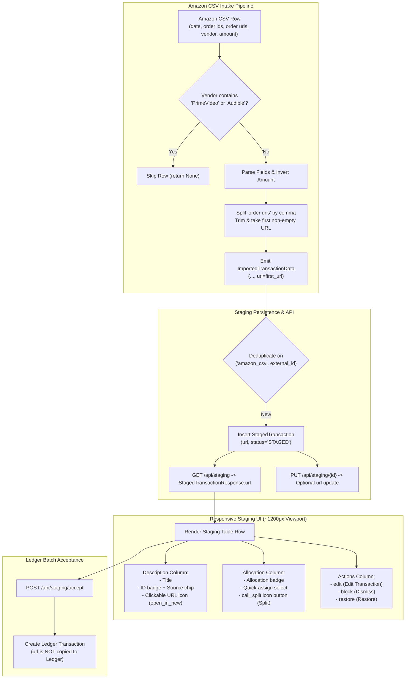

# Staged Transaction URL & Amazon Importer Enhancements Specification

## 1. Goal & Overview

This specification details four related architectural enhancements to Wrangler's intake pipeline, building on top of [`specs/v2/1-importer-framework/spec.md`](file:///D:/src/personal/wrangler/specs/v2/1-importer-framework/spec.md) and [`specs/v2/3-amazon-csv-importer/spec.md`](file:///D:/src/personal/wrangler/specs/v2/3-amazon-csv-importer/spec.md):

1. **Staged Transaction Investigation URL:** Introduces a nullable `url` field to [`StagedTransaction`](file:///D:/src/personal/wrangler/api/src/models/staged_transaction.py#L13-L35). This field is strictly staging-scoped to facilitate investigating and reconciling pending items before ledger acceptance.
2. **Amazon CSV Importer URL Ingestion:** Updates [`AmazonCsvImporter`](file:///D:/src/personal/wrangler/api/src/services/importers/amazon_csv.py#L8-L76) to extract order URLs from the `order urls` column. When a row contains multiple URLs separated by commas, the importer splits by comma, trims whitespace/quotes, and captures the first URL.
3. **Amazon CSV Vendor Filtering:** Updates [`AmazonCsvImporter`](file:///D:/src/personal/wrangler/api/src/services/importers/amazon_csv.py#L8-L76) to skip intake of transactions where the `vendor` column includes the case-sensitive strings `"PrimeVideo"` or `"Audible"`.
4. **Responsive Staging Table Layout (~1200px Viewport):** Redesigns the Staging Review Table in [`web/src/views/ImportView.vue`](file:///D:/src/personal/wrangler/web/src/views/ImportView.vue) to eliminate horizontal scrolling on desktop viewports down to ~1200px wide. This is achieved by embedding source and external ID with an inline external link button in the Description column, converting action and receipt buttons into compact icon buttons with tooltips, removing duplicate Edit/Split buttons, and simplifying CAD currency formatting to drop redundant `"CA$"` prefixes.



---

## 2. Data Model & Migration Changes

### 2.1 `StagedTransaction` Schema Modification
In [`api/src/models/staged_transaction.py`](file:///D:/src/personal/wrangler/api/src/models/staged_transaction.py#L13-L35), add a new nullable `url` column:

- **Field:** `url`
- **Type:** `Mapped[str | None] = mapped_column(String, nullable=True)`
- **Constraints:** Nullable, no unique index.
- **Scope & Immutability Rule:** `url` is **strictly staging-scoped**. It is stored in `staged_transactions` to allow users to open source transaction links during review. When a staged transaction is accepted into the ledger ([`POST /api/staging/accept`](file:///D:/src/personal/wrangler/api/src/routers/staging.py#L384-L446)), the ledger [`Transaction`](file:///D:/src/personal/wrangler/api/src/models/transaction.py#L13-L31) table is **not modified** and does not store `url`.

### 2.2 Database Migration (`api/alembic/versions/`)
A new Alembic migration script (e.g., `e8a1f2c3b4d5_add_url_to_staged_transactions.py`) must be created:

```python
"""add url to staged_transactions

Revision ID: <revision_id>
Revises: b7d3e5f29a10
Create Date: 2026-10-18
"""

from collections.abc import Sequence

import sqlalchemy as sa
from alembic import op

revision: str = "<auto_generated>"
down_revision: str | Sequence[str] | None = "b7d3e5f29a10"
branch_labels: str | Sequence[str] | None = None
depends_on: str | Sequence[str] | None = None


def upgrade() -> None:
    with op.batch_alter_table("staged_transactions") as batch_op:
        batch_op.add_column(sa.Column("url", sa.String(), nullable=True))


def downgrade() -> None:
    with op.batch_alter_table("staged_transactions") as batch_op:
        batch_op.drop_column("url")
```

---

## 3. Importer Framework Updates

### 3.1 Normalized Item Schema (`api/src/services/importers/base.py`)
Update [`ImportedTransactionData`](file:///D:/src/personal/wrangler/api/src/services/importers/base.py#L27-L56) to include optional `url`:

```python
class ImportedTransactionData(BaseModel):
    """Normalized transaction item produced by an importer implementation."""

    external_id: str | None = None
    date: datetime.date | None = None
    description: str | None = None
    total_amount: Decimal | None = None
    currency_code: str = "CAD"
    receipt: ImporterReceiptData | None = None
    url: str | None = None

    model_config = ConfigDict(from_attributes=True)

    @field_validator("url", mode="before")
    @classmethod
    def clean_url(cls, v: Any) -> str | None:
        if v is None:
            return None
        cleaned = str(v).strip().strip('"').strip("'").strip()
        return cleaned if cleaned else None
```

Existing importers ([`WranglerCsvImporter`](file:///D:/src/personal/wrangler/api/src/services/importers/wrangler_csv.py), [`GoogleGroupsImporter`](file:///D:/src/personal/wrangler/api/src/services/importers/google_groups.py), MCP) leave `url=None` by default.

### 3.2 Importer Execution Pipeline (`api/src/routers/importers.py`)
In [`run_importer`](file:///D:/src/personal/wrangler/api/src/routers/importers.py#L38-L151), when constructing [`StagedTransaction`](file:///D:/src/personal/wrangler/api/src/models/staged_transaction.py#L13-L35) instances from `parsed_items`, pass `url=item.url`:

```python
staged_tx = StagedTransaction(
    id=staged_id,
    source=importer.source_name,
    external_id=ext_id,
    date=item.date,
    description=item.description,
    total_amount=item.total_amount,
    currency_code=item.currency_code,
    receipt_file_path=receipt_file_path,
    url=item.url,
    status="STAGED",
    is_marked_imported=False,
)
```

### 3.3 Staging Schemas (`api/src/schemas/staging.py`)
Update schemas to serialize and accept `url`:

1. **`StagedTransactionResponse`:**
   Add `url: str | None = None`.
2. **`StagedTransactionUpdate`:**
   Add `url: str | None = None` with a validator that strips whitespace and converts empty strings to `None`.
3. **`serialize_staged_transaction`:**
   Include `url=staged_tx.url`.

### 3.4 Staging Router Updates (`api/src/routers/staging.py`)
In `update_staged_transaction` ([`PUT /api/staging/{staged_id}`](file:///D:/src/personal/wrangler/api/src/routers/staging.py#L159-L210)):
- If `payload.url is not None` (or if `url` field is explicitly updated in the payload), update `staged_tx.url = payload.url.strip() if payload.url else None`.

In `accept_staged_transactions` ([`POST /api/staging/accept`](file:///D:/src/personal/wrangler/api/src/routers/staging.py#L384-L446)):
- Validation and atomic ledger transaction creation remains unchanged. Ledger [`Transaction`](file:///D:/src/personal/wrangler/api/src/models/transaction.py#L13-L31) records continue to be created without `url`.

---

## 4. Amazon CSV Importer Updates (`api/src/services/importers/amazon_csv.py`)

### 4.1 Vendor Filter Check
In `parse_row(self, row: dict[str, str], row_number: int) -> ImportedTransactionData | None`:
- Read `raw_vendor = row.get("vendor", "")`.
- **Filtering Rule:** If `"PrimeVideo" in raw_vendor or "Audible" in raw_vendor`:
  - Return `None` immediately.
  - **Action & Semantics:** The row is completely skipped and omitted from intake. No record is created in `staged_transactions`, no receipt is downloaded, and no duplicate key is tracked. This is identical to the behavior for repeated CSV header rows.

### 4.2 Order URL Extraction
In `parse_row`:
- Read `raw_urls = row.get("order urls", "")`.
- **Extraction Rule:**
  1. If `raw_urls` is empty or whitespace-only, `parsed_url = None`.
  2. If `raw_urls` contains commas, split by comma: `first_candidate = raw_urls.split(",")[0]`.
  3. Strip surrounding whitespace, double quotes, and single quotes:
     `cleaned_url = first_candidate.strip().strip('"').strip("'").strip()`.
  4. If `cleaned_url` is non-empty, set `parsed_url = cleaned_url`; otherwise `None`.
- Set `url=parsed_url` on the returned [`ImportedTransactionData`](file:///D:/src/personal/wrangler/api/src/services/importers/base.py#L27-L56).

### 4.3 Updated `parse_row` Method Specification
```python
def parse_row(self, row: dict[str, str], row_number: int) -> ImportedTransactionData | None:
    raw_date = row.get("date", "").strip()
    raw_order_id = row.get("order ids", "").strip()
    raw_vendor = row.get("vendor", "")

    # 1. Repeated Header Row Detection
    if raw_date.lower() == "date" or raw_order_id.lower() == "order ids":
        return None

    # 2. Vendor Filtering: Skip PrimeVideo and Audible (case-sensitive)
    if "PrimeVideo" in raw_vendor or "Audible" in raw_vendor:
        return None

    # 3. Date Parsing
    tx_date: date | None = None
    if raw_date:
        try:
            tx_date = self.parse_iso_or_common_date(raw_date)
        except ValueError:
            tx_date = None

    # 4. Description: Amazon transactions leave description blank for user staging review
    description: str | None = None

    # 5. Amount Parsing & Inversion
    raw_amount = row.get("amount", "").strip()
    total_amount: Decimal | None = None
    if raw_amount:
        try:
            parsed_amount = self.parse_amount(raw_amount)
            if parsed_amount == Decimal("0"):
                total_amount = None
            else:
                total_amount = (-parsed_amount).quantize(Decimal("0.01"))
        except ValueError:
            total_amount = None

    # 6. External ID: Composite key
    if raw_order_id:
        date_str = tx_date.isoformat() if tx_date is not None else "nodate"
        amount_str = str(total_amount) if total_amount is not None else "noamount"
        external_id: str | None = f"{raw_order_id}_{date_str}_{amount_str}"
    else:
        external_id = None

    # 7. Order URL Extraction: Split on comma and take first URL
    raw_urls = row.get("order urls", "").strip()
    parsed_url: str | None = None
    if raw_urls:
        first_url = raw_urls.split(",")[0].strip().strip('"').strip("'").strip()
        if first_url:
            parsed_url = first_url

    return ImportedTransactionData(
        external_id=external_id,
        date=tx_date,
        description=description,
        total_amount=total_amount,
        currency_code="CAD",
        receipt=None,
        url=parsed_url,
    )
```

---

## 5. Frontend UI & Layout Architecture

### 5.1 Type Definitions (`web/src/types/staging.ts`)
Update frontend models to support `url`:
- Add `url: string | null` to `StagedTransaction`.
- Add `url?: string | null` to `StagedTransactionUpdatePayload`.

### 5.2 Responsive Staging Review Table (`web/src/views/ImportView.vue`)
To eliminate horizontal scrolling on desktop screens down to ~1200px wide, the Staging Review Table is consolidated as follows:

| Column | Name / Alignment | Width Strategy | Contents & Responsive Optimizations |
| :--- | :--- | :--- | :--- |
| 1 | `select` (Center) | Fixed ~48px | Batch acceptance checkbox (visible when row is `STAGED` and `is_ready`). |
| 2 | `date` (Left) | Fixed ~95px | ISO Date string (`YYYY-MM-DD`). |
| 3 | `description` (Left) | Flexible min ~280px | **Primary Line:** `description` (or fallback italicized `"Unlabeled transaction"`).<br/>**Metadata Line (no-wrap / items-center q-gutter-xs):**<br/>- Source chip (`dense size="xs"` e.g., `amazon_csv`)<br/>- External ID caption (`ID: ...`)<br/>- **Investigation URL Link Button:** If `row.url` is present, renders a compact `q-btn flat round dense size="xs" icon="open_in_new" color="primary"` that opens `row.url` in a new tab (`target="_blank"` with `rel="noopener noreferrer"`) and has `<q-tooltip>Open order in Amazon</q-tooltip>`. |
| 4 | `total_amount` (Right) | Fixed ~95px | Formatted amount with sign. **Currency Simplification:** Uses standard currency formatting (e.g. `$96.04` or `-$15.00`) without the redundant `"CA$"` prefix when `currency_code == 'CAD'`. Only non-CAD currencies (e.g. `USD 15.00`) show a currency code. |
| 5 | `allocations` (Left) | Fixed ~260px | Compact allocation badge + inline quick assign `q-select` (`dense outlined options-dense style="min-width: 150px"`) + **Split icon button:** `q-btn flat round dense size="sm" icon="call_split" color="primary"` with `<q-tooltip>Split Allocations</q-tooltip>` (opens [`StagedTransactionEditDialog`](file:///D:/src/personal/wrangler/web/src/components/StagedTransactionEditDialog.vue) to configure multi-company splits). |
| 6 | `receipt` (Center) | Fixed ~80px | Compact icon-only buttons (`size="sm" round dense`):<br/>- View receipt: `icon="receipt"`<br/>- Replace receipt: `icon="upload_file"`<br/>- Remove receipt: `icon="delete_outline"`<br/>- Attach receipt (when no receipt attached): `q-btn flat round dense size="sm" icon="attach_file"` with `<q-tooltip>Attach Receipt</q-tooltip>`. |
| 7 | `actions` (Right) | Fixed ~80px | Compact icon-only row action buttons (`size="sm" round dense`):<br/>- **Edit Button:** `icon="edit" color="primary"` with `<q-tooltip>Edit Transaction</q-tooltip>` (opens [`StagedTransactionEditDialog`](file:///D:/src/personal/wrangler/web/src/components/StagedTransactionEditDialog.vue) to edit date, description, amount, URL, receipt, and splits).<br/>- **Dismiss Button:** `icon="block" color="negative"` with `<q-tooltip>Dismiss Transaction</q-tooltip>` (when `status === 'STAGED'`).<br/>- **Restore Button:** `icon="restore" color="primary"` with `<q-tooltip>Restore Transaction</q-tooltip>` (when `status === 'DISMISSED'`). |

#### Elimination of Space Inefficiencies:
1. **Source Column Removed:** The dedicated `source` table column is eliminated. The source identifier is placed directly under the description next to the external ID.
2. **Intent-Specific Actions:** Controls are cleanly separated by user context and purpose:
   - The **Allocations** column features a dedicated forked-arrow `call_split` icon button adjacent to the quick-assign selector to open the split manager directly.
   - The **Actions** column features an `edit` pencil icon button for full transaction editing (date, description, amount, investigation URL, receipt, and allocations), alongside the `block` dismiss icon button.
3. **Icon-Only Buttons with Tooltips:** Text buttons (`"Dismiss"`, `"Restore"`, `"Attach Receipt"`, `"Edit / Split"`) are replaced by standardized icon-only buttons with tooltips, saving over 220px of table width.
4. **Currency Display:** Dropping `"CA$"` saves horizontal space while maintaining clarity.

### 5.3 Staged Transaction Edit Dialog (`web/src/components/StagedTransactionEditDialog.vue`)
Update the edit dialog so users can view and edit the staged transaction's URL:
- Add a `url` text input field to `StagedTransactionEditFormState` and the dialog template:
  ```html
  <q-input
    v-model="form.url"
    dense
    outlined
    label="Investigation URL"
    placeholder="https://..."
    data-testid="input-staged-url"
    class="q-mb-sm"
  >
    <template #prepend>
      <q-icon name="link" />
    </template>
    <template #append v-if="form.url">
      <q-btn flat round dense size="sm" icon="open_in_new" :href="form.url" target="_blank" />
    </template>
  </q-input>
  ```
- Initialize `form.url` from `props.stagedTransaction.url`.
- Include `url: form.value.url?.trim() || null` in the save payload sent to [`PUT /api/staging/{id}`](file:///D:/src/personal/wrangler/api/src/routers/staging.py#L159-L210).

---

## 6. Architectural Impact & Cross-Spec Consistency

1. **Double-Entry Accounting & Ledger Immutability:**
   - Ledger [`Transaction`](file:///D:/src/personal/wrangler/api/src/models/transaction.py#L13-L31) records remain strictly balanced, compliant with double-entry principles, and immutable regarding staging metadata.
   - The `url` attribute is ephemeral to the staging intake lifecycle. Accepting transactions into the ledger does not affect or pollute the core ledger schema.
2. **Backwards Compatibility:**
   - Existing staged records in SQLite will have `url = NULL` after migration.
   - All existing importers continue to function unchanged without needing to supply `url`.
3. **Deduplication Invariance:**
   - Vendor filtering occurs prior to deduplication. Skipped rows with vendor `"PrimeVideo"` or `"Audible"` do not consume external IDs or trigger duplicate conflicts if re-uploaded.
4. **Performance:**
   - Parsing order URLs and vendor substring checks in Python memory adds negligible overhead (sub-millisecond per row).
   - Consolidating the staging review table reduces DOM element count, improving frontend table render and scrolling performance.

---

## 7. Testing Requirements

### 7.1 Backend Tests (`api/tests/test_amazon_csv_importer.py`)
- **Vendor Filtering:**
  - Row with `vendor="PrimeVideo"` is skipped (`parse_row` returns `None`).
  - Row with `vendor="Amazon PrimeVideo CA"` is skipped.
  - Row with `vendor="Audible"` is skipped.
  - Row with `vendor="Audible.ca"` is skipped.
  - Row with `vendor="Amazon.ca"` or `vendor="AMZN Mktp CA"` is parsed normally.
  - Row with `vendor="primevideo"` (lowercase) is NOT skipped (case-sensitive requirement verified).
- **URL Parsing:**
  - Row with single order URL extracts trimmed URL correctly.
  - Row with two URLs separated by comma (e.g., `"https://amazon.ca/order1, https://amazon.ca/order2"`) extracts the first URL (`"https://amazon.ca/order1"`).
  - Row with quoted comma-separated URLs extracts the first URL without quotes.
  - Row with empty/missing order URL sets `url = None`.
- **Database Persistence & API Updates (`api/tests/test_staging.py`):**
  - Running Amazon CSV importer persists `StagedTransaction.url` in database.
  - `GET /api/staging` returns `url` in `StagedTransactionResponse`.
  - `PUT /api/staging/{id}` allows updating `url`.
  - `POST /api/staging/accept` succeeds and creates ledger transactions without error.

### 7.2 Frontend Tests (`web/src/views/__tests__/ImportView.spec.ts`)
- Verify `columns` does not include a standalone `source` column.
- Verify table renders `open_in_new` external link button when `row.url` is present.
- Verify `allocations` column renders `call_split` icon button next to quick-assign dropdown.
- Verify `Actions` column renders `edit` icon button and `block` (Dismiss) for staged rows, and `restore` for dismissed rows.
- Verify CAD currency amounts render without `"CA$"` prefix (e.g. `"$96.04"`).
