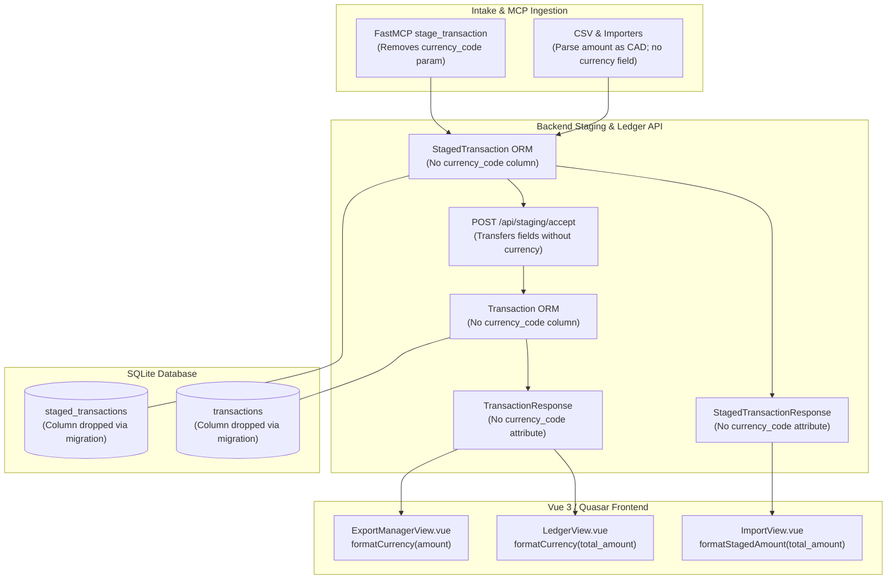

# Removal of Multi-Currency Support (CAD Single-Currency Architecture) Specification

## 1. Goal & Overview

The original system architecture for Wrangler provisioned a `currency_code` field across intake pipelines, database models, API schemas, and frontend view layers under the assumption of multi-currency accounting. In reality, Wrangler is strictly a single-currency application designed and operated exclusively in Canadian Dollars (**CAD**).

> [!IMPORTANT]
> **Supersedes v1 Specification:** This specification explicitly supersedes the multi-currency requirements defined in the foundational system specification ([`specs/v1/spec.md`](file:///D:/src/personal/wrangler/specs/v1/spec.md)), specifically §4.3 (`Transaction.currency_code`) and all associated multi-currency handling across intake, database persistence, and API schemas. Multi-currency support is eliminated in favor of a strict single-currency (CAD) architecture.

This specification details the comprehensive removal of multi-currency handling from the entire system stack:
1. **Database:** Permanently removes the `currency_code` column from both the [`transactions`](file:///D:/src/personal/wrangler/api/src/models/transaction.py#L13-L31) and [`staged_transactions`](file:///D:/src/personal/wrangler/api/src/models/staged_transaction.py#L13-L36) tables via an Alembic schema migration.
2. **Backend Models & Schemas:** Eliminates `currency_code` attributes from SQLAlchemy ORM models, Pydantic schemas ([`TransactionCreate`](file:///D:/src/personal/wrangler/api/src/schemas/transaction.py#L11-L63), [`TransactionUpdate`](file:///D:/src/personal/wrangler/api/src/schemas/transaction.py#L65-L96), [`TransactionResponse`](file:///D:/src/personal/wrangler/api/src/schemas/transaction.py#L98-L110), [`StagedTransactionResponse`](file:///D:/src/personal/wrangler/api/src/schemas/staging.py#L69-L81)), and internal intake structures ([`ImportedTransactionData`](file:///D:/src/personal/wrangler/api/src/services/importers/base.py#L27-L38), [`ParsedTransaction`](file:///D:/src/personal/wrangler/api/src/services/intake.py#L9-L21)).
3. **AI Agent / FastMCP:** Removes `currency_code` from the [`stage_transaction`](file:///D:/src/personal/wrangler/api/src/services/mcp.py#L36-L59) MCP tool signature, human-readable response strings, and staging persistence logic.
4. **Intake & Importers:** Simplifies CSV amount parsing to cleanly extract numeric amounts as CAD, removing multi-currency parsing and stripping operations.
5. **Frontend / UI:** Removes `currency_code` from TypeScript models, streamlines amount formatters ([`formatCurrency`](file:///D:/src/personal/wrangler/web/src/views/ledger.ts#L12-L19) and [`formatStagedAmount`](file:///D:/src/personal/wrangler/web/src/views/importView.ts#L7-L27)) to format all values consistently as `$X,XXX.XX` / `-$X,XXX.XX`, and removes all redundant template bindings.



---

## 2. Database Schema & Migration Requirements

### 2.1 Schema Column Deletions
The `currency_code` column must be dropped from both existing transaction tables in SQLite:
1. `transactions` table: Drop `currency_code` (`VARCHAR`, non-nullable).
2. `staged_transactions` table: Drop `currency_code` (`VARCHAR`, non-nullable).

All stored amounts represent CAD implicitly. No historical currency conversion or data transformation is performed; the column is dropped cleanly.

### 2.2 Alembic Migration (`api/alembic/versions/`)
Because SQLite has limited native support for `ALTER TABLE DROP COLUMN`, Alembic's batch operation mode (`batch_alter_table`) must be used to rebuild the tables without the dropped columns.

A new migration script (e.g., `api/alembic/versions/<hash>_remove_currency_code.py`) must implement:

```python
"""remove currency_code from transactions and staged_transactions

Revision ID: <revision_id>
Revises: <down_revision>
Create Date: <timestamp>
"""

from alembic import op
import sqlalchemy as sa

# revision identifiers, used by Alembic.
revision = "<revision_id>"
down_revision = "<down_revision>"
branch_labels = None
depends_on = None


def upgrade() -> None:
    with op.batch_alter_table("transactions", schema=None) as batch_op:
        batch_op.drop_column("currency_code")

    with op.batch_alter_table("staged_transactions", schema=None) as batch_op:
        batch_op.drop_column("currency_code")


def downgrade() -> None:
    with op.batch_alter_table("staged_transactions", schema=None) as batch_op:
        batch_op.add_column(
            sa.Column("currency_code", sa.String(), nullable=False, server_default="CAD")
        )

    with op.batch_alter_table("transactions", schema=None) as batch_op:
        batch_op.add_column(
            sa.Column("currency_code", sa.String(), nullable=False, server_default="CAD")
        )
```

### 2.3 SQLAlchemy ORM Models
1. **[`Transaction`](file:///D:/src/personal/wrangler/api/src/models/transaction.py#L13-L31):**
   - Delete the `currency_code` mapped column:
     ```python
     # Remove:
     # currency_code: Mapped[str] = mapped_column(String, nullable=False, default="CAD")
     ```
2. **[`StagedTransaction`](file:///D:/src/personal/wrangler/api/src/models/staged_transaction.py#L13-L36):**
   - Delete the `currency_code` mapped column:
     ```python
     # Remove:
     # currency_code: Mapped[str] = mapped_column(String, nullable=False, default="CAD")
     ```

---

## 3. Backend Architecture & API Contracts

### 3.1 Pydantic Schema Updates (`api/src/schemas/`)

#### 3.1.1 `Transaction` Schemas ([`api/src/schemas/transaction.py`](file:///D:/src/personal/wrangler/api/src/schemas/transaction.py))
- **`TransactionCreate`:**
  - Remove `currency_code: str = "CAD"`.
  - Payloads containing unknown fields will be handled per Pydantic model configuration (or rejected under strict validation).
- **`TransactionUpdate`:**
  - Remove `currency_code: str | None = None`.
- **`TransactionResponse`:**
  - Remove `currency_code: str`.
  - The schema response consists of:
    ```python
    class TransactionResponse(BaseModel):
        id: uuid.UUID
        source: str
        external_id: str | None = None
        date: datetime.date
        description: str
        total_amount: Decimal
        receipt_file_path: str | None = None
        allocations: list[AllocationResponse] = []

        model_config = ConfigDict(from_attributes=True)
    ```

#### 3.1.2 Staging Schemas ([`api/src/schemas/staging.py`](file:///D:/src/personal/wrangler/api/src/schemas/staging.py))
- **`StagedTransactionResponse`:**
  - Remove `currency_code: str`.
  - The schema response consists of:
    ```python
    class StagedTransactionResponse(BaseModel):
        id: uuid.UUID
        source: str
        external_id: str | None = None
        date: datetime.date | None = None
        description: str | None = None
        total_amount: Decimal | None = None
        receipt_file_path: str | None = None
        url: str | None = None
        status: str
        is_marked_imported: bool
        ledger_transaction_id: uuid.UUID | None = None
        created_at: datetime.datetime
        allocations: list[StagedAllocationResponse] = []
        is_split: bool = False
        allocated_total: Decimal = Decimal("0")
        is_fully_allocated: bool = False

        model_config = ConfigDict(from_attributes=True)
    ```
- **`to_response` Serializer:**
  - In `to_response(staged_tx: StagedTransaction) -> StagedTransactionResponse`:
  - Remove the argument `currency_code=staged_tx.currency_code`.

### 3.2 Router Implementations (`api/src/routers/`)

#### 3.2.1 Transactions Router ([`api/src/routers/transactions.py`](file:///D:/src/personal/wrangler/api/src/routers/transactions.py))
- **`create_transaction`:**
  - Remove `currency_code=payload.currency_code` when instantiating [`Transaction`](file:///D:/src/personal/wrangler/api/src/models/transaction.py#L13-L31).
- **`update_transaction`:**
  - Update `scalar_fields` tuple:
    ```python
    # Before:
    # scalar_fields = ("date", "description", "total_amount", "currency_code", "source", "external_id", "receipt_file_path")
    # After:
    scalar_fields = ("date", "description", "total_amount", "source", "external_id", "receipt_file_path")
    ```

#### 3.2.2 Staging Router ([`api/src/routers/staging.py`](file:///D:/src/personal/wrangler/api/src/routers/staging.py))
- **`accept_staged_transactions`:**
  - When copying fields from `StagedTransaction` to instantiate `Transaction`, remove `currency_code=stx.currency_code`:
    ```python
    ledger_tx = Transaction(
        id=tx_id,
        source=stx.source,
        external_id=stx.external_id,
        date=stx.date,
        description=stx.description,
        total_amount=stx.total_amount,
        receipt_file_path=stx.receipt_file_path,
    )
    ```

#### 3.2.3 Importers Router ([`api/src/routers/importers.py`](file:///D:/src/personal/wrangler/api/src/routers/importers.py))
- **`run_importer`:**
  - When creating `StagedTransaction` from `ImportedTransactionData`, remove `currency_code=item.currency_code`.

---

## 4. Intake Pipelines & AI Agent Integration

### 4.1 Importer Infrastructure (`api/src/services/importers/`)

#### 4.1.1 Normalized Importer Data Structures ([`api/src/services/importers/base.py`](file:///D:/src/personal/wrangler/api/src/services/importers/base.py))
- Remove `currency_code: str = "CAD"` from [`ImportedTransactionData`](file:///D:/src/personal/wrangler/api/src/services/importers/base.py#L27-L38):
  ```python
  class ImportedTransactionData(BaseModel):
      external_id: str | None = None
      date: datetime.date | None = None
      description: str | None = None
      total_amount: Decimal | None = None
      receipt: ImporterReceiptData | None = None
      url: str | None = None

      model_config = ConfigDict(from_attributes=True)
  ```

#### 4.1.2 Intake Parser Base ([`api/src/services/intake.py`](file:///D:/src/personal/wrangler/api/src/services/intake.py))
- Remove `currency_code: str = "CAD"` from [`ParsedTransaction`](file:///D:/src/personal/wrangler/api/src/services/intake.py#L9-L21).
- In [`ManualIntakeParser.parse`](file:///D:/src/personal/wrangler/api/src/services/intake.py#L45-L78), remove `data.setdefault("currency_code", "CAD")` and `"currency_code": getattr(item, "currency_code", "CAD")`.

#### 4.1.3 CSV Base Amount Parsing ([`api/src/services/importers/csv_base.py`](file:///D:/src/personal/wrangler/api/src/services/importers/csv_base.py))
- In [`BaseCsvImporter.parse_amount(raw: str) -> Decimal`](file:///D:/src/personal/wrangler/api/src/services/importers/csv_base.py#L28-L63):
  - Strip common currency symbols (`$`, `CA$`) and whitespace.
  - Remove multi-currency regex replacements (e.g., `re.sub(r"\b(?:CAD|USD)\b", "", ...)`).
  - Treat all extracted values as CAD.
  - Parenthetical numbers `(12.34)` continue to parse to `-12.34`.

#### 4.1.4 Amazon CSV Importer ([`api/src/services/importers/amazon_csv.py`](file:///D:/src/personal/wrangler/api/src/services/importers/amazon_csv.py))
- In `parse_row`, remove `currency_code="CAD"` when creating `ImportedTransactionData`.

### 4.2 FastMCP AI Agent Service ([`api/src/services/mcp.py`](file:///D:/src/personal/wrangler/api/src/services/mcp.py))

#### 4.2.1 Tool Signature & Docstring
- Remove the `currency_code` parameter from [`stage_transaction`](file:///D:/src/personal/wrangler/api/src/services/mcp.py#L36-L59):
  ```python
  @mcp.tool()
  def stage_transaction(
      source_label: str,
      external_id: str,
      date: str | None = None,
      total_amount: float | None = None,
      description: str | None = None,
  ) -> str:
      """Stage a transaction in Wrangler for user review and allocation.

      Any value that cannot be determined should be passed as null (never guessed); the user completes it in Wrangler.

      Args:
          source_label: Intake source identifier (e.g., 'amazon', 'receipts@mmjm.ca'). Required.
          external_id: Unique order ID or transaction reference from the merchant. Required.
          date: Transaction date in ISO format (YYYY-MM-DD or ISO timestamp), or null if unknown.
          total_amount: Non-zero float; positive for purchases, negative for returns/refunds, or null if unknown.
          description: Item title, summary, or vendor notes, or null if unknown.

      Returns:
          A human-readable confirmation string detailing whether the transaction was staged
          or skipped as a duplicate.
      """
  ```

#### 4.2.2 Logic & Confirmation Strings
- Remove all `cleaned_currency` logic:
  ```python
  # Delete:
  # cleaned_currency = (currency_code or "CAD").strip().upper()
  # if not cleaned_currency:
  #     cleaned_currency = "CAD"
  ```
- Remove `currency_code` from `StagedTransaction(...)` instantiation.
- Format confirmation return strings using standard currency notation without currency code suffixes:
  ```python
  amt_display = f"(${amount_decimal:.2f})" if amount_decimal is not None else "(amount pending)"
  ```
  and:
  ```python
  return f"Successfully staged transaction: [mcp] {namespaced_external_id} - {formatted_description} (${amount_decimal:.2f})."
  ```

---

## 5. Frontend Architecture & User Interface

### 5.1 TypeScript Type Definitions (`web/src/types/`)

#### 5.1.1 Transaction Types ([`web/src/types/transaction.ts`](file:///D:/src/personal/wrangler/web/src/types/transaction.ts))
- In `TransactionCreate`: Remove `currency_code?: string`.
- In `TransactionUpdate`: Remove `currency_code?: string`.
- In `Transaction`: Remove `currency_code: string`.

#### 5.1.2 Staging Types ([`web/src/types/staging.ts`](file:///D:/src/personal/wrangler/web/src/types/staging.ts))
- In `StagedTransaction`: Remove `currency_code: string`.

#### 5.1.3 Export Manager Types ([`web/src/views/exportManager.ts`](file:///D:/src/personal/wrangler/web/src/views/exportManager.ts))
- In `CompanyTransactionRow`: Remove `currency_code: string`.
- In `generateCompanyRows`: Remove mapping `currency_code: tx.currency_code || "CAD"`.

### 5.2 Currency Formatting Utilities

#### 5.2.1 Ledger Formatter ([`web/src/views/ledger.ts`](file:///D:/src/personal/wrangler/web/src/views/ledger.ts))
- Remove the `currencyCode` parameter from `formatCurrency`.
- Format all numeric values using standard currency representation with `$`:
  ```typescript
  /**
   * Formats a numeric amount or string into standard CAD currency format ($X,XXX.XX or -$X,XXX.XX).
   */
  export function formatCurrency(amount: string | number | null | undefined): string {
    if (amount === null || amount === undefined || amount === "") {
      return "$0.00"
    }
    const num = typeof amount === "string" ? parseFloat(amount) : amount
    if (Number.isNaN(num)) return "$0.00"

    const isNegative = num < 0
    const absFormatted = Math.abs(num).toLocaleString("en-US", {
      minimumFractionDigits: 2,
      maximumFractionDigits: 2,
    })
    return `${isNegative ? "-" : ""}$${absFormatted}`
  }
  ```

#### 5.2.2 Staging Amount Formatter ([`web/src/views/importView.ts`](file:///D:/src/personal/wrangler/web/src/views/importView.ts))
- Remove the `currencyCode` parameter and non-CAD branches from `formatStagedAmount`.
- Align directly with `formatCurrency`:
  ```typescript
  /**
   * Formats a staged amount or string into standard CAD currency format ($X,XXX.XX or -$X,XXX.XX).
   */
  export function formatStagedAmount(amount: string | number | null | undefined): string {
    return formatCurrency(amount)
  }
  ```

### 5.3 Vue Components & Views

All template references that pass `props.row.currency_code` must be updated to pass only the amount:

1. **[`web/src/views/LedgerView.vue`](file:///D:/src/personal/wrangler/web/src/views/LedgerView.vue):**
   - Main total amount cell:
     ```html
     <!-- Before: {{ formatCurrency(props.row.total_amount, props.row.currency_code) }} -->
     {{ formatCurrency(props.row.total_amount) }}
     ```
   - Split allocation list amount:
     ```html
     <!-- Before: {{ formatCurrency(alloc.amount, props.row.currency_code) }} -->
     {{ formatCurrency(alloc.amount) }}
     ```
2. **[`web/src/views/ImportView.vue`](file:///D:/src/personal/wrangler/web/src/views/ImportView.vue):**
   - Total amount cell:
     ```html
     <!-- Before: {{ formatStagedAmount(props.row.total_amount, props.row.currency_code) }} -->
     {{ formatStagedAmount(props.row.total_amount) }}
     ```
3. **[`web/src/views/ExportManagerView.vue`](file:///D:/src/personal/wrangler/web/src/views/ExportManagerView.vue):**
   - Row allocation amount cell:
     ```html
     <!-- Before: {{ formatCurrency(props.row.amount, props.row.currency_code) }} -->
     {{ formatCurrency(props.row.amount) }}
     ```
4. **Table Column Headers:**
   - Table headers across all views remain clean and concise (`Amount`, `Total Amount`), formatted with standard `$` notation. No explicit currency prefixes or suffixes (`(CAD)`) are added.

---

## 6. Testing Strategy & Verification Plan

### 6.1 Backend Pytest Suites (`pnpm test` / `uv run pytest`)
1. **Migration Verification ([`api/tests/test_migrations.py`](file:///D:/src/personal/wrangler/api/tests/test_migrations.py)):**
   - Add test verifying upgrade applies cleanly and confirms `currency_code` is absent from columns for `transactions` and `staged_transactions`.
   - Verify downgrade adds back `currency_code` with default `'CAD'`.
2. **FastMCP Tool Tests ([`api/tests/test_mcp_tools.py`](file:///D:/src/personal/wrangler/api/tests/test_mcp_tools.py), [`api/tests/test_mcp_staging_lifecycle.py`](file:///D:/src/personal/wrangler/api/tests/test_mcp_staging_lifecycle.py)):**
   - Remove `currency_code` from tool call parameters and assertions.
   - Delete tests that specifically test passing foreign currencies (`currency_code="USD"`).
   - Assert returned string format: `Successfully staged transaction: [mcp] ... ($12.50).`
3. **Importer Tests ([`api/tests/test_amazon_csv_importer.py`](file:///D:/src/personal/wrangler/api/tests/test_amazon_csv_importer.py), [`api/tests/test_importer_framework.py`](file:///D:/src/personal/wrangler/api/tests/test_importer_framework.py)):**
   - Remove assertions checking `assert item.currency_code == "CAD"`.
   - Verify amount parsing correctly handles amounts like `$12.50`, `-$25.00`, and `(45.00)`.
4. **Transaction API Tests ([`api/tests/test_transactions.py`](file:///D:/src/personal/wrangler/api/tests/test_transactions.py), [`api/tests/test_staging.py`](file:///D:/src/personal/wrangler/api/tests/test_staging.py)):**
   - Remove `currency_code` from request payloads and response assertions.

### 6.2 Frontend Vitest Suites (`pnpm test` / `pnpm --filter web test:unit`)
1. **Ledger Formatter Tests ([`web/tests/ledger.test.ts`](file:///D:/src/personal/wrangler/web/tests/ledger.test.ts)):**
   - Verify `formatCurrency(45.99)` -> `"$45.99"`.
   - Verify `formatCurrency(-25.5)` -> `"-$25.50"`.
   - Verify `formatCurrency("1250.50")` -> `"$1,250.50"`.
   - Verify `formatCurrency(0)` -> `"$0.00"`.
   - Verify `formatCurrency("invalid")` and `formatCurrency(null)` -> `"$0.00"`.
   - Remove `currency_code` from all transaction mock fixtures.
2. **Import View Tests ([`web/src/views/__tests__/importView.spec.ts`](file:///D:/src/personal/wrangler/web/src/views/__tests__/importView.spec.ts)):**
   - Remove tests asserting retention of non-CAD currency codes (`USD 15.00`, `EUR 99.99`).
   - Update template layout assertion: verify template contains `formatStagedAmount(props.row.total_amount)`.
3. **Component & Store Tests ([`web/src/components/__tests__/stagedTransactionEdit.spec.ts`](file:///D:/src/personal/wrangler/web/src/components/__tests__/stagedTransactionEdit.spec.ts), [`web/src/stores/__tests__/staging.spec.ts`](file:///D:/src/personal/wrangler/web/src/stores/__tests__/staging.spec.ts), [`web/tests/transaction.test.ts`](file:///D:/src/personal/wrangler/web/tests/transaction.test.ts), [`web/tests/company.test.ts`](file:///D:/src/personal/wrangler/web/tests/company.test.ts)):**
   - Remove `currency_code: "CAD"` from mock objects and snapshot fixtures.

---

## 7. Architectural Impact Analysis & Cross-Spec Consistency

| Consideration | Design Decision | Risk & Rationale |
| :--- | :--- | :--- |
| **Cross-Spec Integrity** | Do not modify prior specifications (`specs/v1/spec.md`, `specs/v2/**`). | Maintains an immutable audit trail of architectural iterations while `specs/v2/6-remove-multi-currency/spec.md` serves as the authoritative superseding spec for currency handling. |
| **SQLite Schema Migration** | Use `op.batch_alter_table` in Alembic for column drop. | SQLite cannot natively drop columns on older engine releases without table reconstruction. Batch mode handles table recreation, copying data, and preserving indexes safely. |
| **External Agent / MCP Idempotency** | Remove `currency_code` from `stage_transaction` signature. | Eliminates prompt confusion for AI agents attempting to determine or convert currencies. Wrangler assumes all input amounts are CAD. |
| **Wave CSV Export** | No change to [`generate_wave_csv`](file:///D:/src/personal/wrangler/api/src/services/export.py#L9-L38). | Wave's CSV import standard (`Date,Description,Amount`) never accepted a currency column. Output remains 100% compliant and unaffected. |
| **Frontend Amount Formatting** | Unify `formatCurrency` and `formatStagedAmount` on `$X,XXX.XX`. | Eliminates subtle display discrepancies between views. Negative amounts consistently render as `-$X.XX`. |
