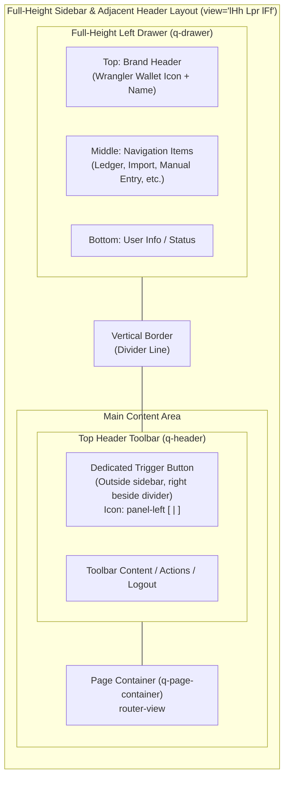

# Collapsible Icon-Rail Sidebar Navigation Specification

## 1. Goal & Overview

In the original Wrangler user interface (defined in [`specs/v1/spec.md`](file:///D:/src/personal/wrangler/specs/v1/spec.md) §7.1 and implemented in [`MainLayout.vue`](file:///D:/src/personal/wrangler/web/src/layouts/MainLayout.vue)), the left navigation drawer toggles between fully expanded (240px) and completely hidden off-screen via a generic hamburger icon (`menu`).

For desktop financial applications, hiding navigation entirely creates unnecessary friction. Furthermore, modern design systems (notably [shadcn/ui Sidebar](https://ui.shadcn.com/docs/components/base/sidebar)) establish an intuitive desktop navigation standard: **a full-height sidebar that collapses into a docked icon-only rail, paired with a dedicated sidebar trigger button located outside the sidebar, immediately adjacent to the sidebar's right border in the main header**.

> [!IMPORTANT]
> **Adoption of the Dedicated External Sidebar Trigger & Icon Rail Pattern:**
> This specification details the updated navigation architecture matching the visual and behavioral pattern established by shadcn/ui:
> 1. **Full-Height Sidebar (`q-layout view="lHh Lpr lFf"`):** The navigation sidebar runs the full height of the viewport on the left. The application branding (Wrangler icon + title) lives at the top of the sidebar.
> 2. **Dedicated External Trigger Icon:** The hamburger icon in the toolbar is replaced with a dedicated sidebar trigger icon (`panel-left` SVG icon: a rounded rectangle divided vertically by a left panel line) positioned **outside the sidebar** at the far-left edge of the main content header, immediately adjacent to the sidebar divider border.
> 3. **Persistent Docked Icon Rail (Mini Mode):** When collapsed, the sidebar never disappears; it shrinks from 240px to a 60px icon rail. Because the header begins at the right boundary of the drawer, the external trigger button automatically remains flush against the dividing border in both expanded and collapsed modes.
> 4. **Contextual Tooltips:** In mini mode, hovering over navigation rail items displays a floating Quasar tooltip ([`q-tooltip`](https://quasar.dev/vue-components/tooltip)). Tooltips are suppressed when expanded.
> 5. **State Persistence:** Sidebar state (`expanded` vs. `collapsed`) is managed in Pinia ([`useAppStore`](file:///D:/src/personal/wrangler/web/src/stores/app.ts)) and persisted to browser `localStorage` across page reloads.
> 6. **Keyboard Shortcut (`Ctrl+B` / `Cmd+B`):** Users can toggle the sidebar from anywhere in the app using the standard desktop hotkey.
> 7. **Desktop-First Scope:** Viewport breakpoint auto-hiding is disabled (`:breakpoint="0"`), keeping the sidebar permanently docked.



---

## 2. Visual & Structural Specifications

### 2.1 Layout View Configuration (`view="lHh Lpr lFf"`)
Currently, [`MainLayout.vue`](file:///D:/src/personal/wrangler/web/src/layouts/MainLayout.vue#L23) uses `view="hHh Lpr fFf"`, which causes the top header to span across the entire screen above the drawer.

To match the dedicated external trigger pattern:
* Update `view` to `"lHh Lpr lFf"`:
  * First letter `l`: The Left drawer (`q-drawer`) spans the **full height** from top to bottom.
  * Second letter `H`: The top header (`q-header`) sits **between** the left drawer and the right margin, starting flush at the right edge of the left drawer.
* Dynamic Alignment:
  * When the drawer is expanded (240px wide), the header starts at $x = 240\text{px}$.
  * When the drawer is collapsed (60px wide), the header starts at $x = 60\text{px}$.
  * In both states, the first button in the header toolbar sits right beside the sidebar separator border line.

### 2.2 Dedicated Sidebar Trigger Button (`SidebarTrigger`)
Located as the first element in `<q-header> > <q-toolbar>`:
* **Icon:** The standard `panel-left` icon (rounded rectangle with a vertical pane bar separating the left third):
  ```svg
  <svg xmlns="http://www.w3.org/2000/svg" width="18" height="18" viewBox="0 0 24 24" fill="none" stroke="currentColor" stroke-width="2" stroke-linecap="round" stroke-linejoin="round">
    <rect width="18" height="18" x="3" y="3" rx="2" />
    <path d="M9 3v18" />
  </svg>
  ```
* **Button Styling:**
  * Flat, compact, rounded button (`flat dense round` or subtle rounded rectangle `rounded-borders q-pa-xs`).
  * Contrast: Neutral grey (`text-grey-7` / `text-grey-8` on light headers, or `text-white` if header retains primary branding).
  * Hover: Subtle background accent on hover (`hover:bg-grey-3` or standard Quasar flat ripple).
* **Tooltip:**
  * Displays a [`q-tooltip`](https://quasar.dev/vue-components/tooltip) with:
    `{{ appStore.sidebarCollapsed ? 'Expand sidebar (Ctrl+B)' : 'Collapse sidebar (Ctrl+B)' }}`.
* **Click Action:** Invokes `appStore.toggleSidebar()`.

### 2.3 Sidebar Branding & Header (Inside `q-drawer`)
At the very top of `<q-drawer>`:
* **Expanded State (240px):**
  * Displays a brand row:
    * Wallet icon: `<q-icon name="account_balance_wallet" size="sm" class="text-primary q-mr-sm" />`
    * Title: `<span class="text-subtitle1 text-weight-bold text-grey-9">Wrangler</span>`
  * Below branding: Section header label `"Platform"` or `"Navigation"` in muted uppercase caption (`text-caption text-weight-bold text-grey-6`).
* **Collapsed Mode (60px Icon Rail):**
  * Displays only the centered wallet icon: `<q-icon name="account_balance_wallet" size="sm" class="text-primary" />`.
  * Section title text is hidden (`v-show="!appStore.sidebarCollapsed"`).

### 2.4 Navigation Items & Mini Tooltips
* Navigation items are loaded from [`navItems`](file:///D:/src/personal/wrangler/web/src/layouts/nav.ts#L8-L14) (`ledger`, `import`, `manual-entry`, `export-manager`, `settings`).
* In **Expanded Mode**, items show icon and label with active route styling (`bg-blue-1 text-primary text-weight-bold`).
* In **Collapsed Mini Mode**, Quasar's `:mini="isMini"` automatically hides non-avatar `q-item-section` labels.
* **Contextual Tooltips:**
  * Each `<q-item>` renders a `<q-tooltip>` when collapsed:
    * Condition: `v-if="appStore.sidebarCollapsed"`
    * Placement: `anchor="center right"` `self="center left"` `:offset="[12, 12]"`
    * Styling: `class="bg-grey-9 text-white shadow-3 text-caption text-weight-medium"`
    * Label: `item.label` (e.g. `"Ledger"`, `"Import"`, `"Manual Entry"`).

### 2.5 Keyboard Shortcut (`Ctrl+B` / `Cmd+B`)
* A global keydown listener is registered on `window` in `MainLayout.vue`.
* Checks for `(event.ctrlKey || event.metaKey) && event.key.toLowerCase() === "b"`.
* Input guard clause: If `event.target` is an `<input>`, `<textarea>`, or content-editable element, the shortcut is ignored so standard typing is not interrupted.
* Prevents browser default action (`event.preventDefault()`) and invokes `appStore.toggleSidebar()`.

---

## 3. Data Model & State Specifications

### 3.1 Backend & Database Impact
**None.** Pure client-side UI/UX layout update. No database schema changes, Alembic migrations, or FastAPI endpoint modifications.

### 3.2 Frontend State Management ([`web/src/stores/app.ts`](file:///D:/src/personal/wrangler/web/src/stores/app.ts))

The application store is updated with persistent sidebar state:

#### 3.2.1 State
* **`sidebarCollapsed` (`Ref<boolean>`):**
  * Initialized from `localStorage.getItem("wrangler_sidebar_collapsed") === "true"`.
  * Defaults to `false` (expanded) if not set.

#### 3.2.2 Actions
* **`toggleSidebar(): void`:**
  * Negates `sidebarCollapsed.value`.
  * Writes the boolean string to `localStorage.setItem("wrangler_sidebar_collapsed", String(sidebarCollapsed.value))`.
* **`setSidebarCollapsed(collapsed: boolean): void`:**
  * Explicitly assigns `sidebarCollapsed.value = collapsed`.
  * Persists to `localStorage`.

#### 3.2.3 Store Implementation Contract
```typescript
import { defineStore } from "pinia"
import { ref } from "vue"

export const STORAGE_KEY_SIDEBAR_COLLAPSED = "wrangler_sidebar_collapsed"

export const useAppStore = defineStore("app", () => {
  const appName = ref<string>("Wrangler")
  const initialized = ref<boolean>(true)

  const storedCollapsed = typeof window !== "undefined"
    ? localStorage.getItem(STORAGE_KEY_SIDEBAR_COLLAPSED) === "true"
    : false
  const sidebarCollapsed = ref<boolean>(storedCollapsed)

  function toggleSidebar(): void {
    sidebarCollapsed.value = !sidebarCollapsed.value
    if (typeof window !== "undefined") {
      localStorage.setItem(STORAGE_KEY_SIDEBAR_COLLAPSED, String(sidebarCollapsed.value))
    }
  }

  function setSidebarCollapsed(collapsed: boolean): void {
    sidebarCollapsed.value = collapsed
    if (typeof window !== "undefined") {
      localStorage.setItem(STORAGE_KEY_SIDEBAR_COLLAPSED, String(collapsed))
    }
  }

  return {
    appName,
    initialized,
    sidebarCollapsed,
    toggleSidebar,
    setSidebarCollapsed,
  }
})
```

---

## 4. Frontend Component Specifications

### 4.1 Layout Template ([`web/src/layouts/MainLayout.vue`](file:///D:/src/personal/wrangler/web/src/layouts/MainLayout.vue))

```html
<template>
  <q-layout view="lHh Lpr lFf">
    <!-- Top Header Toolbar (starts to the right of the full-height drawer) -->
    <q-header elevated class="bg-primary text-white">
      <q-toolbar>
        <!-- Dedicated external sidebar trigger button, positioned flush outside the sidebar border -->
        <q-btn
          flat
          dense
          round
          class="q-mr-sm"
          aria-label="Toggle sidebar"
          :title="appStore.sidebarCollapsed ? 'Expand sidebar (Ctrl+B)' : 'Collapse sidebar (Ctrl+B)'"
          @click="appStore.toggleSidebar"
        >
          <!-- Lucide panel-left SVG icon -->
          <svg
            xmlns="http://www.w3.org/2000/svg"
            width="20"
            height="20"
            viewBox="0 0 24 24"
            fill="none"
            stroke="currentColor"
            stroke-width="2"
            stroke-linecap="round"
            stroke-linejoin="round"
          >
            <rect width="18" height="18" x="3" y="3" rx="2" />
            <path d="M9 3v18" />
          </svg>
          <q-tooltip anchor="bottom right" self="top left" :offset="[8, 8]">
            {{ appStore.sidebarCollapsed ? 'Expand sidebar (Ctrl+B)' : 'Collapse sidebar (Ctrl+B)' }}
          </q-tooltip>
        </q-btn>

        <q-toolbar-title class="row items-center text-weight-medium text-body1">
          <!-- Optional page breadcrumb or title context -->
        </q-toolbar-title>

        <div class="row items-center q-gutter-sm">
          <span class="text-caption text-weight-medium">
            {{ authStore.username || "User" }}
          </span>
          <q-btn flat dense round icon="logout" aria-label="Logout" title="Logout" @click="onLogout" />
        </div>
      </q-toolbar>
    </q-header>

    <!-- Full-height Drawer -->
    <q-drawer
      v-model="drawerOpen"
      show-if-above
      bordered
      side="left"
      class="bg-grey-1 text-grey-8"
      :mini="appStore.sidebarCollapsed"
      :mini-width="60"
      :width="240"
      :breakpoint="0"
    >
      <q-scroll-area class="fit">
        <!-- Top branding inside drawer -->
        <div
          class="row items-center q-px-md q-py-md cursor-pointer no-wrap"
          :class="appStore.sidebarCollapsed ? 'justify-center' : 'justify-start'"
          @click="router.push({ name: 'ledger' })"
        >
          <q-icon name="account_balance_wallet" size="sm" color="primary" />
          <span
            v-show="!appStore.sidebarCollapsed"
            class="text-subtitle1 text-weight-bold text-grey-9 q-ml-sm"
          >
            Wrangler
          </span>
        </div>

        <q-separator />

        <!-- Navigation Section -->
        <q-list padding class="text-grey-8">
          <q-item-label
            v-show="!appStore.sidebarCollapsed"
            header
            class="text-uppercase text-weight-bold text-grey-6"
            style="font-size: 0.72rem; letter-spacing: 0.08em"
          >
            Navigation
          </q-item-label>

          <q-item
            v-for="item in navItems"
            :key="item.name"
            clickable
            v-ripple
            :to="{ name: item.name }"
            exact
            active-class="text-primary bg-blue-1 text-weight-bold"
            class="rounded-borders q-mx-xs q-mb-xs"
          >
            <q-item-section avatar style="min-width: 40px">
              <q-icon :name="item.icon" size="sm" />
            </q-item-section>

            <q-item-section>
              <q-item-label>{{ item.label }}</q-item-label>
            </q-item-section>

            <!-- Contextual Tooltip for Mini Rail Mode -->
            <q-tooltip
              v-if="appStore.sidebarCollapsed"
              anchor="center right"
              self="center left"
              :offset="[14, 14]"
              class="bg-grey-9 text-white shadow-3 text-caption text-weight-medium"
            >
              {{ item.label }}
            </q-tooltip>
          </q-item>
        </q-list>
      </q-scroll-area>
    </q-drawer>

    <!-- Main Page Container -->
    <q-page-container>
      <router-view />
    </q-page-container>
  </q-layout>
</template>
```

### 4.2 Script Setup Logic ([`web/src/layouts/MainLayout.vue`](file:///D:/src/personal/wrangler/web/src/layouts/MainLayout.vue))

```typescript
<script setup lang="ts">
import { ref, onMounted, onUnmounted } from "vue"
import { useRouter } from "vue-router"
import { useAuthStore } from "../stores/auth"
import { useAppStore } from "../stores/app"
import { navItems } from "./nav"

const router = useRouter()
const authStore = useAuthStore()
const appStore = useAppStore()

// Keep drawer visible; collapsing is handled by appStore.sidebarCollapsed and :mini
const drawerOpen = ref<boolean>(true)

function handleKeydown(event: KeyboardEvent): void {
  if ((event.ctrlKey || event.metaKey) && event.key.toLowerCase() === "b") {
    const target = event.target as HTMLElement | null
    if (target && (target.tagName === "INPUT" || target.tagName === "TEXTAREA" || target.isContentEditable)) {
      return
    }
    event.preventDefault()
    appStore.toggleSidebar()
  }
}

onMounted(() => {
  window.addEventListener("keydown", handleKeydown)
})

onUnmounted(() => {
  window.removeEventListener("keydown", handleKeydown)
})

function onLogout(): void {
  authStore.logout()
  router.push({ name: "login" })
}
</script>
```

---

## 5. Architectural Impact & Regression Analysis (The "Boost" Phase)

| Architectural Dimension | Analysis & Risk Mitigation |
| :--- | :--- |
| **Cross-Spec Consistency** | Extends [`specs/v1/spec.md`](file:///D:/src/personal/wrangler/specs/v1/spec.md) §7.1. All view routes (`/ledger`, `/import`, `/manual-entry`, `/export-manager`, `/settings`) remain identical and untouched. |
| **Drawer Layout Shifts** | Changing `view` from `hHh Lpr fFf` to `lHh Lpr lFf` cleanly anchors the left drawer as a full-height column, ensuring the external trigger button is always positioned immediately to the right of the border dividing line without absolute positioning hacks or manual CSS offsets. |
| **Desktop Responsiveness** | `:breakpoint="0"` ensures the drawer never collapses into an overlay on smaller desktop window sizes. |
| **Performance** | Pinia state toggle is $O(1)$ and synchronous. LocalStorage persistence takes < 1ms. |
| **Hotkey Safety** | Explicit check for `INPUT`, `TEXTAREA`, or `contenteditable` targets ensures typing inside transaction edit forms or search bars never inadvertently toggles the navigation rail. |
| **Accessibility** | All interactive elements maintain proper `aria-label`, `title`, and Quasar `q-tooltip` indicators. |

---

## 6. Testing & Verification Specifications

### 6.1 App Store Unit Tests (`web/tests/appStore.test.ts` or `web/src/stores/__tests__/app.test.ts`)
1. **Initial State (Default):** Defaults to `sidebarCollapsed = false` when `localStorage` has no record.
2. **Initial State (Persisted):** When `localStorage.getItem("wrangler_sidebar_collapsed")` is `"true"`, initializes to `true`.
3. **Toggle Action:** Calling `toggleSidebar()` flips state and updates `localStorage`.
4. **Direct Setter:** Calling `setSidebarCollapsed(bool)` assigns state and writes to `localStorage`.

### 6.2 Layout Unit Tests (`web/tests/layout.test.ts`)
1. **External Trigger Button:** Verify the header contains the dedicated sidebar trigger button containing the `panel-left` SVG icon.
2. **Branding Location:** Verify the Wrangler logo and title render at the top of the drawer.
3. **Nav Item Preservation:** Assert all 5 core navigation items (`ledger`, `import`, `manual-entry`, `export-manager`, `settings`) are present.
4. **Mini Tooltip Verification:** Assert that when `sidebarCollapsed` is true, tooltips are attached to nav items.
5. **Hotkey Event Listener:** Test dispatching `KeyboardEvent("keydown", { key: "b", ctrlKey: true })` toggles `sidebarCollapsed`. Verify it does not trigger when event target is an `<input>`.
