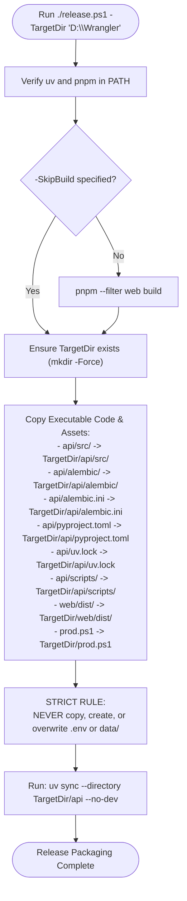

# Production Deployment, Release Pipeline & Backup Architecture Specification

## 1. Goal & Architecture Overview

This specification defines the production release pipeline, runtime serving architecture, smart database migration lifecycle, decoupled data storage, and automated cloud backup strategy for Wrangler on Windows.

Wrangler is an internal family accounting and receipt ingestion tool operated on-demand (typically weekly or monthly). The system must run in **production mode** (no hot reload, pre-compiled static assets, minimal resource overhead) via an isolated deployment target on the local machine (`D:\Wrangler`), fully separated from the Git source repository.

```
+-------------------------------------------------------------------------------------------------------+
|                                         DEVELOPMENT WORKSPACE                                         |
|                                    (D:\src\personal\wrangler - Git)                                   |
|                                                                                                       |
|   +-------------------+      +---------------------------------+      +---------------------------+   |
|   |  Vue 3 / Quasar   |      |  FastAPI Backend (api/)         |      |  Deployment Automation    |   |
|   |  web/src/         |      |  src/, alembic/, pyproject.toml |      |  release.ps1, prod.ps1    |   |
|   +---------+---------+      +----------------+----------------+      +-------------+-------------+   |
|             |                                 |                                     |                 |
|             | (pnpm build)                    |                                     |                 |
|             v                                 |                                     |                 |
|         web/dist/ <---------------------------+-------------------------------------+                 |
|                                               |                                                       |
|                                               |  release.ps1                                          |
|                                               |  (Deploys code & assets;                              |
|                                               |   NEVER touches .env or data/)                        |
+-----------------------------------------------|-------------------------------------------------------+
                                                v
+-------------------------------------------------------------------------------------------------------+
|                                          PRODUCTION RUNTIME                                           |
|                                             (D:\Wrangler)                                             |
|                                                                                                       |
|   +-----------------------------------------------------------------------------------------------+   |
|   |  Installed Code & Runtime Assets                                                              |   |
|   |  api/ (src, alembic, pyproject.toml, uv.lock), web/dist/, prod.ps1                           |   |
|   +---------------------------------------------------------------+-------------------------------+   |
|                                                                   |                                   |
|   +-------------------------------+   +---------------------------+---+                               |
|   |  Production Config (.env)     |   |  Local Data (DATA_DIR)        |                               |
|   |  DATA_DIR, BACKUP_DIR, etc.   |   |  data/wrangler.db & receipts/ |                               |
|   +---------------+---------------+   +---------------+---------------+                               |
|                   |                                   |                                               |
|                   +-------------------+---------------+                                               |
|                                       v                                                               |
|                                   prod.ps1                                                            |
|                           (Interactive Runtime Launcher)                                              |
|                                       |                                                               |
|          +----------------------------+----------------------------+                                  |
|          |                                                         |                                  |
|          | 1. Startup & Smart Migration Check                      | 2. Unified Single Process        |
|          |    Prompts if migrations pending                        |    FastAPI on :PORT serves:      |
|          |                                                         |    - web/dist/ (SPA)             |
|          |                                                         |    - /api and /mcp (REST/SSE)    |
|          |                                                         |                                  |
|          | 3. Clean Shutdown Hook (Ctrl+C)                         |                                  |
|          |    - SQLite VACUUM INTO snapshot                        |                                  |
|          |    - Incremental receipts sync                          |                                  |
+----------|---------------------------------------------------------|----------------------------------+
           |                                                         |
           v                                                         v
+------------------------------------+             +------------------------------------+
|         BROWSER CLIENT             |             |       GOOGLE DRIVE BACKUP          |
|     http://localhost:PORT          |             |           (BACKUP_DIR)             |
|  (or http://<LAN-IP>:PORT)         |             |  - wrangler.db (Atomic Snapshot)   |
+------------------------------------+             |  - receipts/ (Mirrored PDFs/Images)|
                                                   +------------------------------------+
```

### 1.1 Core Principles & System Boundaries

1. **Two-Stage Script Workflow:**
   - **`release.ps1` (Release Packaging Script):** Runs from the source code repository. Compiles the frontend SPA, copies runtime assets into the target production directory (default: `D:\Wrangler`), and runs `uv sync --no-dev` in the target virtual environment. It **never touches, creates, or overwrites** `.env`, `data/`, or any production data assets.
   - **`prod.ps1` (Runtime Launcher Script):** Resides in the production target directory. Checks for pending Alembic migrations with an interactive confirmation prompt, launches Uvicorn in production mode (no `--reload`, unified SPA + API delivery on an injected port), and traps `Ctrl+C` to execute safe backup snapshotting.
2. **Unified Single-Process Delivery:** 
   FastAPI serves the compiled frontend SPA directly from `web/dist`, providing an SPA catch-all fallback (`index.html`) for Vue Router's HTML5 history navigation. No separate Node.js server or reverse proxy is required.
3. **Decoupled Data Architecture (`DATA_DIR`):**
   Stateful user data—the active SQLite database (`wrangler.db`) and uploaded receipt files (`receipts/`)—resides locally in an isolated `DATA_DIR` (e.g. `D:\Wrangler\data`), completely insulated from Git checkouts and external cloud file locks during active sessions.
4. **Failure-Safe Cloud Backup (`BACKUP_DIR`):**
   To avoid SQLite WAL lock contention and cloud sync conflicts, Google Drive does not touch the active database while Wrangler is running. On clean process exit (`Ctrl+C`), the launcher takes an atomic SQLite snapshot (`VACUUM INTO '<BACKUP_DIR>/wrangler.db'`) and mirrors newly added receipts to Google Drive. Backups are skipped if the server fails on startup, protecting the last known good backup.

---

## 2. Configuration & Data Model Extensions

### 2.1 Backend Settings Extensions (`api/src/core/config.py`)

The application settings class [`Settings`](file:///D:/src/personal/wrangler/api/src/core/config.py#L11-L56) is extended to support `DATA_DIR` and `STATIC_DIR` while preserving full backward compatibility with default relative paths.

```python
class Settings(BaseSettings):
    # Model configuration remains configured to load .env from API/Root dirs
    model_config = SettingsConfigDict(
        env_file=(
            str(_API_DIR / ".env"),
            str(_ROOT_DIR / ".env"),
            ".env",
        ),
        env_file_encoding="utf-8",
        extra="ignore",
    )

    # Centralized Local Data Directory
    # If set, automatically derives default DATABASE_URL and RECEIPT_STORAGE_DIR
    DATA_DIR: Path | None = None

    # Database Connection String
    DATABASE_URL: str = "sqlite:///./wrangler.db"

    # Receipt Storage Directory
    RECEIPT_STORAGE_DIR: Path = Path("receipts").resolve()

    # Static Assets Directory (Compiled Vue SPA)
    STATIC_DIR: Path = Path(__file__).resolve().parent.parent.parent.parent / "web" / "dist"

    @model_validator(mode="after")
    def resolve_paths(self) -> "Settings":
        if self.DATA_DIR is not None:
            resolved_data = self.DATA_DIR.expanduser().resolve()
            resolved_data.mkdir(parents=True, exist_ok=True)

            # Default DATABASE_URL to DATA_DIR/wrangler.db if not explicitly customized
            if self.DATABASE_URL == "sqlite:///./wrangler.db":
                db_file = (resolved_data / "wrangler.db").as_posix()
                self.DATABASE_URL = f"sqlite:///{db_file}"

            # Default RECEIPT_STORAGE_DIR to DATA_DIR/receipts if not explicitly customized
            if self.RECEIPT_STORAGE_DIR == Path("receipts").resolve():
                self.RECEIPT_STORAGE_DIR = (resolved_data / "receipts").resolve()

        # Ensure receipt storage directory exists
        self.RECEIPT_STORAGE_DIR.mkdir(parents=True, exist_ok=True)
        return self
```

### 2.2 Production Environment Contract (`.env`)

The production `.env` file resides exclusively inside `D:\Wrangler\.env` (or custom `-TargetDir`). It is managed manually by the user and is never modified or overwritten by `release.ps1`.

```bash
# ==============================================================================
# Wrangler Production Configuration (D:\Wrangler\.env)
# ==============================================================================

# Local Data Storage (Isolated from source code and cloud locks)
DATA_DIR=D:/Wrangler/data

# Google Drive Cloud Backup Destination
BACKUP_DIR=C:/Users/mjdry/Google Drive/WranglerBackups

# Security & Authentication (Required)
ADMIN_USERNAME=admin
ADMIN_PASSWORD=change-to-a-secure-production-password
JWT_SECRET_KEY=change-to-a-secure-random-32-character-secret-key
JWT_ACCESS_TOKEN_EXPIRE_MINUTES=1440

# Network & MCP Integration
MCP_API_KEY=your-mcp-key-if-using-lan-clients

# AI Parsing
AI_PROVIDER=openai
OPENAI_API_KEY=your-openai-api-key
```

---

## 3. Unified Backend SPA Serving (`api/src/main.py`)

In production, the compiled frontend assets in `web/dist` are served directly by FastAPI.

### 3.1 Route Resolution Hierarchy

1. **/api/\* Routes:** Prioritized first. Matched by existing API routers (`auth_router`, `companies_router`, `transactions_router`, `receipts_router`, `allocations_router`, `importers_router`, `staging_router`).
2. **/mcp/\* Routes:** Prioritized second. Handled by `MCPTransportDispatcher` (`/mcp/sse` and `/mcp/messages/`).
3. **/assets/\* Static Files:** Mounted via `StaticFiles` pointing to `settings.STATIC_DIR / "assets"`.
4. **SPA Catch-All Route (`/{full_path:path}`):** Registered after all API routers.
   - If `full_path` points to a literal file in the root of `STATIC_DIR` (e.g., `favicon.ico`, `vite.svg`, `robots.txt`), it returns the file.
   - If `full_path` starts with `api/` or `mcp/` and reached this fallback, it returns HTTP `404 Not Found` JSON, preventing API errors from returning HTML.
   - For all other paths (e.g. `/`, `/ledger`, `/staging`, `/export-manager`, `/settings`), it returns `web/dist/index.html` with status `200 OK`, allowing Vue Router HTML5 history mode to initialize cleanly.

```python
# SPA mounting block in api/src/main.py (registered at the end of the file)

if settings.STATIC_DIR.is_dir() and (settings.STATIC_DIR / "index.html").is_file():
    assets_dir = settings.STATIC_DIR / "assets"
    if assets_dir.is_dir():
        app.mount("/assets", StaticFiles(directory=assets_dir), name="static_assets")

    @app.get("/{full_path:path}", include_in_schema=False)
    async def serve_spa(full_path: str):
        if full_path.startswith("api") or full_path.startswith("mcp"):
            raise HTTPException(status_code=404, detail="Endpoint not found")

        candidate_file = (settings.STATIC_DIR / full_path).resolve()
        if candidate_file.is_file() and candidate_file.is_relative_to(settings.STATIC_DIR):
            return FileResponse(candidate_file)

        return FileResponse(settings.STATIC_DIR / "index.html")
```

---

## 4. Release Packaging Pipeline (`release.ps1`)

The release pipeline script resides at the root of the Git repository: `release.ps1`.

### 4.1 Script Parameter Contract

```powershell
param (
    [string]$TargetDir = "D:\Wrangler",
    [switch]$SkipBuild
)
```

### 4.2 Execution Lifecycle



### 4.3 Detailed PowerShell Implementation (`release.ps1`)

```powershell
param (
    [string]$TargetDir = "D:\Wrangler",
    [switch]$SkipBuild
)

$ErrorActionPreference = "Stop"
$ScriptDir = $PSScriptRoot

Write-Host "========================================" -ForegroundColor Cyan
Write-Host "     Wrangler Release Packaging         " -ForegroundColor Cyan
Write-Host "========================================" -ForegroundColor Cyan
Write-Host "Target Directory: $TargetDir" -ForegroundColor DarkGray

# 1. Dependency Checks
if (-not (Get-Command "uv" -ErrorAction SilentlyContinue)) {
    Write-Error "'uv' was not found in PATH. Please install uv."
    exit 1
}
if (-not (Get-Command "pnpm" -ErrorAction SilentlyContinue)) {
    Write-Error "'pnpm' was not found in PATH. Please install pnpm."
    exit 1
}

# 2. Compile Frontend SPA
if (-not $SkipBuild) {
    Write-Host "`n[1/4] Compiling frontend assets (Vite)..." -ForegroundColor Yellow
    & pnpm --filter web build
    if ($LASTEXITCODE -ne 0) {
        Write-Error "Frontend compilation failed."
        exit $LASTEXITCODE
    }
} else {
    Write-Host "`n[1/4] Skipping frontend build (-SkipBuild specified)." -ForegroundColor DarkGray
}

$DistPath = Join-Path $ScriptDir "web\dist"
if (-not (Test-Path (Join-Path $DistPath "index.html"))) {
    Write-Error "web/dist/index.html not found. Run without -SkipBuild."
    exit 1
}

# 3. Prepare Target Structure
Write-Host "`n[2/4] Preparing production target directory..." -ForegroundColor Yellow
$TargetApi = Join-Path $TargetDir "api"
$TargetWeb = Join-Path $TargetDir "web"

New-Item -ItemType Directory -Force -Path $TargetApi | Out-Null
New-Item -ItemType Directory -Force -Path $TargetWeb | Out-Null

# 4. Copy Code & Runtime Assets (STRICT: Never touch .env or data/)
Write-Host "`n[3/4] Copying runtime code and compiled assets..." -ForegroundColor Yellow

# Copy Backend Assets
$RoboFlags = @("/MIR", "/FFT", "/Z", "/NP", "/NDL", "/NJS", "/NJH")
& robocopy (Join-Path $ScriptDir "api\src") (Join-Path $TargetApi "src") $RoboFlags | Out-Null
& robocopy (Join-Path $ScriptDir "api\alembic") (Join-Path $TargetApi "alembic") $RoboFlags | Out-Null
& robocopy (Join-Path $ScriptDir "api\scripts") (Join-Path $TargetApi "scripts") $RoboFlags | Out-Null

Copy-Item (Join-Path $ScriptDir "api\alembic.ini") $TargetApi -Force
Copy-Item (Join-Path $ScriptDir "api\pyproject.toml") $TargetApi -Force
Copy-Item (Join-Path $ScriptDir "api\uv.lock") $TargetApi -Force

# Copy Compiled Frontend Assets
& robocopy $DistPath (Join-Path $TargetWeb "dist") $RoboFlags | Out-Null

# Copy Production Launcher
Copy-Item (Join-Path $ScriptDir "prod.ps1") $TargetDir -Force

Write-Host "Code and compiled assets copied successfully." -ForegroundColor Green
Write-Host "Verified: .env and data directories remain untouched." -ForegroundColor DarkGray

# 5. Synchronize Production Virtualenv
Write-Host "`n[4/4] Synchronizing production Python environment..." -ForegroundColor Yellow
& uv sync --directory $TargetApi --no-dev
if ($LASTEXITCODE -ne 0) {
    Write-Error "Production dependency sync failed."
    exit $LASTEXITCODE
}

Write-Host "`nRelease successfully deployed to $TargetDir!" -ForegroundColor Green
Write-Host "To start Wrangler, run:" -ForegroundColor Cyan
Write-Host "  cd `"$TargetDir`"; .\prod.ps1`n" -ForegroundColor White
```

---

## 5. Production Runtime Launcher (`prod.ps1`)

The runtime launcher script operates inside the deployed target directory (`D:\Wrangler\prod.ps1`). It is also maintained in the root of the repository so that `release.ps1` deploys it.

### 5.1 Script Parameter Contract

```powershell
param (
    [int]$Port = 8000,
    [string]$HostAddress = "0.0.0.0",
    [switch]$Migrate,
    [switch]$SkipMigration
)
```

### 5.2 Smart Migration Check Architecture

To eliminate repetitive prompts during normal bookkeeping sessions while safeguarding schema updates:
1. The script runs a pre-flight Python helper: `api/scripts/check_migrations.py`.
2. The helper queries Alembic's current database revision and compares it to the head revision.
3. **If current == head:** The script prints `Database schema is up to date.` and proceeds immediately without prompting.
4. **If pending revisions exist:**
   - If `-Migrate` was passed: Runs migrations immediately.
   - If `-SkipMigration` was passed: Bypasses migrations with a warning.
   - Otherwise: Pauses with an interactive prompt: `Pending database migrations detected. Apply them now? [Y/n]`.

### 5.3 Backup & Failure Safety Hook

1. A `$ServerStartedCleanly` boolean flag is initialized to `$false`.
2. The Uvicorn process is executed inside a `try` block. Once the process enters normal execution, the flag is marked `$true`.
3. In the `finally` block:
   - If `$ServerStartedCleanly -eq $true`:
     1. Executes `api/scripts/wal_backup.py` to trigger an atomic SQLite `VACUUM INTO '<BACKUP_DIR>/wrangler.db'`.
     2. Runs `robocopy <DATA_DIR>/receipts <BACKUP_DIR>/receipts /MIR` to fast-mirror new receipt files.
     3. Reports: `Backup successfully written to <BACKUP_DIR>`.
   - If `$ServerStartedCleanly -eq $false` (e.g. Uvicorn failed to bind port or a migration failed):
     - The backup is **aborted**, protecting the existing Google Drive backup from being overwritten with a broken state.

### 5.4 Detailed PowerShell Implementation (`prod.ps1`)

```powershell
param (
    [int]$Port = 8000,
    [string]$HostAddress = "0.0.0.0",
    [switch]$Migrate,
    [switch]$SkipMigration
)

$ErrorActionPreference = "Stop"
$ScriptDir = $PSScriptRoot
$ApiDir = Join-Path $ScriptDir "api"

Write-Host "========================================" -ForegroundColor Cyan
Write-Host "       Wrangler Production Server       " -ForegroundColor Cyan
Write-Host "========================================" -ForegroundColor Cyan

# 1. Dependency Validation
if (-not (Get-Command "uv" -ErrorAction SilentlyContinue)) {
    Write-Error "'uv' is required to run Wrangler. Please install uv."
    exit 1
}

# 2. Smart Database Migration Check
Write-Host "`n[1/2] Checking database schema status..." -ForegroundColor Yellow
$MigrationStatus = & uv run --directory $ApiDir python scripts/check_migrations.py
$StatusExit = $LASTEXITCODE

if ($StatusExit -eq 2) {
    # Exit code 2 indicates pending migrations detected
    $ShouldMigrate = $false
    if ($Migrate) {
        $ShouldMigrate = $true
    } elseif (-not $SkipMigration) {
        $response = Read-Host "Pending database migrations detected. Apply them now? [Y/n]"
        if ($response -eq "" -or $response -match "^[yY]") {
            $ShouldMigrate = $true
        }
    }

    if ($ShouldMigrate) {
        Write-Host "Applying database migrations..." -ForegroundColor Cyan
        & uv run --directory $ApiDir alembic upgrade head
        if ($LASTEXITCODE -ne 0) {
            Write-Error "Database migration failed. Aborting startup."
            exit $LASTEXITCODE
        }
    } else {
        Write-Host "Skipping pending migrations." -ForegroundColor DarkGray
    }
} elseif ($StatusExit -eq 0) {
    Write-Host "Database schema is up to date." -ForegroundColor Green
} else {
    Write-Host "Warning: Could not determine migration status ($MigrationStatus). Continuing." -ForegroundColor DarkYellow
}

# 3. Launch Production Server with Clean Exit Trap
Write-Host "`n[2/2] Launching server on http://${HostAddress}:${Port}" -ForegroundColor Green
Write-Host "Press Ctrl+C to stop server and initiate backup.`n" -ForegroundColor DarkGray

$ServerStartedCleanly = $false

try {
    # Mark as cleanly running once Uvicorn is invoked
    $ServerStartedCleanly = $true
    & uv run --directory $ApiDir uvicorn main:app --app-dir src --host $HostAddress --port $Port
} finally {
    Write-Host "`nShutting down Wrangler..." -ForegroundColor Yellow
    
    if ($ServerStartedCleanly) {
        Write-Host "Executing clean SQLite snapshot and mirroring receipts..." -ForegroundColor Cyan
        & uv run --directory $ApiDir python scripts/wal_backup.py
        if ($LASTEXITCODE -eq 0) {
            Write-Host "Backup completed successfully." -ForegroundColor Green
        } else {
            Write-Host "Warning: Backup hook encountered an error." -ForegroundColor DarkYellow
        }
    } else {
        Write-Host "Startup was interrupted or failed. Backup skipped to protect existing snapshot." -ForegroundColor DarkYellow
    }
    
    Write-Host "Wrangler stopped cleanly." -ForegroundColor Green
}
```

---

## 6. Backend Migration & Backup Helpers

Two lightweight scripts are placed in [`api/scripts/`](file:///D:/src/personal/wrangler/api/scripts) to support the launcher hooks deterministically:

### 6.1 Migration Status Checker (`api/scripts/check_migrations.py`)

Compares Alembic's current database revision against the head migration file:

```python
"""Checks whether pending Alembic migrations exist.

Exit Codes:
  0: Database schema is fully up-to-date.
  2: Pending migrations detected.
  1: Error inspecting database or alembic environment.
"""

import sys
from pathlib import Path

# Add src to sys.path
sys.path.insert(0, str(Path(__file__).resolve().parent.parent / "src"))

from alembic.config import Config
from alembic.script import ScriptDirectory
from database import engine
from sqlalchemy import inspect, text


def check_migrations():
    ini_path = Path(__file__).resolve().parent.parent / "alembic.ini"
    alembic_cfg = Config(str(ini_path))
    script = ScriptDirectory.from_config(alembic_cfg)
    head_rev = script.get_current_head()

    try:
        with engine.connect() as conn:
            inspector = inspect(conn)
            if "alembic_version" not in inspector.get_table_names():
                # No migration table exists yet
                print("No alembic_version table found. Migrations pending.")
                sys.exit(2)

            result = conn.execute(text("SELECT version_num FROM alembic_version LIMIT 1"))
            row = result.fetchone()
            current_rev = row[0] if row else None

        if current_rev != head_rev:
            print(f"Pending migrations: current={current_rev}, head={head_rev}")
            sys.exit(2)

        print(f"Database up-to-date at revision {current_rev}")
        sys.exit(0)

    except Exception as exc:
        print(f"Error checking migration status: {exc}", file=sys.stderr)
        sys.exit(1)


if __name__ == "__main__":
    check_migrations()
```

### 6.2 Atomic Snapshot & Receipt Mirror (`api/scripts/wal_backup.py`)

Executes the atomic SQLite snapshot via `VACUUM INTO` and mirrors receipts into `BACKUP_DIR`:

```python
"""Performs atomic SQLite VACUUM INTO snapshot and mirrors receipts to BACKUP_DIR."""

import os
import shutil
import subprocess
import sys
from pathlib import Path

# Add src to sys.path
sys.path.insert(0, str(Path(__file__).resolve().parent.parent / "src"))

from core.config import settings
from database import engine
from sqlalchemy import text


def run_backup():
    backup_dir_str = os.getenv("BACKUP_DIR")
    if not backup_dir_str:
        print("BACKUP_DIR is not set in environment. Skipping backup snapshot.")
        return 0

    backup_dir = Path(backup_dir_str).expanduser().resolve()
    backup_dir.mkdir(parents=True, exist_ok=True)

    # 1. Atomic SQLite Snapshot via VACUUM INTO
    if settings.DATABASE_URL.startswith("sqlite"):
        target_db = backup_dir / "wrangler.db"
        temp_target_db = backup_dir / "wrangler.db.tmp"

        if temp_target_db.exists():
            temp_target_db.unlink()

        try:
            with engine.connect() as conn:
                # SQLite VACUUM INTO creates a crash-consistent, complete single-file copy
                conn.execute(text(f"VACUUM INTO '{temp_target_db.as_posix()}';"))

            # Atomically replace destination file
            if target_db.exists():
                target_db.unlink()
            temp_target_db.rename(target_db)
            print(f"SQLite snapshot saved to: {target_db}")

        except Exception as exc:
            print(f"Error executing SQLite snapshot: {exc}", file=sys.stderr)
            if temp_target_db.exists():
                temp_target_db.unlink()
            return 1

    # 2. Mirror Receipts
    source_receipts = settings.RECEIPT_STORAGE_DIR
    target_receipts = backup_dir / "receipts"
    target_receipts.mkdir(parents=True, exist_ok=True)

    if source_receipts.exists():
        if sys.platform == "win32":
            # Fast incremental robocopy on Windows
            cmd = [
                "robocopy",
                str(source_receipts),
                str(target_receipts),
                "/MIR",
                "/FFT",
                "/Z",
                "/NP",
                "/NDL",
                "/NJS",
                "/NJH",
            ]
            subprocess.run(cmd, check=False)  # robocopy exit codes < 8 indicate success
        else:
            for item in source_receipts.rglob("*"):
                if item.is_file():
                    rel = item.relative_to(source_receipts)
                    dest = target_receipts / rel
                    dest.parent.mkdir(parents=True, exist_ok=True)
                    if not dest.exists() or dest.stat().st_mtime < item.stat().st_mtime:
                        shutil.copy2(item, dest)

        print(f"Receipts mirrored to: {target_receipts}")

    return 0


if __name__ == "__main__":
    sys.exit(run_backup())
```

---

## 7. Architectural Impact Review & Risk Mitigation

| Risk / Concern | Impact | Architectural Mitigation |
| :--- | :--- | :--- |
| **Accidental Overwrite of `.env` or Production Data** | Critical | `release.ps1` explicitly isolates code assets (`src`, `alembic`, `dist`) and **never** creates, copies, or replaces `.env` or the `data/` folder in `D:\Wrangler`. |
| **Cloud File-Locking Collisions in SQLite** | High | The live database resides locally in `DATA_DIR` outside Google Drive. Google Drive only ever interacts with the static `VACUUM INTO` snapshot written upon clean exit. |
| **Corrupted Backup on Server Failure** | High | `$ServerStartedCleanly` flag ensures the exit backup hook only runs if the server was running normally and terminated via `Ctrl+C`. Startup crashes bypass the backup. |
| **Repetitive Migration Prompts** | Low | `check_migrations.py` compares current revision with head; `prod.ps1` only prompts when a pending migration is detected. |
| **Broken SPA Navigation on Page Refresh** | Medium | FastAPI SPA catch-all handler returns `web/dist/index.html` for all unmatched browser routes, with strict guards preventing API/MCP 404s from returning HTML. |
| **Port Clashes** | Low | Port injection is parameterized in `prod.ps1` (`-Port 8000`), allowing instant overrides from the terminal without configuration edits. |

---

## 8. Verification & Acceptance Testing Plan

1. **Release Pipeline Verification (`release.ps1`):**
   - Execute `./release.ps1 -TargetDir "D:\Wrangler"`.
   - Verify that `D:\Wrangler\api\src`, `D:\Wrangler\web\dist`, and `D:\Wrangler\prod.ps1` are present.
   - Place a custom `.env` and `data/test.txt` inside `D:\Wrangler`. Re-run `./release.ps1`.
   - Confirm `.env` and `data/test.txt` remain untouched.
2. **SPA Serving & HTML5 History Mode:**
   - In `D:\Wrangler`, run `./prod.ps1 -Port 8080`.
   - In browser, open `http://localhost:8080/`. Confirm Vue SPA renders.
   - Navigate to `http://localhost:8080/export-manager` and press browser refresh. Confirm view reloads cleanly without 404.
   - Request `http://localhost:8080/api/nonexistent`. Confirm standard JSON 404 response.
3. **Smart Migration Prompt:**
   - On an up-to-date database, launch `./prod.ps1`. Verify `Database schema is up to date.` prints with zero prompts.
   - Simulate a pending migration (or clean database). Launch `./prod.ps1`. Confirm interactive prompt appears.
4. **Clean Exit Backup & Google Drive Sync:**
   - Configure `BACKUP_DIR` in `D:\Wrangler\.env`.
   - In the running app, create a transaction and upload a receipt.
   - Press `Ctrl+C` in the PowerShell window.
   - Confirm `wrangler.db` snapshot and `receipts/` mirror are created inside `BACKUP_DIR`.
5. **Failure Safety Test:**
   - Trigger a startup error (e.g., launch with an already bound port `./prod.ps1 -Port <occupied-port>`).
   - Confirm the backup hook is bypassed and the existing backup is not touched.
